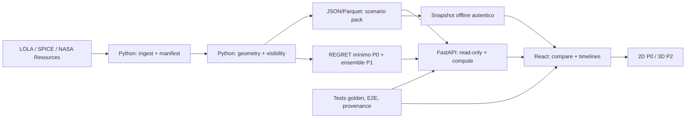
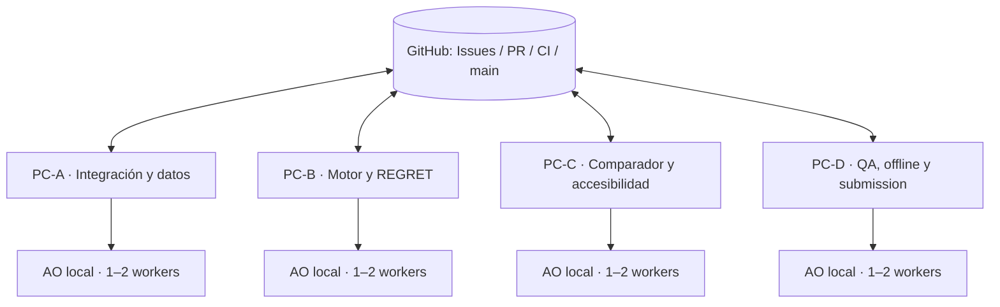
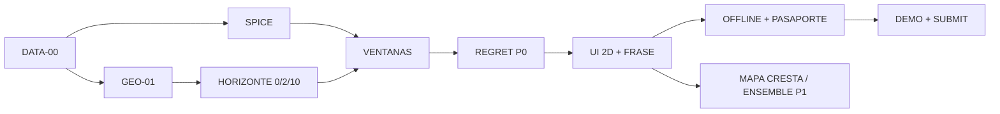
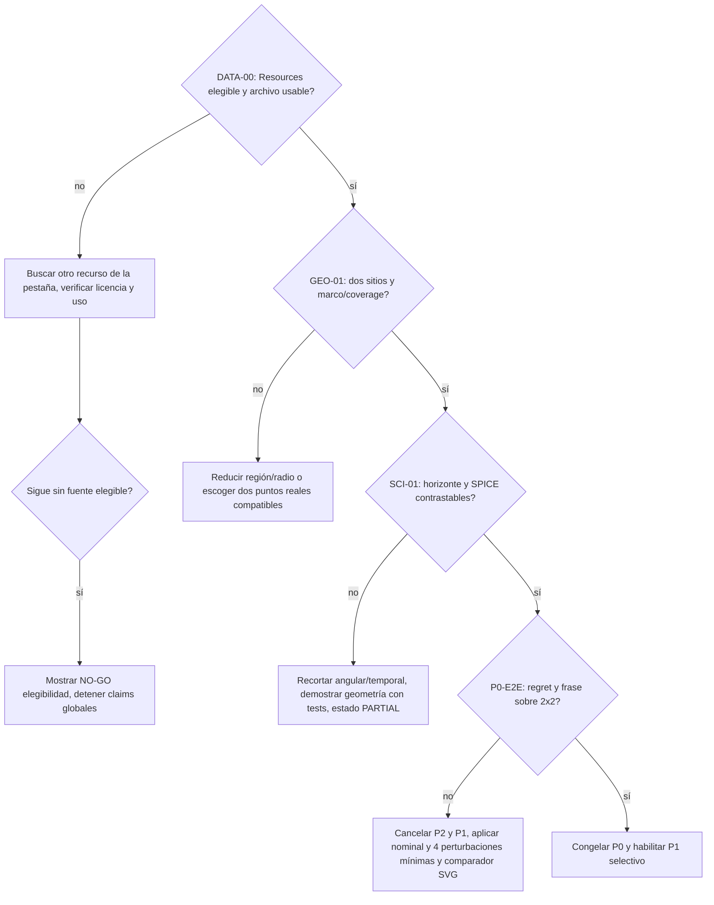

# SITE REGRET — Plan maestro · Edición 1.0

**NASA International Space Apps Challenge 2026 · Bilbao / 42 Urduliz Bizkaia**  
**Reto #04:** *Lunar Landing Site Navigator*.  
**Fecha:** 13 de noviembre de 2026 · **Edición:** 1.0.  
**Estado:** ESPECIFICACIÓN INICIAL · NO EXISTE SOFTWARE CONSTRUIDO, DATOS PROCESADOS NI PRUEBAS DEL PRODUCTO.  
**Equipo de trabajo:** QuemandoTokens · cuatro portátiles · coordinación AO local + GitHub.  
**Pregunta central:** «¿Y si el mapa se equivoca?».  
**Pitch:** *SITE REGRET convierte topografía lunar y efemérides de NASA en un laboratorio interactivo para comparar sitios y fechas de misión, diseñar infraestructuras elevadas y descubrir si una decisión sobrevive a la incertidumbre del terreno.*

> **REGLA DEL HACKATHON.** La organización advierte que no se comience a construir el proyecto antes del **14/11/2026 a las 09:00 hora local del evento**, porque podría causar descalificación. Antes se permite investigar, seleccionar reto, analizar recursos y formar equipo. Este documento es planificación. [GO Team, discusión #1827](https://github.com/nasa/spaceapps/discussions/1827). No crear ahora el código, UI funcional, datasets procesados propios del proyecto ni el vídeo renderizado del prototipo; el prompt audiovisual se entrega solo como especificación para ejecutar cuando esté permitido.

> **ELEGIBILIDAD GLOBAL PENDIENTE.** NASA exige utilizar al menos **una fuente NASA expresamente incluida en la pestaña Resources del reto elegido**, además de citarla. Se ha verificado que existen archivos LOLA y SPICE de NASA, **no** que el recurso exacto figure en esa pestaña —el acceso web a la pestaña no fue concluyente—. Marcar `RESOURCE_TAB_UNVERIFIED` hasta verificación manual antes del desarrollo. [Respuesta oficial GO Team](https://github.com/nasa/spaceapps/discussions/1827).

> **NO OPERACIONAL:** herramienta de demostración científica y divulgación; no certifica alunizajes, conectividad real, disponibilidad de energía, estabilidad estructural, radiación, geotecnia, ni viabilidad de misiones. Las salidas son condicionadas por hipótesis. Distinguir siempre `OBSERVED`, `DERIVED`, `MODELED`, `SIMULATED` y, por separado, `VERIFIED_ASSET`, `CANDIDATE`, `UNAVAILABLE`.

---

> **ESTADO Y ALCANCE:** todos los escenarios, interfaces, tests y resultados representados a continuación son especificaciones de trabajo. Sus salidas científicas se calcularán exclusivamente durante el hackathon a partir de activos verificados.

> **ELEGIBILIDAD:** debe utilizarse efectivamente al menos un recurso NASA incluido en la pestaña Resources del reto #04. La pertenencia exacta se declara `RESOURCE_TAB_UNVERIFIED` hasta comprobación humana documentada; un recurso NASA conocido no equivale a elegibilidad acreditada.

## Mapa de lectura y fuente de verdad

| Bloque | Qué especifica | Quién debe leerlo |
|---|---|---|
| 0–3 | Reglas, reto, propuesta y escenario principal | Todo el equipo |
| 4–7 | Funciones, criterios de éxito, datos y modelos físicos | Científicos, backend, QA |
| 8–10 | Arquitectura, contratos y agentes en cuatro PC | Integrador y responsables técnicos |
| 11–13 | Módulos, planificación, pruebas y gates | Cada worker |
| 14–17 | Dirección visual, demos, riesgos y entregables | UI, vídeo y humanos |
| 18–21 | Prompts, operación, fuentes y decisiones | Coordinadores AO / equipo |

**Orden de autoridad:** (1) enunciado y reglas oficiales vigentes; (2) datos y metadatos realmente verificados; (3) decisiones humanas registradas en `docs/DECISIONS.md`; (4) contratos versionados; (5) implementación integrada y CI; (6) issues/PR; (7) mensajes de agentes. Los agentes no pueden modificar requisitos científicos por intuición, ni hacer merge sin revisión humana.

## 0. Contrato de propósito y reglas

### 0.1 La decisión que debe producir SITE REGRET

Una herramienta concebida para confrontar **dos emplazamientos lunares reales (A/B)** en **dos ventanas temporales** con horizontes calculados sobre DEM, direcciones Sol/Tierra obtenidas con SPICE y **tres alturas de observador: 0, 2 y 10 m**. Un responsable elige un criterio cuantificable de decisión antes de ver la clasificación. El sistema calcula una elección nominal, aplica un conjunto mínimo de perturbaciones topográficas con semilla y revela si la elección se sostiene. La salida principal no es un mapa: es una **frase condicional y falsable**, construida sin IA a partir de JSON verificado.

**Plantilla de frase:** «Con [DEM verificado], [kernels registrados], [periodo] y [criterio elegido], [A/B/empate] obtiene el mejor resultado nominal. En [n] de [K] variantes modeladas prevalece [A/B/empate]; bajo [hipótesis] la elección [se mantiene/cambia/no puede determinarse]». Se declaran magnitudes exactas solo cuando existen. Si no hay datos, la frase dice **NO DETERMINABLE**. Jamás prometer reversión: una clasificación estable también es un hallazgo.

### 0.2 Etiquetas de naturaleza y confianza

| Etiqueta | Significado operacional | Caso de uso y límite |
|---|---|---|
| `OBSERVED` | Archivo/dato efectivamente observado o publicado, con fuente y metadatos | DEM original; no convierte una interpolación en medida directa |
| `DERIVED` | Transformación reproducible de datos verificados | horizontes, ángulos, ventanas, métricas y ranking nominal |
| `MODELED` | Cálculo sujeto a hipótesis numéricas y parámetros | variantes de relieve, correlación, sensibilidad y regret |
| `SIMULATED` | Escenario hipotético especificado por usuario | mástil de 2/10 m, intervalo elegido y diseño educativo |

Un segundo eje indica **verificación del recurso**, no naturaleza del dato: `VERIFIED_SOURCE` (documentación consultada), `VERIFIED_ASSET` (archivo concreto descargado, tamaño/metadatos/hash/CRS/cobertura verificados), `CANDIDATE` (posible recurso), `RESOURCE_TAB_UNVERIFIED` (pestaña Resources no comprobada) y `UNAVAILABLE` (recurso imposible de utilizar). Ninguna etiqueta de estado convierte el producto en operacional. `ILLUSTRATIVE` se reserva exclusivamente para los gráficos conceptuales del vídeo y los PDF; **no es un tipo de resultado científico**.

### 0.3 Reglas de seguridad científica y de concurso

1. La construcción del producto, procesamiento de datos del proyecto y grabación de demo empiezan **el 14/11/2026 a las 09:00 hora local**, nunca con anterioridad. Planificación y lectura de documentación no constituyen implementación.
2. Se verifica al menos un recurso NASA de la pestaña **Resources del reto** antes de dar por válida la elegibilidad global. Registrar identificador, URL exacta, captura, uso en una transformación y crédito. Hasta entonces, `RESOURCE_TAB_UNVERIFIED`.
3. Los cálculos científicos son deterministas y reproducibles. La IA solo puede redactar sobre JSON validado; no asigna números, coordenadas ni rankings.
4. La frecuencia de modelos **nunca** se llama probabilidad de éxito o fracaso. Se informa «fracción de variantes modeladas» y parámetros de generación.
5. Mantener separadas incertidumbre epistémica del DEM, error numérico del algoritmo y sensibilidad a parámetros modelados. Ninguna perturbación genérica cuantifica precisión metrológica del LOLA.
6. Ni luz geométrica implica potencia eléctrica garantizada, ni Tierra geométricamente visible implica enlace de radio, ni un valor de regret equivale a seguridad de alunizaje.
7. La demo oficial presenta **producto realmente funcionando**. Las recreaciones tienen rótulo conceptual. No usar logos NASA ni declarar respaldo de la agencia.
8. Dos sitios y dos ventanas, fuente rastreable, comparación 2D, robustez mínima, paquete offline y accesibilidad constituyen una sola cadena P0: no se reemplazan por 3D vistoso.
9. Un fallo de ciencia se representa `PARTIAL` o `UNAVAILABLE` y restringe rankings; nunca se sustituye por mediciones inventadas.
10. Cuatro personas supervisan PC-A/B/C/D. Cada PC mantiene 1–2 workers de IA autorizados y aislados; GitHub Issues/PR es el plano compartido y Agent Orchestrator actúa localmente.

### 0.4 Autoridad documental

Prevalecen, en orden: reglas y reto oficiales vigentes; activos/metadatos verificados; decisiones humanas registradas en `docs/DECISIONS.md`; esquemas de contrato aprobados; pruebas y software integrado; Issues/PR; respuestas de agentes. La documentación presente no certifica ninguna ejecución.

### 0.5 Resultado comunicable en diez segundos

**Problema:** un horizonte aparentemente preciso puede conducir a una elección frágil. **Mecanismo:** misma física para A/B, misma fecha, mismo criterio; alterar hipótesis sobre relieve con control experimental. **Resultado:** decisión legible, trazable y reproducible, con una explicación honesta de qué sabemos, qué calculamos y qué suponemos.

---

## 1. El desafío y sus límites

### 1.1 Enunciado confirmado

Página indexada del desafío oficial: <https://www.spaceappschallenge.org/2026/challenges/lunar-landing-site-navigator/>. La NASA explica que misiones al polo sur lunar tienen restricciones de iluminación y comunicaciones, y solicita una herramienta intuitiva que permita a planificadores, educadores y público **comparar sitios y fechas**, visualizando posiciones del Sol y la Tierra respecto al horizonte para estimar potencial de energía y ventanas de comunicación directa. [Ficha oficial](https://www.spaceappschallenge.org/2026/challenges/lunar-landing-site-navigator/).

La identificación para la entrega será el título literal del reto #04 comprobado en el portal al abrir la ventana oficial.

### 1.2 Matriz de trazabilidad del reto a la demostración

| ID | Necesidad/criterio | Requisito SITE REGRET | Evidencia |
|---|---|---|---|
| R-01 | Interfaz comprensible | Vista esencial: 2 sitios, 2 ventanas, indicadores y leyenda | Test de usuario nuevo en <60 s |
| R-02 | Comparar lugares | Tablero A/B con métricas independientes | Captura y snapshot JSON |
| R-03 | Comparar fechas | Selector de ventana y reproducción temporal | Dos ejecuciones con parámetros distintos |
| R-04 | Posición del Sol | altura/azimut en marco local | Referencia SPICE/Horizons |
| R-05 | Posición de la Tierra | altura/azimut en marco local | Referencia SPICE/Horizons |
| R-06 | Horizonte físico | máscaras de relieve por azimut | Test de horizonte sintético analítico + DEM |
| R-07 | Potencial de generación | ventanas geométricas de Sol, sin inferir vatios | Supuestos explícitos y límites |
| R-08 | Ventanas DTE | visibilidad geométrica del centro terrestre | Intervalos de visibilidad + advertencias |
| R-09 | NASA Resources | al menos un NASA resource listado en pestaña oficial | captura/enlace/ID validado |
| R-10 | Reproducibilidad | mismos inputs = mismos outputs | golden test + manifest + checksum |

### 1.3 Lo que NO solicita el reto y no vamos a fingir

No requiere construir sistema real de soporte vital, certificar una nave, calcular enlaces RF completos, coste de lanzamiento, resistencia mecánica, radiación espacial, estabilidad de mástil o riesgo de aterrizaje. Serían extras de investigación muy posteriores, no promesas P0. Usar el calificativo `mission design exploration` y no `flight qualified`.

### 1.4 Impacto competitivo y precedentes

Las interfaces públicas como [Moon Trek](https://trek.nasa.gov/moon/) ofrecen capas y herramientas lunares. La literatura de Gläser et al. (2014) ya estudió iluminación a **2 y 10 m** sobre relieve polar; por tanto, elevar una torre no es descubrimiento. [Publicación DLR](https://elib.dlr.de/94242/). Los repositorios públicos de participantes se investigarán con nombres y URLs exactos durante la ventana autorizada; no presumimos sus capacidades sin inspección. La propuesta diferencial debe ser la **evaluación transparente de decisiones bajo incertidumbre del modelo de elevación**, hecha accesible a una persona no experta, no atribuir novedad al perfil de horizonte.

---

## 2. Visión de producto y experiencia diferencial

### 2.1 Una pregunta, una interacción, una revelación

**Pregunta:** «Si elijo esta cresta para mi puesto solar, ¿cuánto dependen mis ventajas de la altura del mástil, de la fecha y de errores en la altimetría?». El usuario debe comprenderlo sin leer ecuaciones, pero poder inspeccionarlas.

**Gesto principal:** seleccionar dos sitios; variar altura de observador A/B (0, 2, 10 m), fecha y criterio; activar el control de incertidumbre; ver trazos temporales, horas sin Sol, horas sin Tierra y cambios de ranking. Cuando no cambie el ranking, celebrarlo: es señal de robustez en ese escenario.

### 2.2 Tres modos de lectura

- **COMPARE** (P0): comparador educativo con dos tarjetas, dos ventanas y una línea de tiempo de cinco estados.
- **HEIGHT + REGRET** (P0): horizonte de 0/2/10 m, criterio previo, variantes mínimas y frase determinista.
- **EXPLAIN + CREST MAP** (P1): lenguaje público, validación, ensemble ampliado y mapa de robustez con puntos verificados.

Los modos comparten **un mismo núcleo y valores de referencia**, no calculadoras independientes.

### 2.3 Perfil de usuario y preguntas

| Perfil | Pregunta central | Interacción mínima |
|---|---|---|
| Educadora | «¿Por qué una colina puede quitar el Sol?» | Reproducir horas con/sin visibilidad |
| Planificador conceptual | «¿Qué sitio conserva más periodos de energía y enlace?» | A/B, fechas, umbrales, export |
| Periodista de ciencia | «¿Qué sabemos de verdad?» | Mostrar procedencia y límites |
| Jurado en 30 s | «¿Qué decisión cambia y por qué?» | Mover mástil + ver un contraejemplo real |

### 2.4 Experiencia estrella en seis transiciones

1. El mapa 2D muestra la región polar; los dos sitios son puntos reales verificables, no iconos en lugares inventados.
2. El espectador elige **A** y **B**, observa la curva de altura solar/terrestre y las máscaras del relieve.
3. Una fecha cambia los intervalos; el número de horas con Sol no depende solamente de la latitud.
4. Elevar el observador modifica el horizonte y recalcula intervalos. Una opción puede mejorar poco o mucho según relieve y fecha.
5. El modo `REGRET` crea variantes del DEM sujetas a una **hipótesis explícita de incertidumbre**. La comparación puede sostenerse, empatar o invertirse.
6. El sistema explica por qué, con enlaces a topografía, efemérides, método y un JSON reproducible. No se deduce una «probabilidad de accidente».

### 2.5 No confundir métricas

`sun_hours` = tiempo geométrico de visibilidad del centro del Sol, con umbral; `dte_hours` = tiempo geométrico de visibilidad del centro de la Tierra desde punto local; `joint_hours` = intersección de ambos. `longest_dark_streak` y `longest_no_earth_streak` = rachas máximas dentro del intervalo **declarado**. `energy_budget` = cálculo de ingeniería hipotético condicionado por potencia/capacidad/rendimiento elegidos. **Estas métricas no son equivalentes ni deben condensarse en una puntuación opaca.**

### 2.6 Decisión ética y producto

No publicar lista de «sitios seguros» ni predicciones de éxito de misión. El resultado dice: «bajo este DEM, estos kernels y estos supuestos, el sitio B tiene menos horas consecutivas de sombra». Que la experiencia sea impresionante depende de enseñar la causa, no de atribuir autoridad NASA.

---

### 2.7 El producto que el jurado recuerda: «DECISION CLIFF»

**DECISION CLIFF** es el nombre editorial de una interacción: el usuario observa una elección nominal y pregunta **«¿qué tendría que cambiar del terreno para que dejara de ser la mejor?»**. No es una predicción ni un algoritmo de aterrizaje. Su especificación se compone de tres actos que usan el mismo motor P0:

| Acto | Gesto | Capa científica | Mensaje visible | Resultado útil |
|---|---|---|---|---|
| `01 / CHOOSE` | fijar criterio, A/B y ventana sin ver clasificación | `DERIVED` | «Elegimos qué significa mejor antes de comparar» | decisión sin puntuación opaca |
| `02 / CHALLENGE` | activar P0 REGRET, amplitud ±X y campo correlacionado común | `MODELED` | «Pongamos a prueba esta elección; X es una hipótesis» | contraejemplo reproducible o estabilidad constatada |
| `03 / EXPLAIN` | abrir la traza de una variante y el pasaporte | `DERIVED` + `MODELED` | «La diferencia viene de este sector del horizonte y estos intervalos UTC» | explicación auditable de causa, no solo color |

**La escena decisiva no necesita un ganador invertido.** Si las variantes no cambian el ranking, la frase comunica estabilidad *solo dentro de esa familia finita de variantes*. Si el resultado depende de parámetros, el producto muestra la sensibilidad. Si las fuentes no sostienen una conclusión, `NO DETERMINABLE` es una salida correcta. Elegir deliberadamente un caso después de ver resultados para forzar una inversión sería una narrativa manipulada: el criterio y las ventanas quedan registrados antes de obtener el ranking y se conservan las pruebas descartadas.

### 2.8 Cuatro momentos de wow, uno solo obligatorio

| Momento | Prioridad | Qué ve la persona | Por qué no es un truco |
|---|---|---|---|
| **La decisión habla** | P0 | frase condicional con criterio, nombre del asset, K y limitación | plantilla compilada de JSON validado |
| **Sube el mástil** | P0 | tres horizontes 0/2/10 m + timelines reales, aunque den igual | curva recalculada desde observador real |
| **Muéstrame el contraejemplo** | P0 | una tarjeta de la variante que más perjudica al ganador nominal | selección automática por máximo regret dentro del conjunto modelado; sin inventar flip |
| **Cresta de la robustez** | P1 | transecto coloreado según robustez frente a referencia fija | cada punto es un cálculo con cobertura, K y hash; no se dibuja área continua sin muestreo |

La tarjeta **CONTRAEXAMPLE** (P0) no es una búsqueda adversarial adicional: se escoge de las cuatro variantes de estrés existentes, ordenadas por regret de la elección nominal y con desempate determinista por `variant_id`. Así aumenta Creatividad sin coste científico multiplicativo. El perfil sobre el que se explica la diferencia identifica **azimut del obstáculo, tiempo y estado de visibilidad** solo cuando estas salidas se han calculado. Si no es posible atribuir una variación a un único obstáculo, se muestra «múltiples sectores contribuyen» y un diferencial de perfiles, no causalidad inventada.

### 2.9 Influencia: del hackathon a una capacidad transferible

No se debe afirmar adopción por equipos de misión. El impacto demostrable del prototipo se evalúa en **tres usuarios y tres pruebas**: un estudiante entiende que un mapa no es certeza; una persona de perfil técnico reproduce el resultado con el pasaporte y un enlace; y un evaluador científico puede identificar exactamente qué hipótesis, sensor y referencia condicionan el veredicto. Cada uso tiene evidencia diferente:

- **Educación:** ejercicio `PREDICT → REVEAL` dentro de «Explícamelo» (P1): el visitante predice si elevar 10 m ayuda o si cambiar el relieve revierte la elección; la pantalla revela la salida calculada, no una respuesta guionizada. Se registra únicamente el ensayo anónimo local, sin cuentas ni analítica en red.
- **Ingeniería exploratoria:** un escenario JSON + hash, ventanas completas, criterio firmado y contraejemplo forman una *decision receipt*; otra persona puede auditar y no solo mirar una captura.
- **Comunicación científica:** un botón «¿Qué no sabemos?» separa cobertura `UNKNOWN`, incertidumbre epistémica sin calibrar y error de discretización medido. El producto gana confianza mostrando sus límites, no ocultándolos.

**Pruebas de Influencia en el evento:** PC-D solicita a dos visitantes voluntarios que expliquen «qué haría cambiar la elección» y que encuentren el recurso fuente sin ayuda; reporta observaciones reales, muestra tamaño muestral y no las convierte en estudio estadístico. Un tercer revisor reproduce el mismo `scenario_id` en el paquete offline. Si no hay voluntarios o red, documentar `NOT_TESTED`, no fabricar testimonios.

### 2.10 Cómo se diferencia de lo ya existente

**Moon Trek** dispone de visualización lunar, perfiles de elevación, capas y herramientas de iluminación; sería falso decir que SITE REGRET inventa la cartografía polar. **Horizons** y **WebGeocalc** son herramientas maduras para efemérides y geometría; su existencia valida la necesidad de contrastar el motor, no de proclamarnos superiores. Estudios publicados de iluminación polar han examinado altura de paneles y variación de sombras; elevar el observador tampoco es una innovación exclusiva. La **NASA Planetary Geodynamics Data Archive (PGDA)** documenta, además, mapas de incertidumbre y conjuntos de 100 realizaciones topográficas para algunas regiones: es un precedente científico que podemos convertir en una interfaz auditable si los activos concretos son compatibles y se verifican. Finalmente, otros repositorios públicos del reto deben inspeccionarse antes de atribuirles características o reclamar exclusividad.

La propuesta diferencial defendible es **un flujo integrado, trazable y pedagógico de decisión bajo supuestos topográficos**: criterio declarado primero → física reproducible → decisión nominal → contraejemplo modelado → frase y pasaporte → experimento compartible. No es un reemplazo de herramientas de planeamiento ni un estimador calibrado de riesgo. Fuentes documentales: [Moon Trek](https://trek.nasa.gov/moon/), [NAIF WebGeocalc](https://naif.jpl.nasa.gov/naif/webgeocalc.html), [JPL Horizons](https://ssd.jpl.nasa.gov/horizons/manual.html), [iluminación polar Gläser et al.](https://ntrs.nasa.gov/archive/nasa/casi.ntrs.nasa.gov/20170007365.pdf) y [NASA PGDA, High-Resolution LOLA Topography for Lunar South Pole Sites](https://pgda.gsfc.nasa.gov/products/78). Los sitios y activos de proyecto siguen pendientes de verificación.

## 3. Estrategia de sitios y narrativa de misión

### 3.1 Escenario P0: la cresta y su vecino

**Candidato:** región de Connecting Ridge, entre de Gerlache y Shackleton, frecuentemente estudiada por iluminación. Se elegirán **dos coordenadas** verificadas dentro de una ventana DEM compatible, suficientemente distintas para tener perfiles de horizonte diferentes. No utilizar los números del paper como salida del producto sin reproducir su dominio temporal y topografía.

**Gate GEO-01 (H+3):** 2 puntos dentro del DEM, coordenadas geodésicas compatibles, malla sin `nodata` en horizonte calculado, esquema de conversión conservado en manifest, checksum. Si no, usar otro par de sitios reales del mismo producto con buena cobertura. Si falla la región completa, degradar a otro DEM NASA que pase el gate; ningún sitio inventado en P0.

### 3.2 El reloj de misión

P0 compara **dos ventanas de fechas seleccionadas por el usuario** y calcula las 12 combinaciones sitio×ventana×altura con un paso temporal declarado y un presupuesto computacional explícito. P1 puede añadir análisis de más puntos de la cresta y conjuntos de variantes mayores. Para P0 no es necesario simular un ciclo de 18,6 años ni calcular 2044: eso es una expansión costosa y susceptible a mala interpretación astronómica.

### 3.3 Tres escenarios narrativos

- **N01 · La cresta prometedora:** A y B parecen similares al ver relieve; la serie de iluminación revela ventanas distintas.
- **N02 · El mástil necesario:** altura 0/2/10 m modifica el perfil de horizonte y el mayor intervalo sin Sol; peso de batería es *modelo simplificado* opcional.
- **N03 · El margen perdido:** dos sitios comparados sobre DEM nominal; perturbar altitudes bajo hipótesis documentadas cambia/no cambia la elección; se muestran ambas posibilidades y la fragilidad del modelo.

### 3.4 Cómo elegir el «caso wow» sin manipularlo

El equipo ejecutará una búsqueda reproducible **solo tras H+0**, sobre puntos y ventanas que pasaron validación. Guardar todos los criterios y resultados, incluso si ninguno muestra inversión. No seleccionar silenciosamente una simulación aleatoria excepcional. El escenario con mayor contraste verificable será el de demo, anotando explícitamente que es un ejemplo, no una estadística global.

---

## 4. Alcance inalterable P0 / P1 / P2

### 4.1 P0 — el producto que debe existir

| Módulo | Función obligatoria | Evidencia en ejecución | Dueño |
|---|---|---|---|
| P0-01 DATA | Dos sitios lunares reales con coordenadas, sistema lunar, cobertura y fuente NASA elegible | manifest y fichas A/B con `VERIFIED_ASSET` | PC-A |
| P0-02 GEO | Horizonte DEM por sector, control de `nodata`, 0/2/10 m precalculados | array trazable y prueba geométrica | PC-B |
| P0-03 SKY | Sol y Tierra mediante SPICE sobre el mismo marco y horizonte; dos ventanas | series temporales con UTC/ET, paso y margen visibles | PC-B |
| P0-04 TIME | Intervalos, horas y máximas rachas por estado, truncamiento explícito | timeline de cinco estados y pruebas de contigüidad | PC-B/C |
| P0-05 COMPARE | Comparador nominal A/B en 2D y criterio fijado previamente | elección sin puntuación opaca | PC-C |
| P0-06 REGRET | Perturbación regional del terreno de ±X m y campo correlacionado sencillo con semilla | ranking nominal/variantes, regret, fracción y frase determinista | PC-B |
| P0-07 PROVENANCE | Pasaporte científico con hashes, fuentes, método, parámetros, código y versión | panel de procedencia y enlace de escenario URL + hash | PC-A/C |
| P0-08 DELIVERY | Pack offline de datos realmente calculados, `PARTIAL`/`UNAVAILABLE`, teclado, contraste, descripciones, reduced-motion | segundo portátil sin red y comprobación E2E | PC-D |
| P0-09 SUBMISSION | Grabación auténtica de ≤30 s, evidencia y créditos honestos | vídeo verificable y formulario comprobado | PC-D |

**La robustez mínima es constitutiva del producto.** Orden crítico: DEM → SPICE → horizonte 0/2/10 → ventanas → **regret mínimo + frase** → comparador 2D → evidencia y offline. Trabajar en paralelo por contrato, nunca retrasar REGRET para dar prioridad al 3D.

### 4.2 P1 — diferencial de ampliación, únicamente tras P0-E2E verde

| Módulo | Función | Gate / fallback |
|---|---|---|
| P1-01 CREST MAP | Muchos puntos candidatos sobre una cresta con clasificación robusto/frágil; máximo inicial 25 puntos | mapa auténtico o SVG estático derivado de CSV; nunca colores arbitrarios |
| P1-02 ENSEMBLE | K variantes condicionadas, semilla fija, correlación, mediana, rango, peor caso y tasa de empate | si coste excede presupuesto, conservar nominal y cuatro perturbaciones P0 |
| P1-03 EXPLAIN | Modo «Explícamelo», glosario de 6 términos y escena de ocultación geométrica | diagramas 2D y texto, sin LLM obligatorio |
| P1-04 VALIDATION | Panel de diferencias en grados contra geometría analítica y JPL Horizons/WebGeocalc | sin comparación externa, mostrar `NOT_VALIDATED_EXTERNAL` |
| P1-05 MULTI | Criterios multicriterio transparentes, desempate documentado | selector de un criterio P0 |
| P1-06 REPORT | Informe de una página, JSON/CSV y narrativa con pasaporte | export JSON del P0 |
| P1-07 I18N | ES/EN con todos los avisos traducidos | interfaz ES con glosario EN en submission |
| P1-08 CONTEXT | Texto breve sobre polo sur y contexto Artemis sin predicción de misión | ficha de límites sin nombres de misión inferidos |

### 4.3 P2 — solo tras congelación de P1 y holgura real

- Escena 3D con cámara de observador y **misma** geometría del motor; iluminación artística con `ILLUSTRATIVE LIGHTING`.
- Presupuesto energético educativo mínimo con demanda, eficiencia y reservas introducidas por usuario; no implica dimensionamiento de hardware real.
- Narrador IA que lee JSON validado con cita de hash; su fallo no afecta al producto.
- Accesibilidad ampliada con sonificación del perfil y modo de contraste avanzado.

### 4.4 Fuera del alcance del evento

No se plantean catálogos extensos, infraestructura multiusuario ni subsistemas de planificación de misión o enlaces radio operacionales. La entregabilidad del P0 tiene prioridad sobre cualquier extensión visual.

### 4.5 Regla de progreso

El éxito no es el número de tickets, escenas o agentes. Un módulo está terminado únicamente si tiene contrato, test determinista, caso negativo, estado de error, integración a `main`, rastro de fuentes y demostración sin explicación oral. Ni P1 ni P2 pueden bloquear un P0 incompleto.

---

## 5. Éxito, métricas y aceptación humana

### 5.1 Objetivos de demostración

1. Un participante nuevo compara dos sitios en menos de 60 segundos desde la pantalla de inicio, con dos fechas posibles.
2. Puede identificar una causa física de diferencia («horizonte oeste más alto») sin leer código.
3. Puede acceder a la fuente NASA, ID de DEM/kernels, fecha, resolución, modo de horizonte, parámetros y límites de cada cifra.
4. Existe un smoke end-to-end que arranca con datos guardados auténticos sin servicios externos.
5. Los resultados deterministas son estables ante repetición; el ensemble de incertidumbre es estable con semilla fija, pero sus resultados se declaran condicionados por la hipótesis de perturbación.
6. Hay un vídeo auténtico no mayor de 30 s si la guía final lo exige, y se distinguen las recreaciones de los datos NASA.

### 5.2 Métricas de calidad del software

- `start_to_first_comparison_seconds` (cronómetro manual de usuario nuevo, 3 ensayos, reportar individualmente; no inventar promedio).
- `science_golden_errors` (diferencia en grados/segundos frente a la referencia explícita por caso).
- `missing_data_coverage` (porcentaje de rayos/pasos temporales inválidos; mostrar incertidumbre por cobertura, no ocultar).
- `app_start_offline` (paso/fallo), `CI_checks` (paso/fallo), `demo_private_window` (paso/fallo), `source_link_valid` (paso/fallo).
- `open_prs`, `active_workers`, `merge_conflicts`, `blocked_tasks`: salud del proceso, no mérito científico.

### 5.3 Reglas de aceptación estrictas

- Nada marcado `COMPLETE` sin PR integrada o prueba reproducible aprobada.
- Si se viola el CRS lunar o la orientación de ejes en la geometría, **bloqueo de release**, aunque el 3D parezca perfecto.
- Si el algoritmo devuelve porcentajes de certeza calibrada sin datos de calibración, degradar a «fracción de variantes modeladas».
- Si el vídeo muestra cifras distintas del prototipo, bloquear publicación hasta corregir.

---

## 6. Estrategia de datos: primero identificar, después calcular

### 6.1 Catálogo de candidatos y estado real (13/11/2026)

| Fuente | Papel | Origen documentado | Estado actual |
|---|---|---|---|
| LRO LOLA / LDEM polar | altitud, horizonte, malla | [PDS Geosciences — LOLA](https://pds-geosciences.wustl.edu/missions/lro/lola.htm) | `VERIFIED_SOURCE`, `VERIFIED_ASSET` pendiente |
| LROC WAC polar o Moon Trek | textura/contexto visual | [Moon Trek](https://trek.nasa.gov/moon/) | `VERIFIED_SOURCE`, licencia de cada capa pendiente |
| JPL/NAIF SPICE kernels | Sol/Tierra, orientación lunar, UTC/ET | [NAIF kernels](https://naif.jpl.nasa.gov/naif/data.html) | `VERIFIED_SOURCE`, set compatible pendiente |
| JPL Horizons / WebGeocalc | contraste independiente de efemérides | [JPL Horizons](https://ssd.jpl.nasa.gov/horizons/) | `VERIFIED_SOURCE`, validación pendiente |
| Nomenclatura IAU/USGS | etiquetas geográficas | [IAU Gazetteer](https://planetarynames.wr.usgs.gov/) | `CANDIDATE` |
| DEM local alternativo NASA | fallback de resolución/cobertura | PDS/recursos del desafío | `CANDIDATE` |
| Dataset NASA incluido en Resources #04 | elegibilidad global | pestaña Resources del reto | **`RESOURCE_TAB_UNVERIFIED`** |

No asignar a ningún activo `VERIFIED_ASSET` hasta descargarlo y comprobar sus bytes. Los datos grandes no se incluyen en Git; empaquetar el recorte mínimo con checksum cuando la licencia lo permita. Un enlace de un proyecto de otro equipo no convierte sus ficheros procesados en producto NASA certificado.

### 6.2 Pacto de procedencia: `data/manifest.json`

Campos mínimos por activo: `id`, `provider`, `product`, `release`, `url`, `accessed_at`, `checksum_sha256`, `local_path`, `license_note`, `original_crs`, `target_frame`, `units`, `pixel_resolution`, `time_coverage`, `bbox_lonlat`, `null_value`, `processing_steps`, `verification_status`, `NASA_resource_tab_match`, `limitations`. En el informe de UI mostrar solo campos pertinentes, no ocultar el resto.

### 6.3 Gate DATA-00 antes de programar el motor

1. Abrir pestaña Resources del reto #04 desde navegador humano. Registrar URL e identificador **exacto** del recurso NASA obligatorio, captura o ficha.
2. Determinar DEM real compatible, URL, tamaño, georreferenciación, unidad de elevación, polaridad de longitudes y convención de latitud lunar; auditar raster y límites de `nodata`.
3. Seleccionar kernels SPICE **mutuamente compatibles**: LSK, SPK, PCK de orientación lunar y frame kernel MOON_ME/PA cuando proceda. Comprobar periodo de validez de la efeméride.
4. Definir dos puntos que caigan sobre datos válidos con suficiente contexto de horizonte; si el horizonte lejano excede la cobertura del recorte, registrarlo y no dar falsas horas exactas.
5. Guardar `DATA_DECISION.md` y un primer manifest; recién entonces abrir las tareas científicas específicas.

### 6.4 Procesamiento previsto, sin preafirmar éxito

- Descargar fuentes NASA auténticas con licencia y checksum; separar caché cruda de resultados.
- Leer PDS labels/cabezal de raster; no asumir que una imagen PNG es un DEM georreferenciado.
- Transformar el DEM a vectores/posiciones 3D con un marco lunar explícito; no usar bibliotecas terrestres EPSG como si la Luna tuviera WGS84.
- Extraer ventana alrededor de cada sitio y un horizonte radial cuyo alcance sea suficiente y documentado.
- Precomputar `horizon(azimuth)` con discretización y cobertura; probar numéricamente casos artificiales.
- Generar series UTC con SPICE y guardarlas con el versionado de kernels y time step.
- Derivar intervalos y métricas; publicar JSON o artefactos cacheados para UI.

### 6.5 Fallbacks que conservan la honestidad

| Fallo | Degradación autorizada | Prohibido |
|---|---|---|
| DEM fino inaccesible | usar malla NASA más gruesa y aumentar error/advertencia | usar relieve procedural presentado como NASA |
| DEM recortado sin horizonte lejano | limitar ángulos/ventana y marcar cobertura incompleta | afirmar precisión de todas las horas |
| SPICE falla por versión | usar un cálculo independiente validado con limitaciones claras, si cubre requisito | dibujar órbitas animadas y llamarlas exactas |
| Textura WAC no disponible | terreno coloreado por elevación, atribuido a DEM | descargar cualquier textura sin licencia |
| Sin 3D | gráfica 2D y tarjetas A/B con métricas | sustituir ciencia por vídeo prerenderizado |
| Sin incertidumbre calibrada | sensibilidad paramétrica explícita, sin probabilidad | inventar 95 % de seguridad |

---

### 6.6 Estrategia «datos científicos con incertidumbre real», subordinada al gate P1

Existe una **oportunidad concreta documentada**, no un asset adquirido: la [NASA Planetary Geodynamics Data Archive, producto High-Resolution LOLA Topography for Lunar South Pole Sites](https://pgda.gsfc.nasa.gov/products/78) describe DEMs lunares de sitios polares, mapas de conteo de observaciones, mapas RMS de incertidumbre y **100 realizaciones topográficas** denominadas *clones* para algunos productos. La página también documenta especificaciones de referencia como proyección polar sur, productos GeoTIFF y marco `MOON_ME` con referencia DE421; estas características se verificarán contra metadatos del **archivo exacto** y no autorizan a transformar otro DEM como si compartiera ese marco. El conjunto puede respaldar una conversación de Validez particularmente fuerte.

**Ruta de decisión en H+0–H+3:**

1. Verificar por humano que **al menos un recurso NASA usado** figura realmente en la pestaña Resources del reto, independientemente de que los clones PGDA se utilicen. Estado actual del requisito: `RESOURCE_TAB_UNVERIFIED`.
2. Elegir un DEM apropiado y confirmar qué dos puntos **reales y distintos** pueden situarse dentro de cobertura efectiva; preferir una región pequeña de cresta frente a combinar marcos incompatibles.
3. Revisar en la fuente PGDA si los archivos de elevación, incertidumbre y clones existen y tienen términos de uso, tamaños y coberturas factibles. Registros `VERIFIED_SOURCE` documentales no implican `VERIFIED_ASSET`.
4. Si ambos sitios están cubiertos y las realizaciones comparten un marco consistente, PC-B puede desarrollar P1 «ENSEMBLE DATA-INFORMED» usando un **subconjunto declarado** de realizaciones descargadas, con IDs y hashes; no cambiar P0 por ello. Si las variantes no tienen soporte documental suficiente, mantener únicamente P0 paramétrico y P1 ensemble sintético rotulado `MODELED`.
5. Separar el reporte `MODEL_STRESS` (familia ±X / correlación construida por equipo) de `SOURCE_CLONES` (realizaciones publicadas con metodología y covarianza propias, si se comprueban). No juntarlas en un único porcentaje, no asignar probabilidades implícitas a los clones y no asegurar que son muestras equiprobables.

**Decisión de presupuesto:** consultar PGDA y leer el README/metadatos puede tener alto retorno; descargar decenas de GB o implementar conversiones cartográficas en plena madrugada no. Si tamaño estimado supera presupuesto humano de 20 min para desbloquear el camino P0, se congela PGDA a `CANDIDATE` para P1. El mapa de incertidumbre publicado puede ser elemento explicativo de procedencia incluso si no se consigue usar los clones; no debe mostrarse como incertidumbre cuantificada del resultado si no se ha enlazado matemáticamente con el horizonte.

### 6.7 Selección de dos sitios: protocolo contra el «caso forzado»

Se registran antes de resultados: identificador de asset, método de selección de A/B, distancia entre puntos, justificación de la ventana W1/W2, criterio y umbral de empate. PC-A conserva capturas/manifest y PC-D firma ese registro. Se evita seleccionar dos píxeles adyacentes que compartan exactamente el mismo perfil sin explicar su utilidad; la separación mínima **no** se inventa como requisito NASA, la decidirán cobertura y resolución efectiva. A y B deben representar lugares distintos a escala coherente con la calidad del DEM, no puntos con falsa precisión subpíxel.

**Regla de revelación:** el primer ranking observado no autoriza a cambiar silenciosamente criterio, ventanas o candidatos. Se puede elegir otro escenario por razones científicas, pero se registra en `docs/DECISIONS.md` y se mantiene el anterior como ensayo. Para el pitch, mostrar un ejemplo real verificado que explique el método; si se observa un cambio de decisión, describirlo como propiedad de ese escenario concreto, no como regla general del terreno lunar.

### 6.8 Ledger de cobertura y negación correcta

Cada sitio, altura y ventana recibe un registro `coverage_azimuth_bins_total`, `coverage_azimuth_bins_known`, `samples_requested`, `samples_valid`, `samples_unknown`, `unknown_reason`, `kernel_coverage`, `dem_coverage`, `asset_licenses`. Una región alejada no muestreada puede esconder un obstáculo; limitar el radio de cálculo tiene que aparecer como **limitación geométrica**, no como certeza de horizonte completo. No se rellenan sectores con ceros ni se interpolan agujeros `nodata` sin declarar política.

Si falta solo una ventana, el sistema puede mostrar la otra como `PARTIAL`, pero no hacer ranking 2×2 global. Si falta un sitio, tampoco se simula el segundo. Si faltan variantes, el denominador excluye las inválidas y se publica K solicitado/K evaluado/K descartado; sin el mínimo requerido, el componente `REGRET` se degrada a `UNAVAILABLE` y la frase dice exactamente qué impide la conclusión.

## 7. Ciencia aplicada y definición matemática

### 7.1 Geometría lunar y las tres incertidumbres

Todos los puntos proceden de un DEM etiquetado con su marco lunar, proyección, datum vertical, resolución, convención de longitud, `nodata` y metadatos del producto. Una coordenada sobre la imagen sin esos datos **no basta** para situar al observador. El marco cuerpo-fijo escogido y la transformación a la base local este/norte/arriba deben derivarse de la geometría y probarse en varias latitudes. No intercambiar `MOON_ME`/`MOON_PA` ni tratarlos como sinónimos; utilizar kernels de orientación y parámetros consistentes.

**Epistémica:** lo que el DEM desconoce sobre el terreno real, incluida resolución, interpolación, sesgo y cobertura. No disponemos por defecto de una distribución estadística calibrada. **Numérica:** discretización angular, paso temporal, convergencia radial, interpolación y precisión de flotantes; reducirla y medirla no vuelve cierta la altimetría. **Parámetros modelados:** altura de mástil, márgenes, amplitud ±X m, longitud de correlación L y forma del objetivo; son hipótesis elegidas y comunicadas. Mostrar estas tres familias en secciones separadas del pasaporte y nunca apilar todas bajo un porcentaje único.

### 7.2 Horizonte por azimut y altura de observador

Con observador `o` y cada muestra del terreno `p`, el vector `v = p − o` se proyecta en la base local. El acimut es `atan2(dot(v,east), dot(v,north))` normalizado a 0–360°. La elevación es `atan2(dot(v,up), hypot(dot(v,east),dot(v,north)))`. En cada bin de azimut, el horizonte es el máximo de elevaciones de muestras con cobertura válida dentro del radio justificado. Rayos trazados sobre una Luna curva; prohibido resolver sin compensación de esfericidad salvo tests sintéticos explícitos de plano local. Registrar la distancia de contribución máxima y los sectores desconocidos.

Precalcular los horizontes a **0, 2 y 10 m** sobre la altura nominal del sitio. Es una altura **simulada**, no una torre NASA. Precalcular no significa usar la misma curva verticalmente desplazada: se recalcula la línea de vista completa. La visualización usa las mismas matrices y no una curva decorativa independiente. Ensayar resolución espacial/sector/rango y registrar su efecto en el error numérico.

### 7.3 Sol, Tierra y convención temporal

SPICE aporta vectores de Sol/Tierra desde el observador lunar según kernels efectivos, correcciones geométricas y tiempo ET/TDB derivados de UTC con LSK. Registrar si se usa posición geométrica sin aberración y mantener la misma decisión entre ambos sitios. Convertir a acimut/elevación en un sistema topocéntrico lunar coherente. **Visibilidad = centro del cuerpo por encima del horizonte más margen configurado**, no disco completo visible. En empate geométrico, definir un estado de borde y una regla de inclusión documentada.

Los cinco estados de cada muestra: `SUN_ONLY`, `EARTH_ONLY`, `BOTH`, `NEITHER`, `UNKNOWN`. `UNKNOWN` se propaga si DEM, kernels, periodo o interpolación impiden clasificar; nunca equivale a sombra. Dos ventanas UTC no simultáneas pueden elegirse, pero dentro de cada ventana A/B usa exactamente el mismo paso, criterios y correcciones.

### 7.4 Intervalos y rachas

Las métricas salen de muestras con bordes `[t_i, t_{i+1})`, con un **paso visible** (presupuesto de diseño: 60 min iniciales, a revisar por precisión/tiempo de ejecución). No sumar una muestra extra en el extremo final. `sun_hours`, `dte_center_hours`, `joint_hours` y mayor racha de ausencia se expresan en horas de geometría discretizada; eventos submuestreados se consignan como limitación. Las rachas se recortan a la ventana consultada y se rotulan como *racha observada dentro de esta ventana*, no duración total real. Si hay `UNKNOWN`, el resumen reporta horas conocidas/indeterminadas y los rankings que requieran esos datos quedan no evaluables.

### 7.5 Criterio previo y comparación sin puntuación opaca

El criterio único P0 se elige **antes de consultar ranking**; sugerencia inicial «minimizar mayor racha sin Sol», con sentido y unidad visibles. Especificar de antemano regla de desempate: igualdad exacta después de calcular con valores completos según tolerancia de discretización justificada = `TIE`; no elegir arbitrariamente A. Se pueden ofrecer criterios alternativos claros: maximizar tiempo solar, maximizar tiempo de Tierra, maximizar ambos, minimizar mayor ausencia solar. El objetivo debe ser comparable en idénticas ventanas y alturas; los rankings de ventanas distintas quedan separados.

Definir utilidad `U_s(v)` de cada sitio `s` en variante `v`, con signo de maximización uniforme: si el criterio busca minimizar una racha `d`, `U=-d`. Una ventaja de A frente a B es `D(v)=U_A(v)-U_B(v)`. El ganador nominal depende de `D(0)` y de la tolerancia de empate; el regret de elegir A en la variante `v` es `max(U_A(v),U_B(v))-U_A(v)`, y de forma análoga para B. Resulta no negativo **por construcción**. No llamar al regret «riesgo de misión» ni decidir sobre seguridad de alunizaje a partir de él.

### 7.6 REGRET mínimo: una prueba capaz de refutar una elección

El paquete mínimo (parámetros orientativos de diseño, no estimaciones LOLA): nominal, dos perturbaciones deterministas `+X m` y `−X m` sobre el **relieve circundante** respecto a la elevación nominal fijada del observador, y dos realizaciones opuestas de un campo espacialmente correlacionado con semilla fija. `X` es seleccionable y debe aparecer en el resultado; el valor inicial requiere decisión humana durante el evento, no es el error del DEM. Cada variante aplica la **misma hipótesis espacial** a los dos sitios para no convertir comparaciones en dos sorteos independientes.

**Trampa científica fundamental:** sumar una constante a TODAS las alturas, incluyendo observador y terreno bajo el mismo datum, casi no altera el horizonte relativo; vender ese desplazamiento global como causa de gran reversión sería incorrecto. La prueba `±X m` aplica un sesgo **diferencial documentado** al relieve circundante manteniendo anclada la elevación nominal del observador (o una deformación regional no uniforme justificada); el sitio inmediato usa una máscara de transición explícita. Es una **hipótesis de error relativo**, no una corrección del DEM. Incorporar prueba de invariancia para la traslación uniforme de todo el sistema y no fabricar una reversión visual.

Para el campo correlacionado, generar ruido de semilla definida en una cuadrícula espacial común, filtrarlo con kernel de longitud `L` especificada, normalizar amplitud con convención declarada y muestrearlo sobre los rayos. No invocar distribuciones de error calibradas sin datos de covarianza. Una semilla debe producir el mismo campo y resultados en ambos ordenadores con el mismo motor; guardar versión del algoritmo/PRNG, límite espacial y orden de sumas.

**Indicador de robustez:** `same_winner_count / evaluated_variant_count` donde las variantes perturbadas excluyen el escenario nominal, acompañado de `ties / evaluated_variant_count` y `invalid / total_generated`. Los empates no cuentan como supervivencia inequívoca de una elección. Si el nominal es empate, el indicador se declara `NOT_APPLICABLE`. La etiqueta visible es «fracción de variantes modeladas que conservan el ganador nominal», nunca «probabilidad de que gane». Reportar rango de D y mayor regret de la elección nominal, sin agregar utilidad de objetivos heterogéneos.

**Frase determinista:** convertir resultados numéricos JSON a estructura de frases con plantilla y lógica `READY`/`PARTIAL`/`UNAVAILABLE`; mostrar explícitamente X, L, semilla, K, variable y unidad. En un `PARTIAL` sin comparabilidad no se genera recomendación. Un modelo de IA puede redactar una explicación secundaria solo cuando recibe JSON validado y tiene prohibido crear cifras.

### 7.7 P1 ensemble y crest map

Un ensemble P1 de `K=16` variantes como presupuesto de diseño, configurable con límite duro decidido en gate de rendimiento (se sugiere 32, **no** hecho científico), usa realizaciones correlacionadas reproducibles. Resumen por sitio/criterio: mínimo, máximo, mediana, peor regret, tasa de empate, variantes evaluadas y no evaluadas. Mostrar la sensibilidad de resultados al valor de `K` sin interpretar la frecuencia como convergencia de probabilidades.

Para el **mapa de robustez de la cresta** seleccionar, tras verificarlos sobre DEM, hasta **25 puntos candidatos** en un transecto acotado. Evaluar cada punto con el mismo conjunto de variantes espaciales compartidas, criterio fijado y baseline común; clasificar `ROBUST` si el ganador nominal se mantiene en **todas** las variantes evaluables, `FRAGILE` si alguna variante válida lo invierte y `UNKNOWN` si falta cobertura o no se puede determinar. Un punto puede requerir comparación contra el mismo rival de referencia y esa elección debe constar; sin rival no hay *robustez de elección*, solo dispersión de métrica. El coste aproximado es O(N_puntos × K × N_rayos × N_muestras_radiales + N_puntos × K × N_tiempos); reutilizar horizontes y efemérides de sitios cuando sea viable. Presupuesto de tiempo por lote y cancelación; si excede, reducir puntos/azimut/K **sin esconder el paso**. Fallback: CSV/imagen vectorial de resultados de los puntos realmente procesados; jamás una cresta coloreada intuitivamente.

### 7.8 Validación con diferencias en grados

- **Analítica:** horizonte plano local, obstáculo aislado con elevación conocida, elevación del observador monotónica bajo hipótesis local, traslación global invariantes y máscaras temporales con cinco estados.
- **SPICE / JPL:** consultar JPL Horizons o WebGeocalc desde sitio/tipo de observador y convenciones compatibles. Registrar `reference`, hora UTC, marco, corrección, azimut/elevación propia, azimut/elevación de referencia y diferencias angulares firmadas en grados. Si configuración no coincide, etiquetar `NOT_COMPARABLE`; no atribuir el desvío a SPICE.
- **Convergencia:** comparar resoluciones espaciales, angular/temporal y radios; reportar las diferencias reales, sin decir «error < 0,1°» por deseo.
- **Ciencia de fuentes:** registrar procedencia real del raster, sus metadatos, número de píxeles `nodata`, checksum y validación de elección de los dos sitios.

### 7.9 Límites observables

Se comparan **potenciales geométricos** de iluminación y visión del centro terrestre, no potencia eléctrica, disponibilidad térmica, seguridad de posado ni comunicaciones RF. No hay calibración estadística de incertidumbre topográfica por defecto. El DEM puede omitir obstáculos subpíxel, y la discretización temporal puede omitir ocultaciones cortas; la app declara ambos límites junto a cada cifra y muestra un estado parcial cuando corresponde.

---

### 7.10 «Tipping point»: frontera de cambio de decisión (P1)

La **frontera de cambio** responde una pregunta más potente que «¿cuántas veces ha ganado A?»:

> **Dentro de esta familia de perturbaciones, ¿cuál es la menor amplitud ensayada que revierte la elección nominal?**

Es una búsqueda **discreta y declarada**, no optimización estadística ni magnitud metrológica. Tras congelar criterio, ventanas, altura, sitio, semilla, longitud L y `family_id`, se evalúa la malla predeterminada `X_j = j·ΔX`, con límites y paso seleccionados **antes de calcular**. Se ordenan las amplitudes y se devuelve el primer valor ensayado que produce ganador opuesto, junto con su hash de variante y el intervalo anterior sin inversión. Si no hay inversión, se devuelve `NOT_FOUND_WITHIN_TESTED_RANGE`, nunca «robusto ante cualquier error». Si aparecen alternancias no monótonas se muestran como tal, no se finge una frontera continua ni se usa búsqueda binaria.

| Campo P1 | Semántica indispensable |
|---|---|
| `family_id` | `RELIEF_PLUS`, `RELIEF_MINUS`, `CORRELATED_FIELD_FIXED_SEED` o realización fuente declarada |
| `tested_amplitudes_m` | lista de amplitudes reales evaluadas; ΔX y cota son presupuesto de experimentación, no incertidumbre NASA |
| `first_opposite_winner_at_m` | menor amplitud del conjunto que da ganador opuesto, o `null` |
| `preceding_test_at_m` | última amplitud menor evaluada sin ganador opuesto, o `null` |
| `non_monotonic` | cambios adicionales de signo detectados |
| `validity` | ausencia de nodata y comparabilidad mantenida en todo punto declarado |

**Cálculo eficiente:** P1 reutiliza rayos, kernels y estructuras de cielo ya validadas, dejando un presupuesto de muestras para no consumir P0. Una sola familia de perturbación y una única altura permiten un resultado convincente; no necesitamos un optimizador general. **Fallback:** gráfico de `ΔU(X)` de las amplitudes efectivamente calculadas o texto «no encontramos inversión en el rango ensayado» con límites visibles.

### 7.11 Regret científico y una decisión con «recibo»

Para cada ventana y altura, el conjunto P0 contiene **cinco escenarios en total: uno nominal de referencia y cuatro perturbaciones de estrés** (`REL_PLUS`, `REL_MINUS`, `CORRELATED_POS`, `CORRELATED_NEG`). En la métrica de resistencia **K=4** es el número de variantes *no nominales* generadas; no debe inflarse el denominador incorporando la decisión que inevitablemente coincide consigo misma. P1 puede ampliar K; siempre informa `generated / evaluated / invalid / ties`.

Una `DECISION_RECEIPT` legible registra: criterio elegido y hora relativa de bloqueo, ganador nominal o empate, diferencia y unidad, variante de mayor regret o estable, supervivencia del ganador en `N/K`, advertencias de no calibración, parámetros (`X`, `L`, semilla), ventanas y altura, estado del activo, hash de escenario, enlace offline y tres familias de incertidumbre separadas. Un visitante puede copiarla; un científico puede recomputarla; un jurado la puede enseñar.

**Regret no demuestra protección de misión:** es *opportunity regret* dentro de una elección binaria con la utilidad definida. Se reporta en la **misma unidad del objetivo**, por ejemplo horas de mayor racha sin Sol tras convertir minimización a utilidad. No se agrega regret de criterios incompatibles. Para `UNKNOWN` en una métrica, no hay ranking y no se cuenta como victoria ni empate.

### 7.12 Inspector causal: de la etiqueta a la geometría

Cuando una variante cambia una métrica, el motor conserva para cada transición el `time_index`, `utc_interval`, `body` (`SUN`/`EARTH`), `site_id`, `observer_height_m`, `azimuth_bin`, `celestial_elevation_deg`, `nominal_horizon_deg`, `variant_horizon_deg`, `coverage` y el ID de variante. Esta traza identifica **dónde** difiere la clasificación: por ejemplo, un sector del horizonte que cruza la altura aparente del centro solar durante un paso UTC. No es necesario raytracing 3D para explicarlo; SVG con una loma y dos rayos sirve.

**Regla de causalidad:** mostrar la geometría y el cambio de estado vinculado al cálculo; no afirmar que una colina particular causó toda la diferencia de ranking si varias muestras y sectores contribuyen. Si no existe cambio de paso temporal, la UI declara «ninguna transición clasificada entre las muestras»; la sensibilidad continua entre muestras no se inventa. La tarjeta P0 de peor caso selecciona traza científica **real** con desempate por `variant_id` y no elige una escena cinematográfica imaginaria.

### 7.13 Tres pruebas adversariales contra el propio algoritmo

| Prueba | Construcción sin datos NASA | Relación esperada | Qué detecta |
|---|---|---|---|
| `TRANSLATE_EVERYTHING` | sumar C al terreno y al observador en sistema local plano coherente | mismo horizonte relativo dentro del test de representación; no usarlo como prueba de curvatura lunar | sesgo absoluto presentado falsamente como diferencia de relieve |
| `HEIGHT_MONOTONIC_HORIZON` | obstáculo fijo y observador elevado a 0/2/10 | ángulo local al obstáculo no aumenta al elevar observador en la geometría de prueba | fórmula con signo incorrecto; la duración visible no tiene que aumentar si hay `UNKNOWN` o límites truncados |
| `REGRET_SWAP_SYMMETRY` | permutar nombres A/B y sus resultados | cambia etiqueta del ganador; los regrets por elección se permutan; K no cambia | sesgo de orden y plantilla que siempre favorece A |
| `NODATA_PROPAGATES` | sustituir un sector necesario por faltante | `UNKNOWN`/`PARTIAL`, no cero | fabricar sombra o visibilidad |
| `SEED_AND_BYTES` | mismo PRNG, mismo campo y JSON canónico | mismo hash y salida científica con tolerancia declarada | no determinismo entre PC |
| `MODEL_ZERO_AMPLITUDE` | X=0 y campo escalado a cero | todas las variantes coinciden con nominal, salvo estados no evaluables | mutación del horizonte por artefactos de discretización |

## 8. Arquitectura técnica objetivo — implementable y con caminos de salida

### 8.1 Principio de arquitectura

**Una aplicación, dos planos desacoplados:** cálculo científico reproducible en Python y presentación web en TypeScript. El navegador no inventa efemérides ni calcula el perfil de horizonte; consume resultados firmados con manifest. Un mismo `scenario_id` ha de producir en 2D, 3D, CSV y vídeo las mismas cifras. La arquitectura es una **propuesta pendiente de implementar**, no afirmación de existencia.



### 8.2 Stack provisional y razones

| Capa | Elección propuesta | Razón | Alternativa si bloquea |
|---|---|---|---|
| Web | React + TypeScript + Vite | rapidez, estados tipados, browser | JS/HTML plano para P0 |
| Cartografía/3D | three.js / React Three Fiber (P2) | relieve WebGL y cámara cinematográfica | SVG 2D de perfiles |
| Gráficos | SVG/D3 u otra librería pequeña | control fino de curvas, eje UTC, leyendas | SVG puro |
| Cálculo | Python 3.11+ con numpy, rasterio, spiceypy | herramientas geocientíficas conocidas | precomputar lotes offline |
| API | FastAPI / Pydantic | contratos JSON y ejecución local | servidor estático con packs firmados |
| Tests | pytest + TypeScript test runner + Playwright | física, contratos, experiencia | smoke manual documentado |
| Entrega | frontend estático + scenario pack, API opcional | demo sin dependencias externas | página offline solo lectura |
| Versionado | GitHub PR/Actions | historial verificable y revisión | git local + pruebas manuales, no ideal |
| Coordinación | AO por máquina + GitHub Issues | worktrees aislados y estado común | GitHub manual sin AO |

No introducir Postgres, Redis, colas, autenticación o microservicios si P0 funciona con JSON y caché. Cuatro portátiles no implican cuatro servidores que deban comunicarse en tiempo real. El backend y frontend pueden integrarse en un único equipo cuando se necesite.

### 8.3 Árbol de repositorio propuesto

```text
site-regret/
├─ README.md                      # pitch, qué existe realmente, arrancar
├─ AGENTS.md                      # autoridad, políticas y límites
├─ CLAUDE.md                      # referencia a AGENTS.md
├─ LICENSE                        # decidir y documentar
├─ package.json / pnpm-lock.yaml  # solo tras comprobar toolchain
├─ .github/
│  ├─ workflows/ci.yml
│  ├─ ISSUE_TEMPLATE/feature.md
│  ├─ ISSUE_TEMPLATE/data.md
│  └─ pull_request_template.md
├─ apps/
│  └─ web/                        # React/Vite, UI, 2D y escena 3D opcional
├─ services/
│  └─ science/                    # Python/geometry/horizon/ephemeris/uncertainty
├─ packages/
│  └─ contracts/                  # JSON Schema -> TS/Pydantic, versionado
├─ data/
│  ├─ README.md                   # política de archivos grandes
│  ├─ raw/                        # ignorado por Git, licencia/descarga
│  ├─ subsets/                    # recortes trazables
│  └─ demo/                       # ejemplos auténticos con manifest
├─ scripts/                       # conversiones verificables
├─ docs/
│  ├─ CONTEXT.md                  # estado compacto para agentes
│  ├─ DECISIONS.md                # ADR/decisiones por persona
│  ├─ SOURCES.md                  # científicos + permisos
│  ├─ VALIDATION.md               # tests y tolerancias
│  ├─ AI_USE.md                   # modelos, tareas y autoría
│  ├─ DEMO.md                     # pasos reproducibles
│  ├─ STATUS.md                   # P0/P1/gates
│  ├─ MACHINE-ASSIGNMENTS.md
│  ├─ OWNERSHIP.md
│  └─ HUMAN-APPROVALS.md
└─ tests/
   ├─ fixtures/                   # sintéticos, NO datos NASA
   ├─ golden/                     # NASA contrastado con manifest
   └─ e2e/
```

### 8.4 Flujo de datos y calidad

`raw_asset` → `asset_metadata` → `validated_site` → `horizon_model` → `sun_earth_series` → `visibility_intervals` → `comparison` → `scenario_snapshot` → `UI`. Cada transición conserva `input_sha256`, `algorithm_version` y `warnings[]`. Si se introduce `regret_ensemble`, se referencia al **mismo** escenario nominal y se adjuntan `seed`, `K` y supuestos. Un cambio visual no debe alterar los resultados científicos.

### 8.5 Cache y reproducibilidad

Clave de caché conceptual:

`sha256(site_ids + utc_window + time_step + observer_heights + thresholds + dem_version + kernel_ids + algorithm_version + uncertainty_config)`.

Si la cache se invalida, nunca se ofrece un resultado nominal antiguo sin aviso. `VERIFIED_ASSET` permite repetir sin Internet. El modo demo offline se distribuye como pack publicado con fuente y SHA. El sistema debe degradarse a lectura de resultados auténticos precomputados, **no a números inventados**.

### 8.6 Decisión frontend/backend

El laboratorio 2D no depende de WebGL; separar componentes (`SitePicker`, `TimeControls`, `HorizonProfile`, `VisibilityTimeline`, `MetricsComparison`, `EvidencePanel`, `RegretPanel`). Datos y estado de presentación se manejan en una máquina de estados determinista: `EMPTY → LOADING → READY / PARTIAL / ERROR`; `PARTIAL` indica recursos incompletos o cálculo recortado, no éxito total. La integración usa fixtures solo hasta que NASA esté verificada, y después cambia a los packs auténticos.

### 8.7 Seguridad informática y cuentas

No permitir shells arbitrarias desde frontend ni que un prompt remoto cambie contratos o ejecute descargas. Procesar nombres de fuentes/datasets como datos no confiables. No comprometer API keys en repositorios; no compartir credenciales personales entre portátiles; revisar scopes de GitHub, flujos de autorización de AO, logs y telemetría. No cargar datasets restringidos en enlaces públicos; comprobar licencias individuales. Si se emplea un proveedor LLM, no enviar secretos ni tokens, y guardar las aprobaciones humanas de PR.

---

## 9. Contratos JSON y reproducibilidad

### 9.1 Reglas de contrato

Los fragmentos siguientes son **esquemas ilustrativos, sin valores científicos ni datos reales**; `null`, `PENDING` y valores de diseño señalan trabajo pendiente. Al comenzar el evento, PC-A fija JSON Schema `1.0.0` y PC-B/PC-C generan tipos compatibles. Orden de campos, canonicalización, definición de `NaN` (prohibido), nulos y serialización de flotantes quedan fijados para hashing. Jamás usar `0` como sustituto de falta de datos. Cada ventana se calcula por separado y el mismo criterio se aplica simétricamente.

### 9.2 SiteDTO

```json
{
  "schema_version": "1.0.0", "site_id": "A", "display_name": "PENDIENTE_VERIFICACION",
  "lat_deg": null, "lon_east_deg": null, "radius_m": null,
  "frame": "PENDING_FRAME", "vertical_datum": "PENDING_DATUM",
  "dem_asset_id": "PENDING_ASSET", "source_status": "CANDIDATE",
  "dem_coverage": null, "source_citation_id": "PENDING"
}
```

### 9.3 ScenarioRequest

```json
{
  "schema_version": "1.0.0",
  "site_ids": ["A", "B"],
  "windows_utc": [
    {"start": "PENDING_UTC_START_1", "end": "PENDING_UTC_END_1"},
    {"start": "PENDING_UTC_START_2", "end": "PENDING_UTC_END_2"}
  ],
  "time_step_minutes": 60,
  "observer_heights_m": [0, 2, 10],
  "horizon": {"azimuth_bins": 360, "ray_limit_km": null, "nodata_policy": "UNKNOWN"},
  "thresholds": {"sun_center_margin_deg": 0, "earth_center_margin_deg": 0},
  "objective": {"metric": "longest_dark_streak_h", "direction": "MIN", "selected_before_ranking": true, "tie_tolerance": null},
  "regret": {"method": "DETERMINISTIC_MINIMUM", "terrain_delta_m": null, "correlation_length_m": null, "seed": null, "spatial_field_scope": "SHARED_ACROSS_SITES", "variants": ["NOMINAL", "REL_PLUS", "REL_MINUS", "CORRELATED_POS", "CORRELATED_NEG"], "stress_denominator_excludes_nominal": true}
}
```

`60` minutos, `360` bins, cinco escenarios (nominal + K=4 variantes de estrés) y las alturas constituyen **presupuesto de implementación de diseño**, no precisión medida. Si alguno no es defendible tras el gate científico se registra decisión humana, se calcula el escenario equivalente y se actualiza el pasaporte; no se alteran resultados sin trazabilidad.

### 9.4 ComparisonResult

```json
{
  "schema_version": "1.0.0", "scenario_id": "PENDING_CANONICAL_SHA256",
  "state": "UNAVAILABLE", "data_kind": "DERIVED",
  "windows": [
    {"window_id": "W1", "start_utc": null, "end_utc": null, "time_step_minutes": 60,
     "sites": [{"site_id": "A", "observer_height_m": 0, "sun_hours": null,
       "earth_center_hours": null, "both_hours": null,
       "longest_dark_streak_h": null, "longest_no_earth_streak_h": null,
       "unknown_hours": null, "intervals": [], "horizon_bins": [], "warnings": []}],
     "ranking_nominal": {"objective": "longest_dark_streak_h", "winner": null, "difference": null, "tie": null},
     "robustness": {"kind": "MODELED", "seed": null, "terrain_delta_m": null,
       "correlation_length_m": null, "variant_count": 4, "evaluated_count": 0,
       "same_winner_count": 0, "tie_count": 0, "invalid_count": 0,
       "fraction_same_winner": null, "advantage_range": null,
       "nominal_choice_worst_regret": null, "variants": []},
     "decision_sentence_es": "NO DETERMINABLE: sin datos científicos verificados",
     "decision_sentence_en": "NOT DETERMINABLE: verified scientific data unavailable"}
  ],
  "provenance": {"resources_tab_status": "RESOURCE_TAB_UNVERIFIED", "dem_sha256": null,
    "kernel_sha256": [], "frames": [], "algorithm_git_sha": null,
    "algorithm_version": "PENDING", "parameter_sha256": null,
    "numerical_uncertainty": null, "dem_epistemic_uncertainty": null,
    "modeled_parameter_sensitivity": null},
  "share": {"canonical_scenario_url_hash": null, "offline_pack_hash": null},
  "warnings": ["SPECIFICATION_ONLY_NO_SOFTWARE"]
}
```

La ruta de producción exige **A y B, ventanas W1 y W2, y alturas 0/2/10**. Los fragmentos ilustran forma, no instancia válida. El `decision_sentence_*` es emitido por reglas deterministas del motor: no se acepta texto numérico de LLM. Los vectores de variantes y su `opportunity_regret` deben incluir criterio, unidad y validez.

### 9.5 Provenance, manifest y hash

Manifest de assets con localización original verificada, fecha de acceso, cita, licencia, cobertura, resolución, datum, escala/offset, `nodata`, checksum SHA-256 de **bytes originales**, hash de kernels y condiciones de uso. Cada cálculo registra commit del algoritmo, parámetros canónicos, UTC, zona de visualización y estado de validación independiente. `scenario_id = SHA256(JSON canonizado del escenario + IDs/hashes de activos + algoritmo)`; incluir el escenario canónico en la URL compartible (por ejemplo, fragmento URL con datos comprimidos/codificados) sin introducir secret tokens. El hash **verifica identidad de bytes**, no verdad científica. Reproducibilidad del offline pack exige la misma salida numérica en otra máquina dentro de tolerancias declaradas.

### 9.6 Interfaces objetivo

| Módulo | Entrada | Salida | Falla segura |
|---|---|---|---|
| `resolve_assets` | fuente, manifest | assets verificados | `UNAVAILABLE` |
| `sample_horizon` | site, DEM, altura, método | bins + coverage | bins `UNKNOWN` |
| `sun_earth_series` | sitio, UTC, kernels | az/el y referencia de marco | `UNAVAILABLE` |
| `classify_timeline` | series + horizonte | 5 estados, intervalos y rachas | `PARTIAL` |
| `rank_nominal` | métricas + criterio firmado | ganador/empate | `UNAVAILABLE` |
| `run_regret_min` | datos + semilla + X/L | nominal + 4 variantes, regret y fracción N/K (K solo perturbaciones) | `PARTIAL` |
| `sentence_from_json` | ComparisonResult validado | texto ES/EN | «NO DETERMINABLE» |
| `build_offline_pack` | salida real + manifest | snapshot, hash, UI | aviso si incompleto |

### 9.7 Política de comunicación entre servicios

Se puede usar HTTP local para pruebas durante el evento, pero los cálculos base deben ser funciones puras invocables por test, sin backend remoto obligatorio para la demo offline. No existen endpoints operativos en el momento de esta edición. En errores JSON usar códigos explícitos `INVALID_REQUEST`, `MISSING_RESOURCE`, `CRS_MISMATCH`, `KERNEL_COVERAGE`, `DEM_NODATA`, `NON_COMPARABLE`, `TIMEOUT`; con `message`, `state`, `details` y ruta de evidencia. Rechazar peticiones con fecha inválida, dos sitios iguales por error o ventanas que no admitan un mismo paso.

---

### 9.7 Contrato de `DecisionReceipt` y `BreakpointResult` (especificación)

Las dos estructuras siguientes extienden la comparación sin convertir resultados ficticios en evidencia. No son objetos instanciados con datos lunares.

```json
{
  "schema_version": "1.0.0",
  "kind": "DECISION_RECEIPT",
  "status": "UNAVAILABLE",
  "scenario_id_sha256": null,
  "objective_locked_before_ranking": true,
  "site_pair": ["A", "B"],
  "window_id": "W1",
  "observer_height_m": 0,
  "nominal_winner": null,
  "stress_family": "MODEL_STRESS",
  "stress_variants_generated": 4,
  "stress_variants_evaluated": 0,
  "same_winner_numerator": null,
  "same_winner_denominator": null,
  "tie_count": null,
  "invalid_count": null,
  "worst_variant_id": null,
  "worst_regret_value": null,
  "worst_regret_unit": "h",
  "explanation_trace": [],
  "sentence_es": "NO DETERMINABLE: cálculo no ejecutado",
  "limitations": ["SPECIFICATION_ONLY"],
  "provenance_ref": null
}
```

```json
{
  "kind": "BREAKPOINT_RESULT",
  "priority": "P1",
  "status": "UNAVAILABLE",
  "family_id": "RELIEF_PLUS",
  "tested_amplitudes_m": [],
  "objective_id": "PENDING",
  "first_opposite_winner_at_m": null,
  "preceding_test_at_m": null,
  "non_monotonic": null,
  "result_semantics": "DISCRETE_TESTED_RANGE_ONLY",
  "evidence_variant_sha256": null
}
```

**Regla semántica de numeración:** cinco *escenarios* (nominal + cuatro) no equivalen a cinco variantes de estrés. La fracción base muestra `N/4` solo si las cuatro variantes son válidas; si alguna no es evaluable, muestra `N/K_evaluable` y el recuento excluido. Nunca se expresa una fracción sin denominador. Una amplitud `null` significa no definida, no «cero metros». `stress_variants_generated` expresa el presupuesto solicitado de diseño y **no** una ejecución real: `status=UNAVAILABLE` y `evaluated=0` lo impiden.

### 9.8 Contrato «fuente → conclusión» para evitar espejismos de reproducibilidad

El hash canónico de escenario cubre **parámetros y las referencias inmutables** a datasets y algoritmos, pero no garantiza que un navegador aislado tenga esos datos. El enlace en URL transmite el *recipe* y el hash; el pack offline incluye bytes permitidos de entrada o snapshots auténticos etiquetados, manifiestos y salidas calculadas. Si no cabe el raster o la licencia restringe redistribución, el offline pack puede reproducir **la interacción con resultados precalculados auténticos** y declarar `OFFLINE_REPLAY_ONLY`; no fingir recomputación completa. Una segunda máquina verifica checksum y consistencia de resultados, y la UI distingue `RECOMPUTABLE` de `REPLAY_ONLY`.

El contrato incluye `science_engine_commit`, `asset_id`, `asset_sha256`, `processing_recipe`, `coordinate_frame`, `kernel_set_hashes`, `algorithm_version`, `canonicalization_method`, `claim_type`, `limitations`. Las variantes publicadas por fuentes externas se identifican como `SOURCE_CLONES`, con su estado de licencia, autoría y metodología; nunca se reetiquetan como clones NASA por el mero hecho de haberles añadido ruido propio.

## 10. Cuatro ordenadores, humanos y agentes

### 10.1 Topología sin punto de bloqueo



**GitHub manda entre ordenadores y AO organiza trabajo local.** No hay un servicio propio de sincronización entre agentes, ni dependencia de un tablero ajeno. Cada persona gestiona su cuenta real, credenciales y ramas; no compartir tokens ni simular atribución de commits. El sistema de integración podrá operar solo con Git y PR si la interfaz AO resulta inoperante.

### 10.2 Responsabilidad humana no delegable

| PC | Autoridad exclusiva | Workers admitidos | Revisión cruzada necesaria |
|---|---|---|---|
| A | fuentes, elegibilidad, manifest, repositorio, schemas, merge final | ingesta/contratos | PC-B firma fuente/CRS; PC-D comprueba evidencia |
| B | física lunar, kernels, horizonte, regret mínimo, tolerancias | ciencia/tests | PC-A verifica assets; PC-D ejecuta tests independientes |
| C | UX, comparador, timeline, frase, accesibilidad, P1 crest map | frontend/diagramas | PC-B inspecciona cifras y ejes; PC-D evalúa teclado |
| D | QA, reproducibilidad offline, vídeo auténtico, submission | pruebas/docs/film | PC-A y PC-B firman claims y links |

Las personas no quedan fijadas hasta H+0. Una identidad humana puede desempeñar varios roles cuando no se alcanza simultaneidad, manteniendo segunda revisión de cálculos y submission.

### 10.3 Políticas para los workers de IA

- Máximo recomendado **1–2 workers por portátil**, no abrir agentes a demanda solo para consumir tokens.
- Cada worker recibe un Issue pequeño con alcance, definición de acabado, output esperado, interfaces y tests; no se le concede permiso para modificar fuentes que no le pertenecen.
- Preferir worktree independiente. Cada agente devuelve nombre de rama, commit, pruebas y evidencia; el humano decide aceptar/rechazar.
- PR pequeña: una responsabilidad, tests, enlaces a manifest y captura auténtica si modifica UI. No fusionar una PR que afecte el contrato si PC-A/PC-B/PC-C no han acordado campos.
- Se rechazan las cifras generadas por IA, los URLs adivinados y las tolerancias modificadas para pasar un test. El responsable humano conserva el control de publicación.
- Al agotarse IA o licencias, pasar a terminal + issues y seguir el plan; no gastar las horas disponibles depurando orquestación.

### 10.4 Estados de tickets

`TODO → CLAIMED → WORKING → PR_READY → REVIEWING → MERGED → DEMO_VERIFIED`. El estado `BLOCKED` requiere log, dependencia, fallback seguro y persona solicitada. `MERGED` no es `DEMO_VERIFIED`. `CANCELLED` se reserva al recorte consciente comunicado a los demás PCs.

### 10.5 Protocolo de integración y conflicto

PC-A integra desde la menor dependencia: assets → contrato JSON → ciencia → UI → offline → film. PC-B puede definir tests sintéticos sin datos del reto **solo tras H+0**; PC-C puede usar fixtures etiquetados `SIMULATED_TEST_FIXTURE` para probar representación, nunca para capturas de submission. PC-D mantiene prueba de humo en un navegador sin sesión y registra defectos reproducibles. En conflicto de rama, no reescribir historia ajena: levantar Issue, priorizar tests, hacer PR pequeña y seleccionar el responsable por módulo. Seguridad: API keys fuera del repositorio, plantillas `.env.example` sin tokens, GitHub permissions mínimas y auditoría de secretos.

### 10.6 Bloqueos de infraestructura

Si Agent Orchestrator o un CLI no permite tareas aisladas durante H+0–H+30, usar worktrees Git manuales y continuar. GitHub Issues y PR no dependen del programa AO. Un trabajador con 20 minutos sin evidencia de avance recibe una decisión humana: simplificar contrato, obtener evidencia alternativa o cancelar. No desplazar ciencia/REGRET por investigación de herramientas.

---

## 11. Contratos de aceptación de módulos y fallbacks

Cada módulo contiene **entrada**, **salida**, **prueba medible**, **fallo responsable** y **ruta alternativa**. Estas son condiciones de aceptación futuras, no tests ya ejecutados.

| ID y propiedad | Entrada/salida contractual | Prueba de aceptación | Fallback / responsable |
|---|---|---|---|
| M00 / fuente elegible P0 | URL exacta pestaña Resources → manifest y citation | persona verifica recurso, licencia y uso real; captura/ID asociados | `RESOURCE_TAB_UNVERIFIED`, sin proclamar elegibilidad / A |
| M01 / dos sitios P0 | DEM + IDs A/B → coordenadas, datum, coverage | no nulos; ambos en DEM y sin `nodata` crítico | seleccionar dos sitios dentro de cobertura; si no hay dos, P0 no completo / A |
| M02 / horizonte P0 | raster + sitio + 0/2/10 → bins y coverage | obstáculo analítico e invariancia de traslación global; 3 alturas calculadas | bajar bins/rango con limitación; `UNKNOWN` ante huecos / B |
| M03 / SPICE P0 | kernels + UTC → az/el Sol/Tierra | comparaciones en 3 instantes y marco coherente; cobertura de 2 ventanas | usar kernels compatibles verificados; si no, `UNAVAILABLE` / B |
| M04 / intervalos P0 | serie + horizon → estados/horas/rachas | estados exhaustivos y excluyentes; suma de horas = duración o known+unknown | menor paso/rango; no inventar cruces / B |
| M05 / alturas P0 | 0/2/10 → horizonte y timeline | 3 salidas distintas o iguales físicamente, con coherencia matemática | panel 2D y tabla por altura / B,C |
| M06 / criterio P0 | métrica + direction + firma temporal → ganador | si A/B permutados cambia etiqueta, no la magnitud de ventaja; empate explícito | no ranking si datos desconocidos / B |
| M07 / REGRET P0 | DEM verificado + X/L/seed → nominal + 4 variantes | mismo hash y mismo resultado doble ejecución; regret ≥0; shared field | dos sesgos y una perturbación correlacionada válida documentada; no concluir si fallan / B |
| M08 / frase P0 | JSON validado → oración ES y EN | ninguna cifra que no figure en JSON; `PARTIAL` niega comparación | texto estructurado «NO DETERMINABLE» / C |
| M09 / UI P0 | JSON → comparador, timeline 5 estados | 2×2 ventanas, 3 alturas y legendas con teclado en 60 s | SVG accesible de resultado offline auténtico / C |
| M10 / pasaporte P0 | manifest, commit, params → hash y panel | recalcular hash coincide; links y assets verificables | manifest local con campos pendientes visibles / A |
| M11 / offline P0 | bundle + app → segundo PC sin Internet | con Wi-Fi apagado, cambiar altura/ventana y leer datos ya calculados | snapshot real estático si cálculo de variantes en navegador no viable / D |
| M12 / error state P0 | `nodata`/sin kernels → `PARTIAL`/`UNAVAILABLE` | inyectar falta de dato; no renderizar 0 ni ranking inventado | tabla de motivo y advertencias / D |
| M13 / crest map P1 | transecto + K + rival → puntos robustos/frágiles | hasta 25 puntos con colores derivados de JSON y cobertura por punto | CSV + SVG sin mapa geográfico engañoso / C,B |
| M14 / ensemble P1 | K/seed/L → rangos/medianas/empates | valor repetido idéntico, conteos suman K, timeout controlado | nominal + 4 variantes de estrés P0 / B |
| M15 / explain P1 | estado+perfil → diagrama y glosario | explicar Sol tapado/Tierra tapada y `UNKNOWN`, lectura en 30 s | texto alternativo y esquema SVG / C |
| M16 / validation P1 | salida SPICE + referencia externa → diffs en grados | 3 comparaciones trazables, sin tolerancia no medida | panel `NOT_VALIDATED_EXTERNAL` / B,D |
| M17 / multicriterio P1 | objetivos predeclarados → Pareto/lexicográfico | pesos/prioridades visibles; permuta controlada | criterio único P0 / B,C |
| M18 / report P1 | JSON + CSV + passport → A4 una página | reproducción de todas las cifras desde hashes y JSON | export JSON P0 / D |
| M19 / ES/EN P1 | strings+glosario → idioma completo | comprobar 2 idiomas, etiquetas científicas idénticas | ES P0 e inglés en README / C |
| M20 / contexto P1 | fuentes documentadas → nota educativa | cita verificable y ausencia de aval | límite honesto P0 / D |
| M21 / 3D P2 | mismo motor → escena | proyección y horizonte consistentes a 3 alturas | no ejecutar; 2D permanece / C |
| M22 / energía P2 | usuario: eficiencia/consumo → kWh hipotéticos | unidades coherentes, separación de sombra/potencia | ocultar módulo / B |
| M23 / narración P2 | JSON validado → texto/voz | ninguna cifra ajena a JSON | frase determinista P0 / D |
| M24 / sonido P2 | trazado etiquetado → audio | usuario puede apagarlo; no cambia ciencia | texto descriptivo P0 / C |

### 11.1 Definición de terminado

No se marca `DONE` con un mensaje de agente: requiere PR fusionada, tests acordados, salida validada con manifest/commit, caso negativo, navegación cuando aplique y prueba al menos en un navegador distinto. Para P0, además, integración de usuario A/B × W1/W2 × 0/2/10, escenario URL + hash, robustez mínima y frase. Si no existe, el proyecto aún no tiene P0 completo.

### 11.2 Dependencias y secuencia mínima



El desarrollo paralelo está permitido con contratos y fixtures explícitos, pero las evidencias de la presentación deben proceder exclusivamente de activos NASA efectivamente utilizados y cálculos reproducibles.

---

### 11.3 Presupuesto de tiempo computacional y criterios de corte por módulo

Los presupuestos siguientes son **topes operativos iniciales** para un equipo de cuatro personas, no benchmarks medidos. Se revisan con evidencia en H+3 y se registran antes de iniciar cálculos masivos.

| Operación | Presupuesto inicial | Qué se reduce primero | Nunca se reduce sin declararlo |
|---|---:|---|---|
| carga y verificación de un asset | 20 min de bloqueo crítico | buscar un raster más pequeño y compatible | fuente y metadata |
| cálculo nominal A/B, 2 ventanas, 3 alturas | objetivo interactivo de menos de 20 s sobre escenario cacheado | recortar pasos/azimuth bins con error visible | preservar 2×2×3, cobertura válida |
| cuatro perturbaciones P0 | objetivo total menor de 60 s con caché | procesar en worker y mostrar barra de estado | semilla, amplitud, denominador |
| mapa P1 de cresta | lote acotado ≤25 puntos y tiempo máximo configurado | 25→15→9 puntos, luego K | jamás interpolar robustez inventada |
| búsqueda de tipping point P1 | ≤12 amplitudes por familia declarada | acotar a una familia y una altura | registrar malla y ausencias |
| vídeo de submission real | 30 s máximo si guía oficial lo confirma | recortar transiciones, no evidencia | mostrar app realmente ejecutada |

La experiencia acepta pausas: muestra estado, progreso y cancelación con explicación. Un cómputo incompleto nunca se convierte en un mapa de resultados completos. Si el rendimiento no permite interacción inmediata, se utiliza un conjunto de escenarios calculados y verificados durante el evento, con selector limitado y etiquetado honesto.

### 11.4 Tickets concretos de diferenciación y dependencias

| Ticket | Dueño | Desbloqueo | Entrega probatoria | Gate |
|---|---|---|---|---|
| `D-01` Decision Receipt P0 | A + B | resultado nominal y schema | texto ES/EN y JSON canónico iguales tras recarga | P0-E2E |
| `D-02` Counterexample Card P0 | B + C | 4 variantes evaluadas | peor regret con variante y traza, o estabilidad declarada | P0-E2E |
| `D-03` Crest Atlas P1 | B + C | P0 verde, 9 candidatos cubiertos | 9 puntos verificables; expansión solo si hay tiempo | P1-GATE |
| `D-04` Source Clones P1 | A + B | PGDA assets compatibles y test de cobertura | hashes, método externo y resultado separado de estrés | P1-GATE |
| `D-05` Tipping Point P1 | B + C | D-01 y motor de variantes | malla de X con first flip o NOT_FOUND | P1-GATE |
| `D-06` Teachback P1 | C + D | P0 real y etiquetas | dos personas explican resultado sin confundir fracción/probabilidad | P1-GATE |

No ejecutar `D-04` y `D-05` simultáneamente si PC-B sigue bloqueando pruebas base. El trabajo visual de PC-C puede adelantarse con diagramas conceptuales claramente rotulados, pero las capturas de submission requieren números reales y estado `READY`/`PARTIAL` auténtico.

## 12. Cronograma exacto y prioridades protegidas

**Inicio H+0:** sábado 14/11/2026, 09:00 Europe/Madrid. **Cierre H+38:59:** domingo 15/11/2026, 23:59 local. Ventana nominal de **38 h 59 min (39 h redondeadas)**, con descanso humano y reserva de envío. Si la sede comunica cierre previo, prevalece ese cierre y se acorta la ejecución, no el margen de Submit. Todas las acciones siguientes se consideran futuras a la fecha de esta edición.

| Franja | Hora local de inicio → fin | Salida concreta | Gate / congelación |
|---|---|---|---|
| H+0–0:30 | sáb 09:00–09:30 | repo, responsables, normas, Resources | `DATA-00` preliminar |
| H+0:30–1:30 | sáb 09:30–10:30 | manifest, archivo DEM candidato, kernels, 2 sitios potenciales | `DATA-00` decisión |
| H+1:30–3 | sáb 10:30–12:00 | dos sitios/periodos verificables, CRS, smoke SPICE/raster | `GEO-01` |
| H+3–6 | sáb 12:00–15:00 | horizonte y direcciones 0/2/10, 2 ventanas, pruebas analíticas | `SCI-01` |
| H+6–10 | sáb 15:00–19:00 | nominal + cuatro variantes REGRET, criterio, frase y comparador 2D | `P0-E2E` primera salida |
| H+10–15 | sáb 19:00–dom 00:00 | límites numéricos, passports, URL+hash, UX 5 estados | `SCI-02`, freeze algoritmo P0 |
| H+15–21 | dom 00:00–06:00 | empaquetado offline y QA; P1 crest map solo con P0 verde | freeze UX fundamental |
| H+21–27 | dom 06:00–12:00 | ensemble K, explicar, validación externa si gates | freeze P1 y candidaturas de vídeo |
| H+27–32 | dom 12:00–17:00 | cross-device, accesibilidad, informe si procede | freeze features H+32 |
| H+32–35 | dom 17:00–20:00 | vídeo real ≤30 s, textos y créditos | freeze demo H+35 |
| H+35–37 | dom 20:00–22:00 | URLs públicas, submission draft, segundo revisor | freeze submission |
| H+37–38:59 | dom 22:00–23:59 | pulsar Submit y confirmación, contingencias | margen de cierre |

No todos los participantes trabajan sin pausa; definir guardias y relevo humano para cada franja. El calendario no compromete la duración de una operación científica particular: si su complejidad excede el presupuesto, reducir resolución o escenarios **visiblemente**, sin inventar evidencia.

### 12.1 Primera hora: compromisos reales

En los primeros 30 minutos, PC-A confirma reglamento/Resources y repo, PC-B escribe pruebas geométricas futuras y comprueba el intérprete científico, PC-C fija el wireframe y contrato, PC-D prepara fixture identificable y checklist de entrega. A H+30, no se autoriza construir rankings basados en recursos no verificados. A H+90, PC-A decide si hay DEM con CRS y cobertura suficiente. A H+180, `GEO-01` exige dos posiciones reales comprobadas o se activa el árbol de pivotes.

### 12.2 Plan de las primeras tres horas en intervalos de diez minutos

| Minutos | PC-A (datos/integración) | PC-B (ciencia) | PC-C (producto) | PC-D (QA/entrega) | Decisión visible |
|---|---|---|---|---|---|
| 000–010 | confirmar H+0 y responsables | verificar Python y entorno aislado | abrir especificación 2D | verificar reglas submission | inicio autorizado |
| 010–020 | abrir Resources oficial y guardar referencia | listar kernels requeridos sin inventar nombres | definir tarjetas A/B | checklist fuente/IA | recurso identificado o pendiente |
| 020–030 | crear repo/Issues/README | test analítico de horizonte | contrato timeline 5 estados | reservar plan de vídeo real | `DATA-00` preliminar |
| 030–040 | decidir recurso elegible y licencia | verificar rasters/formatos | interface con fixture simulado | test aceptación de estados | GO/NO-GO elegibilidad |
| 040–050 | descargar archivo exacto y hash | validar propiedades de raster | tarjetas 0/2/10 | revisar capturas evidencias | archivo utilizable |
| 050–060 | registrar dataset y cita | humo SPICE con ventana definida | selector 2 ventanas | prueba de error state | manifest provisional |
| 060–070 | cobertura polar y candidatos A/B | validar CRS/ejes | composiciones A/B | test dos fechas | sitios candidatos |
| 070–080 | comprobar `nodata` cerca de A | demo horizonte analítico | dibujar límites de visual | documentación de pruebas | sitio A válido o pivot |
| 080–090 | comprobar B y distancia/rango | perfil altura 0 sintético | frase sin números ficticios | test de `UNKNOWN` | `DATA-00` final |
| 090–100 | aprobar dos IDs reales | verificación SPICE fecha 1 | sincronizar UI schema | ejecutar test JSON | `GEO-01` parcial |
| 100–110 | confirmar metadatos ambos sitios | verificar fecha 2 y aberración | comparador semántico | captura de evidencia de activos | dos fechas compatibles |
| 110–120 | crear hashes/commit fuente | justificar radio de rayos | accesibilidad teclado básica | ensayo sin red sin datos falsos | `GEO-01` verificado |
| 120–130 | mantener manifest | horizonte 2/10 m a partir de datos | timeline a JSON | test propiedades de altura | 3 alturas correctas |
| 130–140 | comprobar provenance con PC-B | definir bins e interpolación | advertencias `PARTIAL` | fixture en ruta de tests | sin falsos ceros |
| 140–150 | firmar criterio de clasificación | definir ±X y referencia fija | tarjeta REGRET nominal | test simetría A/B | criterio predefinido |
| 150–160 | preparar catálogo escenario | definir ruido correlacionado semilla | plantilla frase determinista | ensayo cross-OS | semilla registrada |
| 160–170 | snapshot contrato | definir fallbacks del motor | conectar promesas de UI | evidencia de error y recuperación | `SCI-01` plan listo |
| 170–180 | decidir recursos y pivote final | confirmar prueba de geometría y kernels | probar flujo 2D con fixture rotulado | registrar gate y plan H+3–6 | GO `GEO-01` o pivot |

**Interpretación:** cada intervalo ocupa 10 minutos completos; no representa un resultado ya conseguido. Los responsables pueden intercambiar una tarea por otra del mismo gate si aparece un bloqueo, dejando el cambio en `docs/DECISIONS.md`.

### 12.3 Árbol de pivotes para no sacrificar REGRET



| Gate que falla | Secuencia de recorte | Evidencia que se conserva | Prohibición |
|---|---|---|---|
| `DATA-00` | verificar otro recurso dentro de Resources → cambiar asset exacto → cancelar casos no cubiertos | intento documentado y motivo `RESOURCE_TAB_UNVERIFIED`/`UNAVAILABLE` | proclamar elegibilidad global sin fuente usada |
| `GEO-01` | acotar región → modificar par A/B dentro del archivo → limitar radio con cobertura → declarar `PARTIAL` | metadatos y mapa de cobertura | fabricar coordenadas o terreno |
| `SCI-01` | simplificar discretización → usar más tests geométricos → dejar fuera rachas no fiables | posiciones realmente defendibles y advertencias | afirmar diferencia en grados sin referencia |
| `P0-E2E` | cortar todo P2 → cortar P1 → reducir K a nominal y cuatro perturbaciones P0 → 2D SVG/JSON local → conservar frase condicional | ranking/robustez si existe ciencia; si no, `NO DETERMINABLE` | sustituir REGRET con escena 3D CGI |

**Orden de retirada universal:** energía y narrador → 3D → bilingüe → informe → multicriterio → ensemble grande → mapa de cresta → recursos decorativos. El **REGRET mínimo, 2 ventanas, 3 alturas, autenticidad y source passport** son el último núcleo que debe defenderse. Si la ciencia falla irreparablemente, no se presenta falso P0 completo: se entrega demostración parcial honesta y se documenta el fallo.

---

### 12.4 El algoritmo de priorización para 39 horas: maximizar evidencia, no features

Cada 60 min PC-A ordena los tickets por **valor de evidencia para jurado** condicionado por dependencias: `E = trazabilidad jurado demostrable × credibilidad científica × probabilidad operativa de terminar`, donde el producto es una **heurística de gestión**, nunca una puntuación científica de sitios. El responsable anota estimaciones subjetivas como tales y puede vetar cualquier tarea que comprometa integridad P0. La prioridad de desarrollo real permanece rígida: **fuentes → geometría → decision receipt/regret → UI real → offline → entrega; después P1 selectivo; P2 al final**.

| Momento | Pregunta crítica | Respuesta si no hay evidencia |
|---|---|---|
| H+3 | ¿Hay dos sitios y marcos con fuente real y eligibilidad confirmada? | pivote DATA/GEO, sin mapa ficticio |
| H+6 | ¿Un caso analítico y un caso de efemérides son defendibles? | detener REGRET con números lunares; depurar ciencia |
| H+10 | ¿La decisión con cuatro variantes llega a pantalla? | cortar P1 y escena 3D, no el caso robustez |
| H+15 | ¿Se reproduce el pasaporte con mismos assets/params? | freeze de ciencia, arreglar hashes y coverage |
| H+21 | ¿Funciona sin red y con incertidumbre rotulada? | P1 bloqueada hasta resolver |
| H+27 | ¿El mapa de cresta es medible y auditado? | mantener P0, reemplazar P1 con inspector causal P0 |
| H+32 | ¿Un desconocido puede entenderlo y el Submit se puede hacer? | freeze total de features |

**Hora de parada científica:** aunque un motor más sofisticado podría rendir mejor, las mejoras de exactitud que invaliden métricas ya mostradas deben resolverse explícitamente, no ocultarse en un commit de último minuto. Si no es viable terminar un test externo, el estado publicado es `NOT_VALIDATED_EXTERNAL`; la revisión de ciencia interna no se reetiqueta como validación independiente.

## 13. Validación: evidencia, no insignias verdes

### 13.1 Niveles de validación separados

| Capa | Prueba obligatoria | Dato mostrado | Resultado posible |
|---|---|---|---|
| Assets | hashes, datum, CRS, `nodata`, licencia, Resources | estado de archivo y elegibilidad | `VERIFIED_ASSET` o `CANDIDATE` |
| Geometría | horizonte plano, pico aislado, invariancia traslación y altura | diferencia respecto a analítico en grados | medido / no ejecutado |
| Efemérides | 3 fechas×al menos 1 sitio frente a Horizons/WebGeocalc compatible | delta az/el firmado en grados | medido / `NOT_COMPARABLE` |
| Temporal | cinco estados exhaustivos y duration ledger | horas de `SUN_ONLY`, `EARTH_ONLY`, `BOTH`, `NEITHER`, `UNKNOWN` | sumas exactas / defecto |
| Decisión | criterio precintado y permuta A/B | ganador, diferencia, empate | `READY` / `PARTIAL` |
| Regret | determinismo, no negatividad, misma perturbación espacial, cero amplitud, empates | semilla, K, rango y fracción | pass / fail / `UNAVAILABLE` |
| Offline | escenario reproducido con red desactivada en PC-D | hash de salida e imagen auténtica | pass / fail |
| UX | teclado, labels y contraste, `prefers-reduced-motion` | checklist y grabación sin ayudas | pass / fail |
| Submission | fuente NASA citada y usada, créditos, links públicos | dos firmas humanas | submit validado / no |

### 13.2 Tolerancias y transparencia

La tolerancia del motor científico no se elige después de observar el fallo. Para geometría sintética puede definirse un valor según resolución esperada y representabilidad, documentado en el test. Para comparaciones JPL externas se informan **diferencias reales en grados y supuestos de configuración**, aunque resulten mayores de lo deseado. Un error aparente de marco lunar, aberración, datum o origen angular requiere corrección o estado `NOT_COMPARABLE`. El eje de error numérico recoge convergencia por muestreo; un ensemble no lo sustituye.

### 13.3 Propiedades matemáticas de REGRET

- Si amplitud de variación `X=0` y campo correlacionado nulo, las variantes deben reproducir el nominal dentro de tolerancia numérica.
- Para cualquier utilidad finita comparable, `regret(choice, variant) ≥ 0`.
- Si se permutan A/B y el criterio permanece, se permutan las etiquetas sin alterar la magnitud de diferencia de utilidad.
- Reusar `seed`, versión del PRNG, grid, kernels, bytes DEM, bins, fechas y criterio debe producir el mismo hash de resultados.
- Perturbaciones se aplican simultáneamente sobre la **misma superficie espacial** para los dos puntos; no sortear terrenos independientes por sitio.
- La traslación vertical uniforme de terreno y observador juntos no justifica un cambio grande de visibilidad por sí sola; el test verifica su invariancia geométrica dentro de la aproximación usada.
- El número de variantes generadas = evaluadas + inválidas; empates se reportan dentro de evaluadas y no como victoria.
- Una columna `UNKNOWN` del DEM que afecte a la línea de visión no puede clasificarse como sombra real por defecto.

### 13.4 Validación visual cruzada

PC-C dibuja usando `horizon_bins` y `sun_earth_series` del mismo JSON que clasifica la visibilidad. PC-D elige muestras individuales al azar y compara etiqueta visible, altitud, obstáculo y estado de timeline. Si hay WebGL P2, no sirve para decidir visibilidad y su iluminación artística se rotula. Ningún número de la frase se redacta manualmente: test de correspondencia con campos JSON.

### 13.5 Procedimiento de evidencia científica pública

Un revisor debe poder abrir el escenario, descargar el pasaporte, verificar el hash del DEM y de kernels usados, seleccionar W1/W2 y alturas 0/2/10 y obtener una salida igual bajo mismo algoritmo; si la ejecución completa no cabe offline, el paquete contiene **resultados auténticos precalculados**, su lógica de reproducción y límites. El informe anota paso, campos parciales y fuentes. Esta es reproducibilidad computacional condicionada por el modelo, no certificación de exactitud física operacional.

---

### 13.6 Escalera de evidencia: cinco niveles que no deben confundirse

| Escalón | Lo que se acredita | Lo que NO acredita | Prueba |
|---|---|---|---|
| 1. Documento | la fuente existe y se describen métodos | que el archivo elegido funciona | URL de NASA y su metadato `VERIFIED_SOURCE` |
| 2. Byte verificable | el asset exacto está disponible e íntegro | que la física del motor es correcta | `VERIFIED_ASSET`, SHA, rango, CRS, nodata |
| 3. Cálculo interno | fórmulas y resultados deterministas | que igualan efemérides externas | tests analíticos y properties |
| 4. Contraste independiente | configuración alineada y diferencias en grados registradas | validez operacional o calidad absoluta del DEM | Horizons/WebGeocalc más procedimiento documentado |
| 5. Explicación replicable | otra persona repite selección, variantes y frase | probabilidad calibrada de éxito | offline pack + scenario hash + test de usuario |

El **sello científico** de cada tarjeta será una combinación de tipo/estado, no un único verde de marketing: `OBSERVED · VERIFIED_ASSET`, `DERIVED · INTERNAL_TESTED`, `MODELED · DECLARED_ASSUMPTIONS`, `DERIVED · EXTERNAL_CHECKED` cuando corresponda. `EXTERNAL_CHECKED` es un **estado de prueba del producto**, no se confunde con los estados de procedencia exigidos. Si una comparación con Horizons usa corrección de aberración distinta o no reproduce el marco local, el resultado es `NOT_COMPARABLE` y la diferencia en grados se interpreta únicamente cuando se resuelva el contraste.

### 13.7 Protocolo de fallo deliberado para ganar Validez

La demo larga de producto y el material de explicación pueden incluir **un test negativo real**: un área `nodata` produce trama `UNKNOWN`; un kernel no cubre una ventana y genera `UNAVAILABLE`; una perturbación sin efecto devuelve la frase «no se observó inversión». Esta demostración de límites científicos aporta Validez más que forzar una gráfica impresionante. PC-D debe conservar el issue, el test y el comportamiento de UI en el pasaporte. No se hará sabotaje en la demo oficial de 30 s si compromete la claridad; se conserva una captura o ruta secundaria verificable para preguntas de jurado.

## 14. Diseño de experiencia y dirección visual

### 14.1 Identidad

Nombre: **SITE REGRET**. Tagline principal: **«Choose a landing site. Question the ground beneath it.»** / «Elige un sitio. Pon a prueba el mapa». Categoría: laboratorio lunar, no juego de exploración en primera persona. Diseño: azul noche `#091524`, azul profundo `#123650`, cian científico `#5fd7e5`, naranja solar `#ff9c6b`, violeta para incertidumbre `#9d8cf7`, blanco hielo `#f4f8fb`. Fuente amplia, números tabulares, líneas del horizonte finas y contraste alto; ninguna insignia oficial NASA como decoración.

### 14.2 Composición principal

- **Izquierda** 55–60 %: terreno lunar y trazas A/B; al iniciar basta mapa 2D y dos perfiles de horizonte; 3D opcional.
- **Derecha** 40–45 %: fichas de Sol/Tierra, rachas, diferencia, altura y controles.
- **Inferior**: línea temporal segmentada: Sol visible, Tierra visible, ambos, ninguno, sin datos.
- **Regret tab:** rango de utilidad bajo variantes modeladas, elección nominal vs robusta, warnings.
- **Evidence drawer:** fuentes y supuestos siempre a un clic; no esconderlo tras pestaña expert inaccesible.

### 14.3 Flujo de onboarding: primer minuto

**0–8 s** gancho sobre polo sur; **8–18 s** clic A/B; **18–30 s** explorar línea de tiempo; **30–45 s** variar altura; **45–60 s** activar variante de terreno y entender una decisión. Si P1 no está lista, el flujo se detiene honradamente en la comparación de fechas.

### 14.4 Motion y estados

Transiciones 250–650 ms con easing suave. El Sol y Tierra deben moverse según **los valores calculados**, no un giro artístico arbitrario. Un `prefers-reduced-motion` detiene animaciones cinemáticas; todas las cifras permanecen accesibles. `LOADING` y `PARTIAL` tienen iconografía y texto distintos; no animar resultados vacíos como si fueran confianza cero.

### 14.5 Accesibilidad y lenguajes

UI bilingüe inglés/español si no pone en peligro P0; al menos documentación y formulario en inglés para evaluación global. Gráficos con descripciones textuales, colores más patrón/etiqueta, teclado, no depender del sonido. Exportar CSV y resumen narrativo. Escenario video explicativo largo: narración española, subtítulos ingleses opcionales; demo global: inglés/subtítulos según guía definitiva.

---

## 15. Narrativa para el jurado y entrega pública

### 15.1 Tres piezas distintas

**Vídeo largo programático:** explicación conceptual del proyecto y su metodología; realizado mediante Remotion/three.js/SVG solo durante las horas permitidas si el equipo dispone de tiempo. Toda ilustración sin datos verificados se rotula. **Vídeo oficial:** máximo 30 segundos como especificación objetivo, únicamente captura real de la aplicación ejecutable tras H+0; confirmar límite vigente de plataforma. **Pitch local:** 2 minutos 30 segundos preparado en ES/EN con los datos efectivos que realmente existan al grabar; el guion es plantilla, no prueba de implementación.

### 15.2 Demo oficial de 30 segundos — ruta P0 (escena por escena)

Cada texto entre llaves se rellena únicamente con output `READY`; el fallback de un campo faltante es advertirlo y eliminar la afirmación, **no improvisar un número**.

| Tiempo | Qué ve el jurado (captura real) | Qué se dice ES | What is said EN | Evidencia necesaria |
|---|---|---|---|---|
| 00–03 | aplicación, dos lugares A/B, plano de perfil | «¿Y si el mapa se equivoca?» | “What if the map is wrong?” | UI real y manifest de A/B |
| 03–09 | dos ventanas y timeline de cinco estados | «El Sol y la Tierra dependen de este horizonte.» | “Sun and Earth visibility depends on this horizon.” | series SPICE + DEM verificado |
| 09–14 | selector 0/2/10 m que responde | «Podemos elevar el observador.» | “We can raise the observer.” | tres horizontes calculados |
| 14–22 | REGRET: nominal vs variantes y frase | «Y comprobar si nuestra elección sobrevive al terreno incierto.» | “And test whether our choice survives uncertain terrain.” | seed, X/L y ranking reales |
| 22–27 | fracción modelada, criterio y diferencia | «No es una probabilidad: son variantes reproducibles.» | “Not a probability: reproducible modeled variants.” | conteos en JSON |
| 27–30 | pasaporte + logo propio SITE REGRET | «No solo elijas. Cuestiona el mapa.» | “Don't just choose. Question the map.” | hash/citas y app pública |

**Ruta con P1 disponible:** reemplazar 22–27 por mapa real de cresta con puntos robustos/frágiles, conservar rótulo de fracción y pasaporte como superposición verificable; no elegir colores sin cálculos. **Ruta sin P1:** mantener exactamente P0; no retirar el instante REGRET ni añadir escena 3D. Si el P0 no dispone de resultados verificables, grabar el estado parcial con limitaciones: no afirmar «funciona».

### 15.3 Pitch oral de 2:30 — ruta P0

| Tiempo | Qué se ve | Guion ES | Script EN | Dato que respalda |
|---|---|---|---|---|
| 00:00–00:12 | pregunta y dos alternativas | «¿Y si el mapa se equivoca? Esa es la pregunta incómoda que queremos hacer antes de escoger una ubicación lunar.» | “What if the map is wrong? That is the uncomfortable question we should ask before choosing a lunar site.” | hipótesis/objetivo del producto, sin cifra |
| 00:12–00:30 | horizonte polar, Sol/Tierra | «Cerca del polo sur, pequeñas elevaciones pueden ocultar Sol y Tierra. La comparación exige lugar y fecha, no una postal bonita.» | “Near the lunar south pole, terrain can obstruct both Sun and Earth. Site selection needs geography and time, not a pretty picture.” | DEM y SPICE citados |
| 00:30–00:50 | fuentes/pasaporte | «Nuestro método parte de un DEM lunar documentado y efemérides SPICE. Cada resultado declara qué fue observado, derivado o modelado.» | “Our method combines a documented lunar DEM with SPICE geometry. Each result says what is observed, derived, or modeled.” | archivo/kernels/hashes reales |
| 00:50–01:15 | A/B, dos fechas, 5 estados | «Estos dos sitios y estas dos ventanas producen franjas de visibilidad que podemos inspeccionar. El gris significa que faltan datos, no sombra.» | “These two sites and time windows yield inspectable visibility bands. Grey means missing data, not darkness.” | arrays temporales con `UNKNOWN` |
| 01:15–01:30 | altura 0/2/10 | «Probamos 0, 2 y 10 metros de altura: la línea de vista se recalcula, no se dibuja de forma artística.» | “We test heights of zero, two and ten metres. The line of sight is recomputed, not artistically guessed.” | horizontes precalculados |
| 01:30–01:55 | selector de criterio y ranking | «Primero fijamos el criterio; solo entonces comparamos. No hay una puntuación secreta que elija por nosotros.» | “We lock the decision criterion first, then rank. There is no hidden score making the choice for us.” | schema `objective.selected_before_ranking` |
| 01:55–02:17 | perturbación y frase | «SITE REGRET modifica hipótesis sobre el relieve con una semilla reproducible. Si la elección se invierte, lo reconocemos; si resiste, también. Es una fracción de variantes, no una probabilidad.» | “SITE REGRET perturbs terrain assumptions using a reproducible seed. If the choice flips, we say so; if it holds, we say so too. These are modeled variants, not calibrated probabilities.” | JSON de regret con `K` real |
| 02:17–02:30 | pasaporte y una frase final | «Cada elección viene con su pasaporte. No solo elijas un lugar: cuestiona el mapa.» | “Every choice comes with a scientific passport. Don't just choose a site: question the map.” | escenario y hash reales |

La suma es 12+18+20+25+15+25+22+13 = **150 s exactos**. El último segundo contiene una única idea memorable. La ruta **con P1** sustituye 01:55–02:17 por el mapa de cresta y las variantes mejor resumidas; el tiempo total permanece 150 s. La ruta **sin P1** es íntegramente P0. No adjudicar a NASA nuestras conclusiones.

### 15.4 Matriz jurado → función → evidencia observable

| Criterio | Qué se demuestra | Evidencia concreta de la demo | Límite declarado |
|---|---|---|---|
| Influencia / Impact | una decisión compleja se explica a educadores y planificadores de forma reproducible | frase condicional, modo simple y URL compartible, escenario offline | no afirmar adopción ni ahorro real medido |
| Creatividad | convertir la sensibilidad del terreno en variable principal de la interfaz | ranking invertido o estable según variantes, gesto 0/2/10 y mapa P1 | no prometer una inversión si los datos no la causan |
| Validez | geometría coherente y evidencia refutable | pruebas analíticas, diferencias en grados, DEM/kernels/hash y `UNKNOWN` | no equivalencia con aprobación operacional |
| Relevancia | comparar lugares y fechas con Sol y Tierra sobre horizonte | 2 sitios × 2 ventanas, estados de luz y Tierra | centro celeste no prueba DTE RF |
| Presentación | entender el resultado en 30 s sin quitar honestidad | UI accesible 2D, guion cronometrado, pasaporte, vídeo real | sin CGI presentado como aplicación |

### 15.5 Preguntas hostiles previsibles del jurado

| Pregunta | Respuesta breve, científica y defendible |
|---|---|
| 01. «¿Esto no existe ya en Moon Trek?» | Moon Trek ofrece visualización y análisis lunar. Nuestra apuesta de producto es poner el **regret de una elección** bajo perturbaciones modeladas en primer plano, con frase y hash; no atribuirnos el cálculo de horizontes. |
| 02. «¿No basta JPL Horizons?» | Horizons da efemérides, no reemplaza sin más un análisis de ocultación local por DEM, una comparación A/B y una prueba explicable de sensibilidad de decisión. |
| 03. «¿Qué habéis inventado?» | La composición de decisión previa, variantes espaciales reproducibles, robustez explicable y pasaporte conectado a una UX de 30 segundos; los componentes físicos son técnicas establecidas. |
| 04. «¿Dónde está el dato NASA de Resources?» | Presentaremos la URL exacta comprobada por una persona, el asset empleado, la referencia en el manifest y su transformación; hasta esa evidencia, se marca pendiente. |
| 05. «¿Usasteis un sitio realmente lunar?» | Solo si ambos IDs incluyen coordenadas, marco, DEM y cobertura verificados; un lugar no verificado aparece `CANDIDATE`. |
| 06. «¿Ese relieve es una fotografía?» | No. Es un horizonte `DERIVED` de un DEM `OBSERVED`; una escena decorativa se etiqueta conceptual. |
| 07. «¿El Sol visible significa potencia eléctrica?» | No. Solo hay geometría del centro solar; rendimiento requiere orientación, temperatura, degradación y equipo real. |
| 08. «¿La Tierra visible significa comunicaciones?» | No. Es condición geométrica para DTE; no modelamos RF, antenas ni estaciones terrestres. |
| 09. «¿Por qué la altura importa?» | La línea de vista puede superar obstáculos locales al elevar el observador; calculamos a 0/2/10 m, sin garantizar efecto en todos los casos. |
| 10. «¿Cambiar 2 metros realmente altera algo?» | La respuesta válida es la medida real de ese sitio y DEM. Si no cambia nada, el producto lo muestra sin fabricar un caso dramático. |
| 11. «¿Cómo distinguís errores?» | Separamos ignorancia del DEM, discretización numérica y parámetros modelados; ninguno se denomina precisión total sin calibración. |
| 12. «¿De dónde sale X metros?» | X es un parámetro educativo de sensibilidad; no se presenta como incertidumbre metrológica del instrumento LOLA. |
| 13. «¿Por qué un sesgo constante cambia el resultado?» | Una traslación uniforme de observador y terreno no debe hacerlo. Nuestro sesgo es relativo/regional con anclaje de observador documentado y prueba de invariancia. |
| 14. «¿Qué representa el 75 %?» | De existir, significa 3/4 variantes **modeladas evaluadas** que conservaron elección, no probabilidad de éxito. Nunca mostraríamos el 80 % sin conteos y semilla. |
| 15. «¿La correlación espacial es realista?» | Es una hipótesis explícita para evitar ruido píxel a píxel sin estructura. No se interpreta como covarianza observada del DEM. |
| 16. «¿Se puede reproducir en mi ordenador?» | El escenario enlaza parámetros y hashes; si el paquete offline real está disponible, otra máquina produce o reproduce los mismos resultados de cálculo. |
| 17. «¿Cuál es el mayor error en grados?» | Solo podemos contestar con medidas de los tests de referencia ejecutados y sus configuraciones; sin ello el panel indica pendiente. |
| 18. «¿Por qué solo dos sitios?» | Porque el reto exige comparabilidad honesta y el hackathon limita tiempo; dos puntos trazables con sensibilidad aportan más que una lista sin garantías. |
| 19. «¿Cómo elegís el ganador?» | El usuario escoge y bloquea una métrica y su sentido antes del ranking; se informa la diferencia y regla de empate. |
| 20. «¿Un peor caso equivale a seguridad?» | No. Es el peor de las variantes declaradas; fuera del ensemble podrían existir terrenos y condiciones no estudiados. |
| 21. «¿Qué garantiza que la IA no fabrique ciencia?» | Los números y frase nacen de motor y schema deterministas; la IA solo puede explicar JSON validado con pruebas de correspondencia. |
| 22. «¿Qué ocurre con sectores nodata?» | Se marca `UNKNOWN`; si condicionan el criterio no se publica una recomendación nominal robusta. |
| 23. «¿Qué pasa si los kernels no cubren la fecha?» | Se muestra `UNAVAILABLE` y no se rellena con posición aproximada presentada como real. |
| 24. «¿Por qué debiéramos confiar en vosotros?» | No pedimos confianza ciega: hashes, fuentes, pruebas, limitaciones, y un escenario reproducible permiten refutarnos. |
| 25. «¿Y si el mapa de robustez no llega?» | Se conserva REGRET mínimo en el comparador P0; el mapa es P1, no el núcleo. |
| 26. «¿Esto aterriza una misión Artemis?» | No. Es un prototipo educativo y de apoyo a comparaciones geométricas, sin aval ni uso operacional. |
| 27. «¿Qué está realmente construido?» | En la entrega señalaremos únicamente commits, tests y rutas reproducidas; en esta edición el software no está construido. |
| 28. «¿Por qué lo llamáis regret?» | Regret es la diferencia de utilidad entre la mejor elección en una variante y la elección nominal bajo el mismo criterio. Es pérdida de oportunidad modelada, no arrepentimiento humano ni riesgo real. |

### 15.6 Submission en inglés — plantilla fiel al producto

**Title:** `SITE REGRET — Question the Ground Beneath Your Lunar Decision`

**Short summary (pending actual evidence):**

> SITE REGRET is a proposed interactive lunar site-comparison tool for NASA Space Apps Challenge 2026. It is designed to compare two verified lunar sites across two time windows using documented lunar elevation data, SPICE Sun/Earth geometry, line-of-sight horizons at three simulated observer heights, and reproducible terrain-sensitivity scenarios. Its distinctive output is an auditable decision sentence that explains whether the nominal ranking survives the modeled variants. All project-specific results and links will be populated only after implementation and verification during the event.

**Long description — to adapt after evidence exists:**

> Near the lunar south pole, relief and timing shape the geometric visibility of the Sun and Earth. SITE REGRET addresses the Lunar Landing Site Navigator challenge by connecting real lunar elevation assets and SPICE kernels to a deterministic horizon and timeline engine. Users select two sites and two UTC windows; the interface presents geometric visibility as Sun-only, Earth-only, both, neither, or missing data. A simulated observer can be placed at 0, 2 or 10 metres above the selected surface model. Before seeing a ranking, users lock a transparent criterion, such as minimizing the longest window of solar occultation. The engine then tests the nominal choice against an explicit, reproducible set of hypothetical DEM perturbations, including relative terrain offsets and a spatially correlated field seeded for repeatability. The result reports a fraction of modeled variants, not a calibrated failure probability, and a deterministic sentence derived from validated JSON. A scientific passport connects every calculation to source files, checksums, model parameters, frame/time conventions, and software identity. A real offline scenario pack and accessible 2D interface are primary deliverables. This prototype does not certify landing safety, electrical generation or operational communications. **Implementation evidence:** [INSERT ACTUAL BUILD URL, COMMIT, TEST REPORT, SCENARIO HASH, RESOURCE CITATION, VALIDATION MEASUREMENTS AND OFFLINE TEST RESULT].

**What AI does:**

> AI tools may assist the human team with drafting, software development, automated tests, translations, and optional explanatory text. Scientific angles, visibility intervals, rankings, uncertainty summaries and the decision sentence are produced by deterministic code using explicitly documented inputs; no generative model invents mission measurements. [INSERT ACTUAL TOOLS, MODELS, HUMAN REVIEW PROCESS AND CONTRIBUTIONS].

**Credits and data:**

> Created by QuemandoTokens for NASA International Space Apps Challenge 2026, Bilbao local event. Lunar terrain: [INSERT EXACT NASA RESOURCE FROM CHALLENGE RESOURCES AND PRODUCT IDENTIFIER]. Geometry: [INSERT ACTUAL NAIF/SPICE KERNEL SOURCES, HASHES AND LICENSE/CITATION]. Additional visual assets and libraries: [INSERT ATTRIBUTIONS AND LICENSES]. Authors: [INSERT REAL PARTICIPANTS AND ACTUAL ROLES]. The project is an independent hackathon entry and is not endorsed by NASA.

**Links:** [PUBLIC REPOSITORY], [PUBLIC DEMO], [REAL 30-SECOND VIDEO], [SCIENTIFIC PASSPORT], [REPRODUCIBLE OFFLINE PACK]. **Pending fields are never silently omitted.**

---

### 15.7 Demo de jurado como experimento de 30 segundos

El relato queda estructurado como un pequeño experimento reproducible en lugar de un recorrido de menú:

| Segundo | Pregunta visible | Acción real | Evidencia en pantalla | Si P1 no existe |
|---|---|---|---|---|
| 00–03 | «¿Y SI EL MAPA SE EQUIVOCA?» | abrir escenario precalculado real | dos sitios, nombre del dataset y fecha | idéntico |
| 03–08 | «¿A O B?» | mostrar W1/W2 y criterio elegido | A/B con cinco estados y periodos | idéntico |
| 08–13 | «¿SUBIR EL MÁSTIL?» | 0→2→10 m en el mismo escenario | horizontes/timeline reales | idéntico |
| 13–21 | «¿SOBREVIVE LA ELECCIÓN?» | activar cuatro variantes P0 | fracción `N/K`, peor caso y criterio | idéntico |
| 21–26 | «¿POR QUÉ?» | abrir traza u otra salida real | sector/times si están disponibles | pasaporte y frase determinista |
| 26–30 | «¿SE PUEDE REPRODUCIR?» | abrir hash/pasaporte | asset y resultado enlazado | idéntico |

El instante de «giro dramático» se adapta a la verdad del cálculo: si B no llega a ganar, se dice «el resultado resiste las variantes ensayadas»; si sí cambia, «esta hipótesis concreta invierte la elección». **No** se coloca un GIF de P1 ni un flip preprogramado en una captura supuestamente real. Las duraciones son estructura de montaje, no garantizan que el producto esté terminado. El guion ES/EN de 2:30 y los fallbacks se desarrollan también en el manual 02.

### 15.8 Propuesta de «final memorable» sin atribución falsa

- **ES:** «No basta con saber dónde hay luz. Hay que saber cuánto depende la elección de un mapa imperfecto».
- **EN:** «Knowing where sunlight reaches is not enough. Know what your choice depends on».

Es una afirmación sobre el método, no una promesa de seguridad lunar. Al pronunciarla, el cuadro final muestra el `scenario_id` de un cálculo real o, si falta, `NO DETERMINABLE`. Ningún diseño de final necesita un logotipo de NASA.

## 16. Riesgos priorizados y cortes ejecutables

| Riesgo | Señal objetiva | Acción y decisión humana | Dueño |
|---|---|---|---|
| Recursos sin equivalencia con Resources | `RESOURCE_TAB_UNVERIFIED` en H+1:30 | verificar recurso alternativo de pestaña; no declarar elegibilidad | A |
| Coordenadas/CRS lunares incoherentes | sitios fuera de raster o perfiles invertidos | congelar generación de cifras; pivot GEO-01 | A,B |
| Kernels y UTC/ET inconsistentes | posiciones no comparables o fuera de cobertura | cambiar solo combinación verificable; `UNAVAILABLE` | B |
| Horizonte incompleto | sectores críticos `UNKNOWN` | acotar región/radio con limitación visible | B |
| Sensibilidad falsa por traslación uniforme | variantes se invierten sin justificación | test de invariancia, rehacer perturbación relativa | B,D |
| Ausencia de reversión espectacular | variantes conservan ganador | mostrar robustez auténtica: resultado válido, no manipular X | B,C |
| Tiempo de cálculo excesivo | timeout tras límite de presupuesto | reducir puntos K/bins/rayos con aviso; defender P0 | B |
| UI consume fixtures en demo | `SIMULATED_TEST_FIXTURE` en bundle oficial | bloquear grabación; reemplazar por datos reales o `PARTIAL` | C,D |
| 3D ocupa tiempo P0 | no hay frase REGRET a H+10 | cancelar toda escena 3D y P1, proteger 2D | A |
| Uso de «probabilidad» no calibrada | porcentajes sin denominador | cambiar a recuento/fracción modelada o suprimir | D |
| Falta offline | depende de API externa en otro PC | bundle de snapshots reales y manual de replay | A,D |
| Links/credenciales | 404 o tokens en repositorio | revocar y corregir; revalidar en incógnito | A,D |
| Texto científico sin fuente | claim no conectado a manifest | eliminar claim o documentar recurso real | D |
| Corte de envío | documento/video aún procesando H+35 | congelar, grabar captura real mínima, subir con margen | D |

**Orden de recorte:** P2 entero → extras de presentación → P1 i18n, informe, multicriterio, validación externa si dependiente de red, ensemble K grande, mapa de cresta → reducir parámetros de cálculo P0 preservando honestidad. No convertir un dato faltante en un dato cero para proteger una demo.

### 16.1 Regla de escalado

Un fallo `DATA-00` o `GEO-01` se debate inmediatamente entre PC-A/B; `SCI-01` entre PC-B/D; `P0-E2E` entre los cuatro. Se dispone de **máximo 20 min de investigación** por bloqueo que afecte el camino crítico antes de registrar pivot concreto. Un gate fallido no se convierte en verde con un vídeo. Todos los cortes quedan en `docs/DECISIONS.md` con coste, motivo y salida verificable.

---

## 17. Dos revisores antes de pulsar Submit

### 17.1 Checklist de liberación

El primer revisor es preferentemente **PC-A (integración/ciencia de fuente)**; el segundo **PC-D (QA/comunicación)**. Ambos comprueban por separado en dispositivos/sesiones distintas y firman el mismo identificador de release. Sin dos firmas, se documenta excepción y no se afirma doble revisión.

- [ ] El reloj y la fecha de cierre local se han confirmado en el portal del evento y, si procede, con Local Lead.
- [ ] La solución fue desarrollada solo desde el 14/11/2026 09:00 hora local; no se atribuye a un software preexistente.
- [ ] El reto seleccionado es *Lunar Landing Site Navigator* (#04), con el equipo realmente inscrito.
- [ ] La pestaña Resources fue comprobada por humano: recurso NASA exacto, ID/URL, uso efectivo y cita constan en submission.
- [ ] A/B tienen coordenadas y marco reales verificados; W1/W2 y las alturas 0/2/10 se pueden recorrer con fuente.
- [ ] La línea temporal distingue Sol, Tierra, ambos, ninguno y `UNKNOWN` con paso, UTC e intervalos.
- [ ] El criterio se define antes del ranking; el REGRET mínimo tiene semilla, X/L, denominador y advertencia estadística.
- [ ] La frase de decisión sale automáticamente de JSON y no implica éxito o fallo de misión.
- [ ] El pasaporte científico expone hashes reales, método, kernels, DEM, commit y límites, sin campos `PENDING` fingidos como verificados.
- [ ] QA confirma diferencias geométricas reales en grados donde haya referencia comparable; las pendientes están rotuladas.
- [ ] El pack offline se abre sin red en otro portátil, con su escenario y hash reproducibles.
- [ ] La vista principal es usable por teclado, ofrece contraste/leyendas y respeta reduced-motion.
- [ ] Toda visualización conceptual está rotulada; no hay logotipos NASA ni declaración de aval.
- [ ] Vídeo oficial bajo límite real confirmado: **captura de app real**, sin reconstrucción artificial de interfaz.
- [ ] Repositorio y demo abren en incógnito; no se exige cuenta privada, local secret ni URL caducada.
- [ ] README, fuentes, bibliotecas, licencias de audio/imagen, participación humana y uso de IA están declarados.
- [ ] Submission en inglés completada con **datos comprobados**, no placeholders ni números hipotéticos.
- [ ] Dos revisores han contrastado enlaces, título, nombre del equipo, reto, links del vídeo y estado enviado.
- [ ] El portal confirma envío completado y existe prueba legible de confirmación sin datos sensibles.

### 17.2 Señales de publicación

`SCIENCE_READY` significa fuentes y cálculos trazables; `UI_READY` integración de interfaz accesible; `OFFLINE_READY` reproducción en segundo dispositivo; `SUBMISSION_READY` contenido auténtico, enlaces y créditos confirmados. El estado global es el mínimo de esas cuatro capas, **no** un porcentaje de Issues cerradas.

---

## 18. Prompts para cuatro responsables y sus workers

### 18.1 Instrucción global compartida

> Trabajas exclusivamente sobre la especificación SITE REGRET de QuemandoTokens durante la ventana autorizada. Nunca transformes una descripción en una afirmación de software terminado. El criterio científico de decisión se elige antes del ranking, el REGRET mínimo y las alturas 0/2/10 pertenecen a P0, y los escenarios P1/P2 no bloquean la entrega. Entrega PR pequeña, test, fuente y log. No inventes URLs, coordenadas, kernels ni datos. Si falla una dependencia científica, devuelve `PARTIAL`/`UNAVAILABLE` con la causa y un fallback verificable. No uses salida de LLM para fabricar cifras. No declares probabilidades de éxito o fracaso sin calibración. Responde siempre indicando qué recurso es `VERIFIED_ASSET` y cuál es solo `CANDIDATE`.

### 18.2 PC-A · integrador y steward de datos

> Tu objetivo es habilitar dos sitios reales dentro de un DEM y verificar al menos un recurso NASA de la pestaña Resources. Gestiona repo, commits, `data/manifest.json`, convenciones de JSON, issues y PR. Conserva evidencia exacta de hashes, CRS, escala, `nodata`, marcos y licencia. Coordina B/C/D sin crear sistema de mensajería adicional. Autoriza cambios de contrato tras revisión y congela P0 a H+15. No confundas `VERIFIED_SOURCE` con `VERIFIED_ASSET`. Rechaza claims sin reproducibilidad y nunca etiquetes el proyecto `DONE` con solo mocks. Entrega: SOURCE manifest, dos sitios, schemas, main estable y enlace final verificado.

### 18.3 PC-B · responsable científico de SPICE, DEM y REGRET

> Implementa funciones deterministas sobre activos documentados. Documenta tiempo UTC/ET, marco lunar, centro de Sol/Tierra, horizonte sobre superficie curva, 0/2/10 m, masks temporales y rachas. Establece primero el criterio nominal, y después las perturbaciones compartidas ±X relativas al observador más campo correlacionado con semilla. Prueba invariancia de traslación global y regret no negativo. Mantén separado error numérico, epistémico y parámetros modelados. Registra diferencias reales en grados contra herramientas JPL cuando sean comparables. Devuelve JSON validado, no texto aspiracional. Entrega: tests analíticos, resultados en 2×2×3 y matriz de variantes.

### 18.4 PC-C · responsable del comparador y la comprensión

> Diseña una interfaz 2D accesible que muestre dos sitios, dos ventanas, 0/2/10 m, cinco estados temporales, criterio elegido previamente, robustez y frase generada de JSON. No dibujes perfiles independientes del motor ni inventes efectos de mástil. Haz que el primer segundo plantee «¿Y si el mapa se equivoca?». Expón `UNKNOWN`, `PARTIAL`, fuentes y hash en una interacción. Si hay P0-E2E verde, diseña mapa de cresta P1 con máximo inicial de 25 puntos realmente calculados. La escena 3D es P2 y no compite por recursos con REGRET. Entrega: E2E con datos reales, teclado, leyenda y demo fluida.

### 18.5 PC-D · responsable de calidad, vídeo real y envío

> Comprueba la cadena fuente→cálculo→JSON→pantalla→frase→pasaporte. Ejecuta caso negativo de `nodata`, kernel fuera de cobertura, discrepancia de ejes, igualdad y mutación de semilla. Valida offline en un segundo portátil con red apagada. Prepara 30 s de grabación real y 2:30 de pitch ES/EN; jamás recrees una interfaz como si estuviese funcionando. Verifica licencias, atribución NASA, derechos de música, IA declarada, URLs en incógnito, límite audiovisual y dos revisores de Submit. Entrega: checklists, capturas auténticas y confirmación de envío.

### 18.6 Plantilla única de Issue

**Título:** `MXX / salida verificable / dueño`.

**Contenido:** situación científica y user story, prioridad P0/P1/P2, fuente/estado, dependencias, entrada JSON, salida JSON, test de éxito, test negativo, tiempo máximo, fallback, propietario humano, criterio de jurado al que aporta, enlace a PR y manifest. Nada de `DONE` sin evidencia observable.

### 18.7 Plantilla única de PR

**Título:** `feat|fix|docs(MXX): resultado verificable`.

**Descripción:** qué comportamiento se implementa; qué activos fueron leídos; pruebas exactas y su salida; semántica de datos; schema impactado; accesibilidad/errores; capturas reales si corresponde; riesgos conocidos; fallback; firma de quien revisa. Evitar blobs de resultados sin procedencia y dependencias añadidas sin lock.

### 18.8 Prompt del revisor de fuentes

> Busca evidencia exacta de elegibilidad, hashes y uso real del activo. Intenta refutar el marco/datum, el orden de ejes y la cobertura de los dos sitios. Enumera solo fallos comprobables y rutas de evidencia, nunca supongas que un URL oficial garantiza pertenencia a Resources. Emite `GO`, `PARTIAL` o `STOP` con pruebas.

### 18.9 Prompt del revisor de matemática

> Reproduce con fixtures analíticos el horizonte y sus tres alturas; con datos auténticos verifica diferencia propia frente a referencia compatible y reporta grados reales. Ejecuta invariancia vertical, cero incertidumbre, simetría de sitios, conteos exactos y frase determinista. No ajustes tolerancias para ocultar errores. Si el resultado no es comparable, dilo antes de valorar.

### 18.10 Prompt del revisor de demos

> Comprueba en navegador privado que se ven 2 sitios, 2 ventanas, tres alturas, cinco estados y REGRET mínimo; captura solo la aplicación construida. Elige un número y rastrea fuente→algoritmo→JSON→UI. Desactiva Internet; vuelve a reproducir el escenario. Indica qué escena de 30 segundos carece de evidencia y sustitúyela por una vista auténtica, nunca por CGI.

---

## 19. Operación humana durante 39 horas

### 19.1 Ritmo repetible

Cada 45–60 minutos: PC-A comunica gate actual, PR integrables, riesgo de datos, cambios de contrato y próximo corte; PC-B comunica pruebas geométricas y ciencia; PC-C muestra producto con fuente de datos declarada; PC-D anota defectos y estado offline/entrega. No ampliar alcance sin señalar el criterio de jurado beneficiado. Cuatro paneles independientes se sincronizan por Issues y PR: no esperar a un coordinador de chat para escribir código.

### 19.2 Parte de situación sin marketing

| Campo | Ejemplo de estado permitido |
|---|---|
| Hora local y gate | `H+__:__ / DATA-00, GEO-01, SCI-01 o P0-E2E` |
| `main` | commit real pendiente; `NOT_BUILT` durante documentación |
| Assets | número real con hash o `CANDIDATE` |
| Tests científicos | `NOT_RUN`, pass con medición, fail con issue |
| P0 | módulos con evidencia, faltantes, bloqueos |
| Robustez | `NOT_COMPUTED` hasta tener DEM y motor |
| Vídeo oficial | `NOT_RECORDED` hasta captura auténtica |
| Envío | `NOT_SUBMITTED` hasta confirmación oficial |

### 19.3 De un bloqueo a una decisión

El mensaje debe contener `BLOCKED | MXX | gate | reproducción | log | impacto | intento | fallback | decisión que solicita | plazo`. PC-A asigna tiempo máximo de desbloqueo; PC-B decide si una simplificación es científicamente admisible; PC-D verifica que el fallback no mienta; PC-C actualiza visualización de estados. Si no llega solución, se ejecuta el pivot de §12, en lugar de abrir más agentes.

### 19.4 Relevos y descanso

Las franjas de 39 horas son calendario, no jornada ininterrumpida para cada persona. Un relevo deja estado de worktree, hash de datos, PR abiertas, tests y credenciales **nunca compartidas**. Para la madrugada, proteger un responsable capaz de compilar/integrar, uno de ciencia y una persona que pueda ejecutar la demo y verificar pantalla. Pausas y sueño reducen el coste de fallos científicos por fatiga.

### 19.5 Procedimiento de congelación final

A H+32 no se admiten features salvo correcciones de seguridad, fallos críticos de ciencia y submission; a H+35 queda congelada la demo real. PC-D prepara el envío con campos comprobados, y PC-A verifica hashes y enlace público. En H+37 comienza la ventana de Submit, con al menos un revisor externo al puesto que rellenó los campos. La confirmación en portal cierra el objetivo operativo.

---

## 20. Fuentes consultables y estado de comprobación

| Recurso | Uso permitido según su naturaleza | Estado editorial (13/11/2026) |
|---|---|---|
| [Reto oficial #04](https://www.spaceappschallenge.org/2026/challenges/lunar-landing-site-navigator/) | objetivo: comparar lugares/fechas Sol y Tierra respecto a horizonte | `VERIFIED_SOURCE` para texto del reto; pertenencia de cada asset a Resources sigue `RESOURCE_TAB_UNVERIFIED` |
| [GO Team, discusión sobre reglas](https://github.com/nasa/spaceapps/discussions/1827) | fecha de inicio y obligación de recurso NASA incluido en Resources | `VERIFIED_SOURCE` como aclaración de organizadores |
| [PDS LOLA / datos GDR](https://pds.nasa.gov/ds-view/pds/viewProfile.jsp?dsid=LRO-L-LOLA-4-GDR-V1.0) | fuente candidata de elevaciones y metadatos de proyección | `VERIFIED_SOURCE` documental; **no** `VERIFIED_ASSET` de un raster concreto |
| [PDS FAQs LOLA](https://pds-geosciences.wustl.edu/missions/lro/lola_faq.htm) | diferencias entre raster IMG/JP2, etiquetas y grillas | `VERIFIED_SOURCE` documental |
| [NAIF SPICE](https://naif.jpl.nasa.gov/) | geometría de observación y kernels | `VERIFIED_SOURCE` documental; kernels específicos `CANDIDATE` |
| [WebGeocalc](https://naif.jpl.nasa.gov/naif/webgeocalc.html) | referencia independiente para ángulos según configuración | herramienta de comparación candidata, tests `NOT_RUN` |
| [JPL Horizons Manual](https://ssd.jpl.nasa.gov/horizons/manual.html) | geometría de cuerpos y observador topocéntrico | `VERIFIED_SOURCE` documental, no comparación ejecutada |
| [Moon Trek](https://trek.nasa.gov/moon/) | precedentes de navegación, datos, perfiles y análisis lunar | `VERIFIED_SOURCE` documental; no presentado como fuente científica utilizada |
| Literatura sobre iluminación polar y elevación de paneles | contexto, sensibilidad de potencia y relieve | artículos exactos pendientes de revisión bibliográfica |
| Repositorios públicos del reto | arte previo, licencias, estado de implementaciones | identificación exacta pendiente; no atribuir funciones no verificadas |

### 20.1 Diferenciación honesta frente a precedentes

**Moon Trek** y otras interfaces cartográficas ya permiten explorar relieve y capas lunares; calcular perfiles topográficos no es original por sí solo. **Horizons/SPICE** y otras herramientas de efemérides ya entregan geometría celeste; SITE REGRET no reclama superioridad de precisión orbital. **La literatura de iluminación polar y paneles elevados** aborda las ventajas potenciales de instalaciones por encima de obstáculos; el selector 0/2/10 no es invención de la técnica. **Repositorios del reto** pueden compartir capas visuales y casos de uso; la comparativa exacta de funcionalidades se hará tras inspección concreta, sin adjudicarse exclusividad global.

La diferenciación **comprobable si se implementa** es la secuencia usuario-criterio→ranking nominal→variantes de terreno correlacionadas→regret y fracción→frase determinista→pasaporte/hash. El valor social/educativo potencial consiste en enseñar cómo un resultado reproducible puede seguir siendo condicional al terreno modelado. No se presume adopción ni utilidad operacional NASA.

### 20.2 Estado de producción al firmar esta edición

| Objeto | Estado verdadero |
|---|---|
| App/web/backend | `SPECIFIED_NOT_IMPLEMENTED` |
| Raster lunar descargado y verificado para A/B | `NOT_VERIFIED` |
| Pertenencia de un recurso exacto a pestaña Resources | `RESOURCE_TAB_UNVERIFIED` |
| Kernels descargados/versionados y compatibilidad | `NOT_VERIFIED` |
| Horizontes Sol/Tierra y métricas reales | `NOT_COMPUTED` |
| REGRET, ensemble y mapa de cresta | `SPECIFIED_NOT_IMPLEMENTED` |
| Paquete offline, vídeo oficial y submission | `NOT_CREATED` |
| AO/CLI en cuatro PCs | `NOT_VERIFIED_ON_TEAM_MACHINES` |

### 20.3 Referencias cruzadas exactas

Este documento es la fuente de verdad. Los demás son adaptaciones operativas y editoriales: `SITE_REGRET_02_GUIA_CREACION_SEGUIMIENTO.md`, `SITE_REGRET_03_RESUMEN_FUNCIONALIDADES.md`, `SITE_REGRET_04_PROMPT_VIDEO_PROGRAMATICO.md` y `SITE_REGRET_05_GUIA_INSTALACION_ENTORNO.md`. Las tres representaciones PDF se llaman, respectivamente, `SITE_REGRET_02_GUIA_CREACION_SEGUIMIENTO.pdf`, `SITE_REGRET_03_RESUMEN_FUNCIONALIDADES.pdf` y `SITE_REGRET_05_GUIA_INSTALACION_ENTORNO.pdf`.

---

## 21. Contrato de victoria y límite ético

Un jurado debería poder entender en 30 segundos **qué elegimos**, **por qué** y **qué incertidumbre del mapa cuestionaría esa decisión**. A medio minuto de producto real deben haber aparecido al menos un sitio A/B, una fecha, un perfil de horizonte, la altura del observador, el criterio y el resultado de robustez con su denominador si la cadena P0 está lista. Un visitante independiente debe poder volver al mismo escenario URL + hash sin depender de una demostración oral.

Esta ambición no autoriza a inventar una reversión de ranking, tratar un ensemble sin calibración como probabilidad o disfrazar un gráfico conceptual de medición. Una elección robusta en el pequeño conjunto de variantes es una observación **dentro del modelo**, no garantía sobre el polo sur. La evidencia más valiosa será precisamente la capacidad de mostrar incertidumbre sin destruir la claridad del resultado.

**Frase final del proyecto:** **«No solo elijas un lugar. Cuestiona el mapa.»**

---

