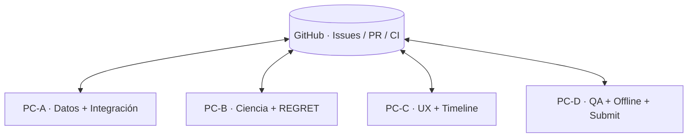
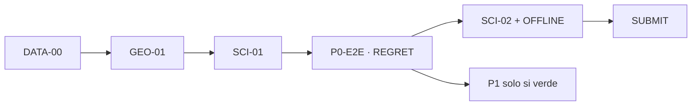

# SITE REGRET — Guía de creación y seguimiento

**QUEMANDOTOKENS · NASA Space Apps Challenge 2026 · Bilbao / 42 Urduliz Bizkaia**  
**Edición 1.0 · 13/11/2026 · Estado: MANUAL DE TRABAJO, NO SOFTWARE CONSTRUIDO.**  
**Ventana:** 14/11/2026 09:00 → 15/11/2026 23:59 Europe/Madrid · 38 h 59 min (39 h nominales).

> **REGLA DE TIEMPO:** ninguna construcción, script, dato procesado ni captura del producto SITE REGRET se realiza antes de H+0, sábado 14/11/2026 a las 09:00 hora local. Investigar, leer herramientas y organizar el equipo son actividades de planificación.

> **ELEGIBILIDAD:** un recurso NASA de la pestaña Resources del reto debe usarse realmente y citarse. Estado inicial `RESOURCE_TAB_UNVERIFIED`: verificarlo con captura, URL e identificador por un humano.

> **NO OPERACIONAL:** el resultado comparará ventanas geométricas Sol/Tierra y sensibilidad modelada del terreno; no certifica energía, enlace RF, probabilidad de misión ni seguridad de aterrizaje. Datos científicos deterministas; IA solo para desarrollar y redactar sobre JSON validado.

## 01 / Una sola misión y cuatro puestos

La tarea no es producir decenas de pantallas. Debemos llegar al domingo con una **decisión de A o B que cualquier persona pueda cuestionar**: dos sitios reales, dos ventanas, horizonte local del DEM, Sol y Tierra con SPICE, 0/2/10 m, cinco estados temporales, ranking por criterio predefinido, REGRET mínimo reproducible y frase que se alimenta del JSON. La prueba no es un concepto en diapositivas, sino una aplicación accesible y un escenario offline auténtico.

**AO = local; GitHub = compartido.** Cada portátil opera con 1–2 workers supervisados por su humano. Una persona en PC-A aprueba la integración global y no se comparten cuentas ni credenciales. Si falla AO, Git worktrees/Issues/PR bastan para continuar.

| PC | Resultado que debe entregar | Evidencia de hecho | Qué puede bloquear |
|---|---|---|---|
| A | dos sitios verificables, recurso elegible, manifest, hashes, schema y main | referencia exacta, commits y checksums | datos sin CRS o fuente no elegible |
| B | horizontes 0/2/10, series Sol/Tierra, rachas, REGRET y frase estructurada | test geométrico, delta JPL si comparable, JSON reproducible | incertidumbre no declarada |
| C | comparador 2D, dos ventanas, estados, altura y pasaporte accesibles | recorrido E2E por teclado desde datos reales | una métrica UI no coincide con JSON |
| D | QA, offline en segundo PC, vídeo real y envío | checklist firmado, captura veraz, URL pública | un recurso ficticio o claim no comprobado |

## 02 / Reglas para todos los responsables

- [ ] Leer el criterio y el riesgo dominante de la tarea antes de encargarla a un worker.
- [ ] Conservar el orden `OBSERVED` / `DERIVED` / `MODELED` / `SIMULATED` para naturaleza y los estados de validación `VERIFIED_SOURCE` / `VERIFIED_ASSET` / `CANDIDATE` / `RESOURCE_TAB_UNVERIFIED` / `UNAVAILABLE` por separado.
- [ ] Cada issue lleva un dueño humano, contrato JSON, test de aceptación, fallback y criterio del jurado al que responde.
- [ ] Ningún worker inventa URLs, coordenadas, versiones de kernels, cifras científicas ni afirmaciones de ejecución.
- [ ] La métrica objetivo se firma **antes** de consultar el ranking nominal.
- [ ] Un campo sin datos es `null` y se acompaña de motivo; jamás se convierte en `0` para facilitar la interfaz.
- [ ] No se abre P1 hasta tener `P0-E2E` con REGRET mínimo y frase de decisión funcionando.
- [ ] En la demo se ven solamente datos reales calculados por el producto, no fixtures o recreaciones.

### Qué significa terminado

`DONE` exige PR integrada, tests con salida real, caso negativo, source/hash y revisión cruzada. `DEMO_VERIFIED` exige operación real sin un desarrollador dictando pasos. Si solo hay una función en un fichero, queda `WORKING`; si hay PR pero no prueba de usuario, queda `MERGED`. Un workflow no se aprueba por la cantidad de tokens ni workers consumidos.

### La métrica que organiza el trabajo: una decisión que resiste preguntas

**La demo que buscamos no es un mapa lunar con efectos:** es una secuencia científica que un jurado pueda interrumpir en cualquier punto y preguntar «¿de dónde sale eso?». Desde la primera hora cada PC debe aportar una pieza al contrato `CHOOSE → CHALLENGE → EXPLAIN → REPRODUCE`:

| Contrato de demo | Dueño que prepara | Prueba que habilita | Bloqueo que lo impide |
|---|---|---|---|
| `CHOOSE` | PC-A + PC-C | criterio y dos ventanas quedan fijados antes de rankear | sitio no verificado |
| `CHALLENGE` | PC-B | nominal + cuatro perturbaciones con semilla común | cálculo científico incongruente |
| `EXPLAIN` | PC-B + PC-C | una tarjeta de mayor regret, o estabilidad, con rastro de la geometría | no hay variantes evaluables |
| `REPRODUCE` | PC-D + PC-A | mismo escenario y datos referenciados en segundo portátil offline | hashes, licencia o pack faltantes |

La tarjeta «peor variante» se elige **automáticamente** dentro de las cuatro variantes P0; no es un motor de búsqueda adicional ni un resultado estadístico. El contador es `N/K` sobre variantes perturbadas válidas, **sin incluir el nominal**. Las hipótesis se fijan antes de ver el ranking y se conservan pruebas que no produzcan efecto. En la presentación no hay inversión garantizada de ganador.

### Regla de oro para todos los agentes

Al cerrar cualquier tarea, el worker entrega **una evidencia visual o reproducible, un test negativo y una afirmación científicamente permitida**. Su coordinador humano los comprueba; PC-A une solo PR revisadas. Nunca se utiliza el razonamiento del agente como sustituto de un cálculo SPICE/DEM ejecutado. El prompt que describe «valores de ejemplo» no autoriza a insertarlos en gráficas ni en un archivo de demo real.

## 03 / Primeras tres horas: plan operativo cronometrado

**H+0 es sábado a las 09:00.** Los intervalos numerados son ventanas **completas de 10 minutos**; cada persona dispone de una tarea que entrega un artefacto o decisión. Los resultados escritos son **objetivos futuros**, no estados alcanzados. El responsable de integración puede sustituir una tarea únicamente registrando motivo y fallback.

| Minuto | PC-A · integración | PC-B · ciencia | PC-C · experiencia | PC-D · calidad |
|---|---|---|---|---|
| 000–010 | confirmar permisos de concurso y registrar equipo | inventario de herramientas Python, SPICE y raster | boceto comparador de una sola pantalla | checklist de reglas y formato de submission |
| 010–020 | acceder a pestaña Resources y guardar prueba exacta | definir entradas de API científica | fijar etiquetas de cinco estados | matriz de jurado y demo que no miente |
| 020–030 | crear repo/ramas/Issues | preparar tests geométricos analíticos | fijar formato de tarjeta de sitios | diseñar test sin conexión |
| 030–040 | certificar o rechazar fuente elegible | listar proyección y datum que deben existir | diagrama A/B × W1/W2 | registrar gate `DATA-00` preliminar |
| 040–050 | obtener bytes reales del recurso aceptado | inspeccionar raster sin asumir escala | construir fixture claramente sintético | test de error con `UNKNOWN` |
| 050–060 | registrar hash y licencia | probar kernel/cobertura temporal | selector altura 0/2/10 | revisar que no hay datos ficticios en ruta real |
| 060–070 | definir candidatos A/B según cobertura | base local lunar y signos | timeline con paso y UTC | preparar log de reproducibilidad |
| 070–080 | comprobar cobertura A y sector radial | test horizonte en un obstáculo sintético | estado sin datos accesible | test de contrato JSON |
| 080–090 | comprobar cobertura B | verificar vectores Sol/Tierra | presentar frase sin cifras por plantilla | test de intervalos/rachas |
| 090–100 | confirmar dos sitios o pivot | elegir primer horizonte a 0 m | componentes puros consumen JSON | cerrar `DATA-00` con evidencia |
| 100–110 | comparar metadatos de ambos sitios | fechas W1 y W2 con kernels | comparar periodos y criterios | test de intercambio A/B |
| 110–120 | fijar `site_id`, unidad, datum y hash | comprobar 2/10 m | dibujar barras de 5 estados | registrar cobertura `UNKNOWN` |
| 120–130 | congelar contrato científico inicial | precálculo de tres alturas | tarjetas A/B sincronizadas | prueba E2E con fixture rotulado |
| 130–140 | confirmar disciplina de fuentes en PR | elegir bins/rango con justificación | añadir limitaciones junto a cifras | plan de prueba offline en PC-D |
| 140–150 | firmar objetivo de ranking con B | definir `±X` **relativo** y máscara de transición | poner REGRET frente al comparador | prueba de invariancia vertical |
| 150–160 | abrir Issue REGRET P0 | fijar campo correlacionado y semilla compartida | plantilla automática de frase | prueba de estabilidad por semilla |
| 160–170 | decidir si `GEO-01` está verde | registrar tolerancias iniciales justificadas | flujo de pasaporte y URL/hash | checklist del pivot si ciencia falla |
| 170–180 | decisión humana GO/PARTIAL/NO-GO | prueba del marco y cobertura de fechas | demo de navegación con fuentes etiquetadas | registrar evidencia de gate y bloqueos |

### Gate de salida H+3

- [ ] Un recurso exacto perteneciente a Resources está identificado y su uso es técnicamente viable; si no, NO-GO de elegibilidad, nunca falso `VERIFIED_ASSET`.
- [ ] A/B usan coordenadas reales confirmadas con el mismo datum y cobertura no inventada; si no, pivot `GEO-01`.
- [ ] Se conoce la ruta para dos ventanas en UTC y las transformaciones de marcos SPICE; si no, evitar prometer cálculo.
- [ ] Los cuatro responsables poseen Issues/PR claros, aceptación medible, fuente de verdad y plan de fallback.
- [ ] REGRET sigue en la ruta crítica H+6–10. La pantalla 3D no aparece en la lista de tareas obligatorias.

### H+3 — paquete de evidencia que debe existir o declararse bloqueado

| Registro que se crea desde H+0 | Campos mínimos | Responsable | Reacción si no existe a H+3 |
|---|---|---|---|
| `RESOURCE_PROOF` | página Resources, recurso NASA exacto, prueba de uso prevista, autor de comprobación | A + D | `RESOURCE_TAB_UNVERIFIED`; no atribuir elegibilidad |
| `ASSET_MANIFEST` | nombre REAL, bytes, SHA, CRS, datum, cobertura, `nodata`, licencia | A + B | `CANDIDATE` o `UNAVAILABLE` |
| `SITE_PAIR` | dos sitios en marco consistente, método de selección, resolución efectiva | A + B | pivot de región, no coordenadas aproximadas |
| `SCENARIO_LOCK` | dos ventanas, criterio, desempate, alturas 0/2/10, muestreo | A + C | no generar ranking de showcase |
| `SCIENCE_PLAN` | caso analítico, convención geométrica y referencia externa planteada | B + D | `SCI-01` pendiente |

**Pivote antes de gastar la tarde:** si falla `DATA-00` se busca una fuente de la pestaña Resources y se mantiene toda claim como candidata; si falla `GEO-01` se reduce la región y se escogen otros dos puntos verificados; no se rellena con SVG un terreno ficticio. El programa de 3 horas es una secuencia planificada: los resultados reales se escribirán al empezar el evento.

## 04 / PC-A — Integration & Data Steward

**Pregunta de tu puesto:** «¿Podemos demostrar exactamente qué bytes y convenciones produjeron esta cifra?». Su misión cubre origen, elegibilidad, configuración, integraciones y merges; no decidir por su cuenta qué tolerancias físicas son aceptables.

### Checklist de inicio del sábado

- [ ] Verificar humanamente el recurso NASA concreto en Resources y escribir ID/URL/captura de referencia.
- [ ] Asociar cada raster/kernels utilizado a fuente, fecha, licencia, checksum, datum, coordenadas, proyección y estado.
- [ ] Comprobar DOS sitios de cobertura suficiente y registrar las dos ventanas UTC elegidas sin anunciar resultados.
- [ ] Fijar una única definición del contrato JSON y generar tipos para backend/frontend.
- [ ] Crear Issues P0 con dueño, evidencia y tiempo máximo; cada PR debe compilar con `main`.
- [ ] Revisar que ninguna ruta de captura contenga fixtures ni secretos.

### Rutina de integración

Cada 45–60 minutos: consultar `main`, ordenar PR por dependencia, seleccionar los bloqueos que amenazan el REGRET y exigir evidencias. Si ciencia y UI discrepan, no se altera una constante a mano: se reproduce con JSON, se inspecciona marco temporal y se requiere firma de B. Cuando haya discrepancia de assets, detener rankings y mantener `PARTIAL` en UX. Si faltan datos elegibles, concentrar a dos personas en Resources con límite temporal, no poner al equipo entero a buscar logos.

**Definición de acabado PC-A:** escenario con 2 sitios × 2 ventanas y tres alturas documentadas, manifest, hash reproducible y repo público sin credenciales, con PR revisadas. **Indicador principal:** número de resultados con cadena completa de procedencia; no número de commits.

### Artefactos de control que PC-A firma

- [ ] Un `docs/DECISIONS.md` con criterios y ventanas sellados antes de comparar; conservar razones de escoger A/B y escenarios descartados.
- [ ] Un `data/manifest.json` con estado separado de **documento** (`VERIFIED_SOURCE`) y **bytes** (`VERIFIED_ASSET`); recursos de la pestaña en estado `RESOURCE_TAB_UNVERIFIED` hasta comprobación.
- [ ] `main` sin secretos, con lockfile, instrucciones reproducibles y contratos JSON aprobados.
- [ ] Una estructura `DECISION_RECEIPT`: `N/K`, criterio, diferencia, peor regret, advertencia, fuente y hash; nulos si no hay cálculo.
- [ ] Revisión de toda afirmación NASA del README: fuente exacta, uso real, sin lenguaje de aval ni logotipo oficial.
- [ ] H+10: ningún trabajo de mapa P1, clones PGDA o búsqueda del tipping point consume al responsable B si `P0-E2E` sigue rojo.

**Si PC-A queda bloqueado:** PC-D toma control de documentación de evidencia y el integrador deja fijado un único propietario temporal de `main` en Issue. Ninguna máquina hace merge a ciegas mientras la persona integradora está ausente. Se privilegia un commit reproducible frente a veinte respuestas de IA paralelas.

## 05 / PC-B — Science & REGRET Lead

**Pregunta de tu puesto:** «¿El resultado sobrevive a una crítica geométrica y a un cambio explícito de hipótesis del terreno?». Eres dueño de marcos, librerías científicas, integridad del tiempo y de la operación matemática de clasificación.

### Checklist científico

- [ ] Comprobar cuerpo-fijo lunar y base local este/norte/arriba; UTC→ET/TDB y kernels reales.
- [ ] Controlar `nodata`, resolución angular, muestreo radial, curvatura y cobertura del DEM.
- [ ] Calcular horizontes independientes para **0/2/10 m**, sin sumar un offset a la línea pintada.
- [ ] Calcular Sol y Tierra por el mismo observador y convención geométrica, nunca como imagen de fondo.
- [ ] Construir las cinco máscaras con bordes temporales documentados, sumas y rachas truncadas a la ventana.
- [ ] Firmar objetivo y dirección de optimización antes de ver ranking A/B; empate sin ganador forzado.
- [ ] Implementar las cinco escenarios (nominal + cuatro perturbaciones) mínimas: nominal, sesgo relativo +X, sesgo relativo −X y campo correlacionado con signos complementarios y misma semilla.
- [ ] Probar que trasladar observador + terreno uniformemente **no** crea artificialmente una reversión; X no es precisión LOLA.
- [ ] Contar evaluadas, inválidas, empates y supervivencia; rotular «fracción de variantes modeladas».
- [ ] Registrar diferencia real en grados ante JPL Horizons/WebGeocalc cuando las configuraciones sean comparables.

**Definición de acabado PC-B:** una función repetible por test que, dado manifest, A/B, W1/W2, altura, objetivo, X/L y semilla, entrega JSON validado y frase determinista, y falla limpiamente ante ausencia de datos. **Indicador principal:** tests científicos reproducibles, nunca una captura bonita.

### Qué hacer si falla ciencia

`DATA-00`: sustituir recurso candidato por otro de Resources documentado. `GEO-01`: acotar zona y escoger dos puntos reales dentro de cobertura. `SCI-01`: simplificar bins o paso, comprobar marcos y ejecutar fixtures analíticos; no proclamar error bajo X grados sin medición. `P0-E2E`: recortar todo P1/P2 y producir la cadena nominal + cinco escenarios (nominal + cuatro perturbaciones). Si ni eso es válido, devolver `NO DETERMINABLE` con causa explícita y mostrar una entrega parcial veraz.

### El contrato físico de PC-B bajo preguntas adversariales

En cada caso científico, PC-B debe poder responder con números **solo si han sido calculados**: ¿qué dirección local se utilizó? ¿es geométrica o aberrada la efeméride? ¿qué duración representa un sample? ¿qué sector del DEM está ausente? ¿el observador se elevó respecto al terreno o se trasladó todo el raster? ¿un `UNKNOWN` se interpretó erróneamente como sombra? El criterio nunca cambia después de ver el ranking.

**Semántica de las perturbaciones:** 1 nominal + 4 estrés (`REL_PLUS`, `REL_MINUS`, `CORRELATED_POS`, `CORRELATED_NEG`). La traslación absoluta conjunta del DEM y del observador no debe venderse como incertidumbre relativa; se prueba la invariancia en modelo local. Los cuatro campos se aplican en una cuadrícula espacial común para A/B, con semilla y longitud de correlación. El denominador del indicador de robustez excluye el nominal y las variantes inválidas; muestra ambos recuentos.

**Pruebas bloqueantes con resultados observables:**

| ID | Entrada | Resultado esperado | Si falla |
|---|---|---|---|
| SCI-A | plano y pico analíticos | horizonte compatible con solución cerrada y diferencia medida | no publicar ángulos reales |
| SCI-B | elevación de 0/2/10 en caso sintético | ángulo de obstáculo no aumenta al subir | bloquear alturas P0 |
| SCI-C | mismo seed/asset/JSON en PC-A y B | misma salida dentro de contrato numérico | bloquear fracción N/K |
| SCI-D | sector raycast `nodata` | estado `UNKNOWN`, no Sol/Tierra inferidos | degradar a `PARTIAL` |
| SCI-E | permutar A y B | mismo caso físico y regret permutado | bloquear ranking |
| SCI-F | amplitud 0 y traslación global | nominal reproducido, sin flip mágico | bloquear perturbaciones |

**Oportunidad científica P1:** [NASA PGDA LOLA south pole](https://pgda.gsfc.nasa.gov/products/78) documenta mapas de incertidumbre y conjuntos de 100 clones topográficos; no son bytes descargados ni prueba de elegibilidad del reto. Solo explorar `SOURCE_CLONES` tras `P0-E2E` verde y comprobación de tamaño, marco y cobertura. No mezclar sus recuentos con los campos sintéticos `MODEL_STRESS` ni presentarlos como probabilidad real.

## 06 / PC-C — Experience & Explanation Lead

**Pregunta de tu puesto:** «¿Una persona sin formación planetaria entiende por qué cambia una decisión, o solo ve un tablero de números?». Su resultado es una interfaz 2D legible antes que cualquier escena de alta fidelidad.

### Checklist de interfaz

- [ ] Mostrar A/B, dos ventanas UTC, paso temporal, 0/2/10 m y criterio seleccionado.
- [ ] Mostrar perfil de horizonte de DEM y direcciones Sol/Tierra derivados del mismo JSON del motor.
- [ ] Usar estados `SUN_ONLY`, `EARTH_ONLY`, `BOTH`, `NEITHER`, `UNKNOWN`, con leyendas y descripciones textuales.
- [ ] Tras el cálculo, ofrecer ranking nominal, variantes, denominador, robustez, semilla y frase determinista.
- [ ] No interpretar una sombra como falta de datos; un panel `PARTIAL` justifica exactamente qué falta.
- [ ] Un usuario de teclado puede completar la interacción sin ratón; contraste y reduced-motion pasan control básico.
- [ ] El pasaporte se abre sin conexión y la URL permite reconstruir el escenario con hash.

**Gestos que deben caber en 30 s:** elegir A/B → inspeccionar dos fechas → alternar 0/2/10 m → fijar objetivo → activar REGRET → leer frase y ver la evidencia. P1 únicamente tras gate: mapa de robustez de hasta 25 puntos, mediana/rango y glosario. Si el mapa tarda, entregar CSV/SVG derivado de los puntos realmente calculados. Una escena 3D sería P2, no condición de aceptación.

**Definición de acabado PC-C:** test E2E que un compañero ejecuta desde otra máquina, con layout fluido y sin suposiciones científicas implícitas. **Indicador principal:** tiempo para explicar una conclusión verdadera y sus límites.

### Criterios de interfaz que hacen que una persona entienda la idea

1. **Primer segundo:** título «¿Y si el mapa se equivoca?» y un escenario real listo; no cargar un globo 3D decorativo como pantalla inicial.
2. **Antes del ranking:** criterio claramente seleccionado y bloqueado, o una declaración de que el escenario guardado fue calculado con ese criterio. Si se cambia el objetivo, debe mostrarse un escenario distinto con hash.
3. **Mismo lienzo:** dos tarjetas A/B, dos ventanas W1/W2 y selector 0/2/10; cinco estados legibles también sin color.
4. **Momento REGRET:** tarjetas `nominal / N/K variantes modeladas / peor caso / límite epistemológico` que se pueden explicar en una frase, no un dashboard de cientos de números.
5. **Por qué:** al seleccionar una variante, mostrar un perfil superpuesto y paso UTC donde cambia clasificación, cuando el motor aporte `explanation_trace`.
6. **Prueba documental:** una acción abre `DECISION_RECEIPT` con asset, hashes y carácter no operacional; la URL no oculta información de fuente.

**Accesibilidad medible:** tabulación completa sin trampa, foco visible en 100 % de controles de P0, control «detener animación» y soporte de `prefers-reduced-motion`, cada estado con texto, `UNKNOWN` con trama y descripción textual; probar también zoom del navegador. Si P1 tiene mapa de robustez, cada punto se navega por lista y posee etiqueta `robust / fragile / unknown`, con `K` y motivo. La versión ES/EN es P1 y puede descartarse para proteger P0.

### P1 con orden inteligente, no backlog infinito

| Orden condicionado a `P0-E2E` | Función | Coste acotado | Salida mínima suficiente |
|---|---|---|---|
| P1-A | Crest Atlas | 9 puntos inicialmente, hasta 25 si cabe | 9 puntos reales contra rival declarado, no mapa inventado |
| P1-B | Enseñar «predice y comprueba» | 1 interacción, no plataforma educativa | explicación causal sobre JSON real |
| P1-C | Tipping Point | hasta 12 amplitudes en **una** familia | primer flip ensayado o NOT_FOUND, con malla visible |
| P1-D | ensemble / clones de fuente | solo si assets compatibles y PC-B liberado | resumen separado por familia `MODEL_STRESS` / `SOURCE_CLONES` |
| P1-E | informe + traducción | no bloquear core | export de una página y/o EN si hay tiempo |

La imagen insignia del mapa de cresta tiene que salir de cálculos realmente terminados. Si su coste crece, disminuir puntos de 25→15→9 y usar SVG con leyenda, sin un shader que interpole robustez entre sitios no evaluados.

## 07 / PC-D — QA, Offline & Submission Lead

**Pregunta de tu puesto:** «¿Puedo refutar un número y reproducirlo sin la red del equipo?». Eres responsable de que la presentación no transforme una conjetura en supuesta medición NASA.

### Checklist de entrega

- [ ] Leer cada Issue P0 y comprobar su contrato, caso positivo y negativo.
- [ ] Seguir una cifra desde DEM y kernels hasta JSON y etiqueta visual.
- [ ] Inyectar `nodata`, fecha sin cobertura SPICE, `NaN` rechazado y fallo de archivo para ver `PARTIAL`/`UNAVAILABLE`.
- [ ] Repetir escenario con misma semilla/parametrización, comprobar hash y fracción K.
- [ ] Desconectar Wi-Fi en PC-D y recorrer el pack offline real, sin endpoints remotos.
- [ ] Grabar vídeo oficial con **pantalla auténtica de la aplicación**; concepto 3D programático es una pieza independiente.
- [ ] Exigir créditos de recursos NASA, librerías, imágenes, música y uso real de agentes IA.
- [ ] Verificar repo y demo en sesión privada, preparar submission en inglés y obtener dos firmas.

### Congelaciones prácticas

A H+27, cerrar adiciones mayores si amenazan QA. A H+32, congelar features; a H+35, congelar demo. H+37 abre margen de envío y comprobación. Si se cae Internet, mantener los assets y el render real en local; si la plataforma exige conexión, usar segundo acceso e incluir suficiente margen. Nunca regrabar con una animación falsa por falta de tiempo.

### La demo de PC-D: dos circuitos independientes

**Circuito funcional (para jurado):** abrir en navegador sin Internet → seleccionar escenario A/B con 2 ventanas y 3 alturas → activar `CHALLENGE` → leer la frase y el recuento `N/K` → abrir pasaporte → copiar hash. Cada transición que muestra un dato debe poder reconstruirse desde el mismo JSON. Si no se puede recalcular en navegador offline, se rotula `OFFLINE_REPLAY_ONLY` y el test verifica que todos los valores reproducidos proceden de salidas realmente calculadas.

**Circuito de seguridad (para científicos):** seleccionar área con `nodata` o ventana fuera de kernels → ver `PARTIAL` o `UNAVAILABLE` sin ranking válido; probar traslación global sin reversión artificial; intentar afirmar «probabilidad de éxito» y comprobar que textos y glosario usan «fracción de variantes modeladas». Esta ruta no hace falta en el vídeo de 30 segundos, pero sí debe estar documentada si la defensa técnica la necesita.

### Parte de QA por turno

| Señal | Valor permitido | Acción inmediata |
|---|---|---|
| fuente en Resources | `RESOURCE_TAB_UNVERIFIED` / recurso usado y acreditado | si falta, bloquear elegibilidad pública |
| P0-E2E | `RED`/`AMBER`/`GREEN`, con test enlazado | verde habilita P1 |
| integridad DEM | hashes, coverage, nodata, CRS | cualquier conflicto = `SCIENCE_STOP` |
| variante modelada | número total/validado/inválido/empate | no mostrar fracción sin denominador |
| offline | `RECOMPUTABLE`/`REPLAY_ONLY`/`FAIL` | fallos se registran explícitos |
| informe y vídeo | `NOT_PREPARED`/`RECORDED_REAL`/`CHECKED` | bloquear CGI confundible con app |
| Submit | `DRAFT`/`REVIEWED_BY_2`/`CONFIRMED` | confirmación requiere pantalla o recibo |

## 08 / Kanban, reporte e indicadores

| Estado de ticket | Evidencia requerida | Señal de bloqueo |
|---|---|---|
| `TODO` | criterio y dueño | ambiguo |
| `CLAIMED` | nombre humano y estimación | dos workers reclamaron lo mismo |
| `WORKING` | logs/commits parciales | 20 min sin artefacto |
| `PR_READY` | test, riesgos y diff pequeño | cambio incompatible de schema |
| `REVIEWING` | persona revisora y comentarios | sin respaldo científico |
| `MERGED` | CI y commit principal | no pasa E2E |
| `DEMO_VERIFIED` | gesto real en otro PC | fixture o red requerida |
| `BLOCKED` | causa exacta, plazo, fallback | requiere pivot |

Indicadores cada hora: cuántos activos `VERIFIED_ASSET`; pares sitio-ventana-altura válidos (objetivo de cobertura **2×2×3=12 combinaciones**); contratos validados; número real de pruebas científicas pass/fail; si el REGRET se puede reproducir; estados de fallo honestos; prueba offline; riesgo al deadline. El 12 es cardinalidad de diseño, no una medición NASA.

### Mensaje de bloqueo estándar

`BLOCKED | ticket | owner | gate | input/hash | expected | observed | error | steps | attempted fix | fallback | decision needed | deadline`

Escalado humano: A decide prioridad y alcance, B decide validez científica, C decide representación y D evalúa evidencia y concurso. Sin respuesta en 20 minutos: aplicar pivot predefinido. La decisión que recorta se documenta y se comunica por Issue, sin reuniones largas.

### Regla de interrupción: 20 minutos y una salida

Un bloqueo se anuncia en GitHub Issue con `BLOCKED | dueño | gate | último test | fuente | impacto | opción de salida | decisión humana requerida`. Si afecta a P0, PC-A/B le dedican como máximo **20 minutos de investigación prioritaria** antes de seleccionar un pivote documentado; no abrir otros cinco agentes para ocultar el bloqueo. Las decisiones se transmiten a las cuatro personas mediante Issue/PR y una conversación corta; AO es local, no hay un bus de tareas entre máquinas.

**Escalera de cortes:** 1) quitar energía/narrador; 2) quitar cualquier 3D; 3) congelar P1 EN y export; 4) cortar tipping point, clones y ensemble ampliado; 5) reducir mapa de cresta 25→9→fuera; 6) mantener nominal+4 perturbaciones, dos sitios/fechas, 0/2/10, 2D accesible, frase y pasaporte. Si falla un gate científico no se «simplifica» con datos ficticios: se publica estado parcial con causa.

### Franja de madrugada: relevo mínimo viable

La ventana sábado 09:00–domingo 23:59 suma **38 h 59 min**. No presupone 39 horas despiertos para nadie. Antes de cada descanso, dejar `HEAD SHA`, comando de test, assets disponibles, estado de portal, dueño de merges y siguiente gate en Issue; separar las claves personales de todo relevo. Como mínimo una persona puede integrar y otra puede detectar un error científico crítico, aunque sus descansos se alternen. PC-D conserva un clip auténtico temprano como contingencia, pero no lo presenta como versión final si su contenido científico no está completo.

## 09 / Gates y cronograma de 39 horas

| Gate | Momento límite | Evidencia mínima | Si falla |
|---|---|---|---|
| `DATA-00` | H+1:30 | recurso de Resources más manifest de asset | otro recurso, no claim global |
| `GEO-01` | H+3 | dos sitios, CRS/datum, cobertura, kernels candidatos | acotar región, par alternativo real |
| `SCI-01` | H+6 | test horizonte, tiempo y SPICE, 3 alturas | simplificar discretización y mostrar parcial |
| `P0-E2E` | H+10 | 2×2, cinco estados, REGRET mínimo, frase | eliminar todo P1/P2 y enfocar P0 |
| `SCI-02` | H+15 | QA y passport, honestidad de limitaciones | freeze motor y arreglar defectos |
| `OFFLINE` | H+21 | snapshot real en otro portátil | conservar salida precalculada auténtica |
| `P1-CHECK` | H+27 | mapa/ensemble solo si sobran recursos | retirar P1 completo |
| `FEATURE-FREEZE` | H+32 | UI accesible y links de evidencia | solo arreglos críticos |
| `DEMO-FREEZE` | H+35 | vídeo ≤30 s real | captura más simple del P0 |
| `SUBMIT` | H+37–38:59 | formulario revisado por dos personas | contingencia de red y confirmación |

El calendario completo y el árbol de pivotes con prioridades de recorte se definen en `SITE_REGRET_01_PLAN_MAESTRO.md`. El responsable de cada gate informa qué sabe, qué **no** sabe, cuáles son los bytes y cuál es el siguiente criterio de aceptación.

### Los cuatro cortes que protegen el concurso

| Corte | Qué se congela | Qué todavía puede cambiar | Evidencia a guardar |
|---|---|---|---|
| H+10 | contrato de `DECISION_RECEIPT` / ruta P0 | fallos técnicos, UI y fuentes | screenshot local + test JSON |
| H+15 | fórmulas del motor y serialización hash | bugs científicamente justificados | golden outputs y commits |
| H+32 | features y arquitectura | correcciones críticas de ciencia, accesibilidad o seguridad | release candidate |
| H+35 | grabación y guion de 30 s | reparación de enlaces, formulario y créditos | archivo de vídeo real y timestamp |

**No se esperan 22 horas para pensar en el formulario.** PC-D realiza una plantilla desde H+3 y revisa las instrucciones oficiales 2026 sin inventar campos. La tarea de envío tiene prioridad real a partir de H+32. Si una petición audiovisual compite con verificar el recurso de Resources, la petición audiovisual pierde.

## 10 / Usuario final, evidencia y mensaje

La persona abre una página con un escenario verificable. Elige sitios A/B y dos ventanas; ve Sol, Tierra, ambos, ninguno o sin datos. Alterna la altura entre 0/2/10 m. Selecciona un criterio (por ejemplo, minimizar racha sin Sol), examina una clasificación nominal y la prueba de sensibilidad del terreno. El resultado aparece como oración determinista y pasaporte con fuente. La persona puede guardar un link con hash y reproducir la escena offline. Una selección no es una recomendación de seguridad de alunizaje.

**Pregunta que debemos ser capaces de responder:** «¿Qué pasa si el mapa se equivoca?». **Respuesta defendible:** «Bajo estos supuestos y este conjunto limitado de variantes, el ranking [se conserva / cambia / no se puede determinar]; aquí están los datos, la semilla y la ruta para repetirlo».

### Preguntas de jurado que cada PC debe dominar

| Pregunta hostil | Responsable | Respuesta breve y defendible |
|---|---|---|
| «¿Por qué no Moon Trek?» | C | «Moon Trek ya tiene cartografía y perfiles. Nuestro foco es someter una **decisión entre A/B** a hipótesis explícitas y entregar el contraejemplo y el recibo reproducible» |
| «¿Es 75 % de éxito?» | B | «No. Sería 3 de 4 **variantes modeladas evaluables**, no una frecuencia calibrada de misión» |
| «¿Qué significa ±X?» | B | «Un estrés de error **relativo** entre relieve y observador, con máscara y semilla; el desplazamiento uniforme se prueba como invariante local» |
| «¿Y los clones de NASA?» | A | «PGDA los documenta. Solo entrarían en P1 si verificamos los archivos concretos; no son certeza de calibración» |
| «¿Qué habéis inventado realmente?» | C | «El flujo claro de criterio → cálculo → prueba de fragilidad → explicación causal → pasaporte compartible; no las efemérides ni la topografía» |
| «¿En qué se basa el impacto?» | D | «En un test de comprensión y reproducción documentado; no afirmamos adopción por NASA» |
| «¿Qué pasa si el mapa no cubre la cresta?» | B | «Marcamos `UNKNOWN`, degradamos la comparación y enseñamos el motivo; no fabricamos continuidad» |
| «¿Puede ejecutar la IA el análisis?» | A | «La IA ayuda a programar y redactar; números y rankings solo proceden del motor determinista validado» |

### Revisión humana previa a Submit

- [ ] Revisor 1 (PC-A): fuente elegible exacta, links, manifest, kernels, datos sin placeholders.
- [ ] Revisor 2 (PC-D): vídeo auténtico, inglés, accesibilidad, IA/credits, offline y formulario.
- [ ] Se ha comprobado que `main` abre en incógnito y el vídeo no oculta una funcionalidad inexistente.
- [ ] Se ha confirmado el envío dentro del plazo local con prueba legible.

**Documentos de apoyo:** `SITE_REGRET_01_PLAN_MAESTRO.md` (autoridad científica y alcance), `SITE_REGRET_03_RESUMEN_FUNCIONALIDADES.md` (visión de producto), `SITE_REGRET_04_PROMPT_VIDEO_PROGRAMATICO.md` (vídeo explicativo conceptual), `SITE_REGRET_05_GUIA_INSTALACION_ENTORNO.md` (instalación y prueba de entorno). La pieza PDF de este manual se llama `SITE_REGRET_02_GUIA_CREACION_SEGUIMIENTO.pdf`.
