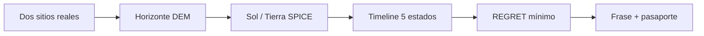
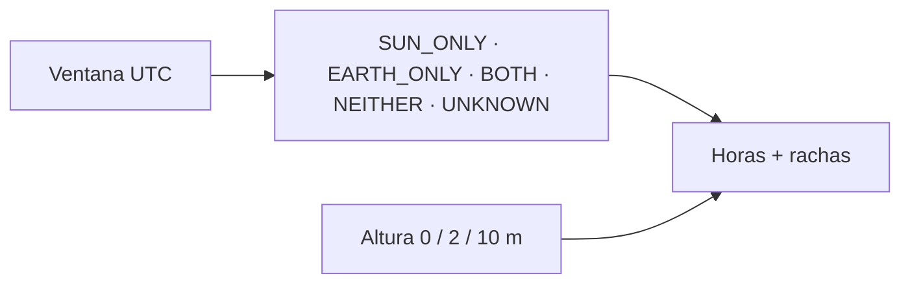
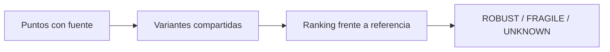
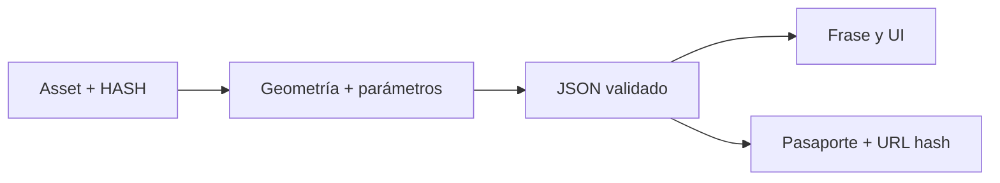

# SITE REGRET — Atlas de funcionalidades

**QUEMANDOTOKENS · NASA International Space Apps Challenge 2026 · Bilbao**  
**Edición 1.0 · 13/11/2026 · Estado: CONCEPTO Y ESPECIFICACIÓN; NADA CONSTRUIDO.**  
**Reto #04:** Lunar Landing Site Navigator.

> **REGLA TEMPORAL:** la implementación y cualquier material grabado del producto comienzan únicamente el 14/11/2026 a las 09:00 hora local. Los diagramas de este atlas son **CONCEPTUALES: NO SON DATOS NI CÁLCULOS NASA**.

> **ELEGIBILIDAD Y CIENCIA:** usar al menos una fuente NASA de Resources confirmada por humano. Estado `RESOURCE_TAB_UNVERIFIED` hasta comprobación. Ningún valor, coordenada o resultado del atlas representa un cálculo ejecutado. Naturaleza de información: `OBSERVED`, `DERIVED`, `MODELED`, `SIMULATED`; fuentes: `VERIFIED_SOURCE`, `VERIFIED_ASSET`, `CANDIDATE`, `RESOURCE_TAB_UNVERIFIED`, `UNAVAILABLE`.

<!-- PAGE -->
## 01 / La gran pregunta

# ¿Y SI EL MAPA SE EQUIVOCA?

Un sitio lunar no es una fotografía con un punto de destino. La posición del Sol y de la Tierra cambia con la fecha; una elevación del terreno puede ocultarlos al observador. Un mapa digital de elevaciones es imprescindible para estudiar esa relación, pero también es una representación finita del terreno. SITE REGRET plantea una pregunta de ingeniería accesible: **¿la elección entre A y B se mantiene cuando alteramos explícitamente nuestras hipótesis sobre el relieve?**

El primer gesto consiste en elegir dos sitios reales y dos ventanas de fechas. El segundo, inspeccionar las franjas de Sol y Tierra. El tercero, subir el observador a 0, 2 o 10 m. El cuarto, **declarar el criterio y poner a prueba la elección**, viendo qué variantes conservan o invierten el ranking y por qué.

> **PROMESA DE PRODUCTO:** no decimos «este sitio es seguro». Decimos: «Con este DEM, estos kernels, esta fecha y este criterio, el resultado nominal es X; estas hipótesis explícitas muestran cuándo puede dejar de serlo». La salida científica está diseñada para ser refutable y repetible.

**CONCEPTO, NO DATOS:** los perfiles y posiciones aquí descritos no corresponden a ningún lugar lunar identificado. No muestran coordenadas ni medidas.

<!-- PAGE -->
## 02 / Dos lugares. Dos relojes. Una geometría.

# LA LUZ NO BASTA SIN UN HORIZONTE

El núcleo del producto se apoya en un DEM lunar con metadatos confirmados y un conjunto compatible de kernels SPICE. El terreno determina qué elevación angular requiere cada azimut para quedar despejado. SPICE calcula la dirección del **centro del Sol** y del **centro de la Tierra** para el observador y los instantes seleccionados. El producto los compara con el mismo horizonte y documenta el paso temporal.

| Objeto | Qué entra | Qué produce | Tipo |
|---|---|---|---|
| Datos de elevación | raster NASA, datum, proyección, cobertura | relieve disponible y `nodata` | `OBSERVED` |
| Geometría local | sitio + observador + DEM | perfil angular por azimut | `DERIVED` |
| Efemérides | kernels + UTC + marco | series de azimut/elevación | `DERIVED` |
| Ventanas temporales | perfil + series + márgenes | horas, rachas, intervalos | `DERIVED` |
| Alturas 0/2/10 | hipótesis del observador | perfiles distintos calculados | `SIMULATED` |

Los dos sitios comparten criterios, tiempo y convenciones. No se puede presentar la posición de una estación terrestre como equivalente a ver el centro de la Tierra. La luz geométrica no certifica rendimiento de un panel solar. Donde falte cobertura, habrá estado desconocido; nunca una oscuridad dibujada para completar la estética.

**Impacto comunicativo:** una herramienta de educación o divulgación puede enseñar por qué las elecciones de ubicación requieren física, fechas y fuentes. El producto no presupone adopción por misiones reales ni validación operacional.

<!-- PAGE -->
## 03 / La vista principal: comparar y elevar

# CINCO ESTADOS. TRES ALTURAS.

La experiencia obligatoria es 2D y accesible. Dos tarjetas A/B muestran las dos ventanas UTC, el paso temporal, el horizonte y un calendario de colores. El calendario distingue `SUN_ONLY` (naranja), `EARTH_ONLY` (cian), `BOTH` (ambos), `NEITHER` (azul oscuro) y `UNKNOWN` (rayado). Una leyenda textual acompaña al color; las horas conocidas y desconocidas se contabilizan por separado.

**El gesto del mástil** es una pregunta geométrica, no una animación ficticia: al seleccionar 0, 2 o 10 m, el observador se sitúa a esa altura simulada y cambia la línea de vista; el horizonte se calcula para cada altura. En algunos lugares el efecto será visible y en otros apenas se apreciará. Ambas situaciones deben ser admisibles para la demo.

Para un visitante sin conocimientos de efemérides, la lectura debe responder «¿cuándo tiene luz?», «¿cuándo ve la Tierra?» y «¿qué zona de la cresta le tapa cada dirección?». Para una persona técnica, cada celda debe revelar hora, elevación, umbral, fuente y método. Un sector `UNKNOWN` debe impedir conclusiones que dependan de él.

**Accesibilidad P0:** teclado, foco visible, contraste suficiente, descripciones de gráficos y reducción de movimiento. El modo sin conexión conserva escenarios auténticos calculados, no simula la API.

### El momento decisivo en una sola tarjeta

> **DECISION RECEIPT:** «Elijo A o B según el criterio fijado. Aquí están cuatro escenarios de estrés, la variante que más perjudica la decisión, qué geometría cambió y cómo repetir el experimento». La tarjeta se redacta por reglas de JSON. Una inversión del ranking no está garantizada ni se fabricará para la demo.

<!-- PAGE -->
## 04 / El corazón diferencial

# UNA DECISIÓN QUE SE PUEDE REFUTAR

Antes de mostrar qué sitio gana, la persona elige el criterio: por ejemplo, **minimizar la mayor racha sin Sol** dentro de la ventana. A/B no recibe una puntuación opaca. Se conoce la métrica, la unidad, el sentido de comparación y la condición de empate. Solo después se calcula el ranking nominal.

A continuación, SITE REGRET pone a prueba el ranking con un conjunto **mínimo de cinco escenarios (nominal + cuatro perturbaciones)** de diseño: terreno nominal, dos desplazamientos relativos de relieve ±X m respecto al observador fijado y dos perturbaciones espaciales correlacionadas con semilla y parámetros visibles. Un desplazamiento uniforme de terreno y observador, por sí solo, no debe fabricar un efecto: el método lo reconoce y lo prueba.

Para la variante `v`, el *regret* de una elección es la diferencia entre la utilidad del mejor sitio en esa variante y la utilidad de esa elección. Como el conjunto está modelado, el resultado reporta **fracción de variantes modeladas**, nunca probabilidad calibrada de éxito o fallo.

> **LA FRASE ES EL PRODUCTO:** «Con [DEM], [kernels], [fecha] y [criterio], [A/B/empate] gana nominalmente. Entre [K] variantes modeladas, [N] conservan la elección; bajo [perturbación] el ranking [cambia/se mantiene/no puede determinarse]». El motor genera la frase de JSON validado, sin LLM.

Las salidas llevan rango de diferencia, empate, variantes inválidas, semilla, X, longitud de correlación y advertencia. Si la evidencia está incompleta, el sistema dice `NO DETERMINABLE`; no anima una reversión que no exista.

### La prueba que evita impresionar con cifras equivocadas

**Nominal + 4 ≠ 5 ensayos independientes.** La robustez `N/K` excluye el escenario nominal; `K=4` significa cuatro perturbaciones de estrés evaluables. Empates e inválidas se cuentan aparte. Una traslación uniforme que afecta a terreno y observador no debe fabricar un efecto: ±X es un error **relativo y declarado**.

**La tarjeta de contraejemplo** elige, de forma determinista, la variante con mayor regret de la decisión nominal. Su explicación se ancla al sector de horizonte y al intervalo UTC que cambian realmente de clasificación; si no hay reversión ni atribución simple, la interfaz lo explica sin inventarla.

<!-- PAGE -->
## 05 / Imagen insignia, si P0 está verde

# LA CRESTA DE LA ROBUSTEZ

En P1, el comparador se extiende a un mapa sobre un transecto real verificado: **hasta 25 puntos candidatos** de una cresta, clasificados según cómo se comporta su elección frente a una referencia declarada cuando se aplican variantes espaciales compartidas. No equivale a pintar un mapa de probabilidad; el color codifica **robusto bajo todas las variantes evaluadas, frágil si aparece una inversión o desconocido por falta de cobertura**.

La prioridad visual se justifica porque expresa una pregunta de decisión en el propio terreno: **¿dónde deja de ser estable la clasificación?** Un científico puede inspeccionar método, paso espacial, límite de puntos, cobertura y K; un visitante identifica una región cuyo color debe poder explicarse con un escenario concreto.

El coste crece aproximadamente con puntos × variantes × rayos × muestras del terreno. El límite inicial de 25 es **presupuesto informático**, no resolución recomendada por NASA. Si el cálculo se vuelve demasiado lento, se reducen puntos, bins o K con transparencia. El fallback es un gráfico SVG o CSV **con los puntos realmente evaluados**, nunca colores inventados. El mapa solo se habilita con `P0-E2E` verde.

**Ensemble P1:** K configurable con semilla y correlación; rango, mediana, peor regret, tasa de empate y cobertura de variantes. La semántica no cambia respecto al núcleo P0 y no se equipara a confianza estadística.

### Dos apuestas P1 de alta creatividad y validez

**DECISION CLIFF:** probar una malla predefinida de amplitudes X y encontrar la menor amplitud **ensayada** que invierte el ganador, o publicar `NOT_FOUND_WITHIN_TESTED_RANGE`. No representa incertidumbre metrológica real y no presupone monotonicidad. **SOURCE CLONES:** la [NASA PGDA](https://pgda.gsfc.nasa.gov/products/78) documenta mapas de incertidumbre y conjuntos de 100 realizaciones topográficas para algunas regiones polares. Su empleo depende de verificar bytes, cobertura y marco; sus resultados se separan de los modelos sintéticos. Ninguna extensión bloquea P0.

<!-- PAGE -->
## 06 / Evidencia legible, no una caja negra

# CADA CIFRA VIAJA CON UN PASAPORTE

El pasaporte científico reúne fuente exacta NASA/otros datos, registro de assets, licencia, CRS/datum, coordenadas de A/B, versiones de algoritmos y kernels realmente usados, SHA-256 de bytes originales, periodo UTC, paso temporal, discretización del horizonte y semilla/perturbaciones. Almacena además las limitaciones de cobertura, la diferencia numérica frente a geometría analítica y las comparaciones externas válidas cuando puedan ejecutarse.

Un enlace compartible codifica el escenario junto a un hash verificable; el paquete offline reproduce el recorrido sin depender de Internet y con resultados científicos calculados durante el hackathon. Un hash verifica identidad y reproducibilidad de entrada, **no exactitud absoluta del DEM**.

**Tres clases de incertidumbre:** epistémica (DEM y cobertura real), numérica (pasos, rayos, interpolación) y de parámetros modelados (mástil, X, L, objetivo). No se suman en un porcentaje total. El panel visible de Validación P1 muestra diferencias realmente medidas en grados frente a soluciones geométricas y, si son comparables, JPL Horizons/WebGeocalc. Si no hay comparación independiente, mostrará `NOT_VALIDATED_EXTERNAL`.

**Modo «Explícamelo» P1:** seis términos esenciales y un dibujo simple: horizonte, azimut, elevación, ventana, máscara desconocida y regret. El conocimiento astronómico se enseña sin depender del narrador IA opcional.

### Del dato a una explicación que cualquiera puede discutir

La interfaz permite abrir **«¿por qué?»**: el perfil indica qué sector del relieve compite con el Sol o la Tierra y qué muestras del intervalo efectivamente cambiaron. Si existen varias causas, se muestran varias sin una falsa atribución única. Con `UNKNOWN`, `PARTIAL` o un kernel incompatible, el producto se niega a fingir un ranking. Esa negativa es también calidad científica.

<!-- PAGE -->
## 07 / Qué entra en la entrega

# P0 FUNCIONA SIN P1 Y SIN 3D

| Nivel | Módulos | Evidencia de que existe | Fallback |
|---|---|---|---|
| P0 | 2 sitios reales; 2 ventanas; DEM + SPICE; horizontes 0/2/10; 5 estados; A/B; REGRET mínimo; frase; pasaporte; URL+hash; offline y acceso básico | test 2×2×3, nominal y 4 perturbaciones reproducidas, UI y segundo PC sin red | 2D SVG y snapshots de cálculo real con `PARTIAL` visible |
| P1 | mapa de cresta; ensemble K; «Explícamelo»; validación; multicriterio visible; informe 1 página; ES/EN; contexto polar | cálculos en puntos con fuente, rango/mediana, diffs en grados y export | conservar íntegro P0 |
| P2 | 3D y cámara observador; energía educativa; narrador IA; accesibilidad sonora/contraste ampliado | escena coherente y cálculos declarados como simulación | desactivar sin perder comparador |

**El orden de construcción protege REGRET.** En H+6–10 se debe obtener la cadena nominal→variantes→frase→pantalla, sin esperar a un mapa 3D. Después se valida el pasaporte y la demo offline. P1 se intenta únicamente con P0 integrado; el 3D ocupa P2. Una demo con la escena visual más espectacular pero sin decisiones reales no responde a la pregunta central.

**Fuera de alcance:** grandes catálogos, comparación operativa entre misiones, infraestructura RF compleja o colaboración multiusuario. El contexto Artemis es una nota educativa breve y citada, no una afirmación de endoso o de planificación de la agencia.

### Los cinco criterios del jurado

| Criterio | Aporte del producto | Prueba visible |
|---|---|---|
| Influencia / Impact | enseñar decisión crítica condicionada | frase, URL y glosario |
| Creatividad | ranking sensible a topografía hipotética | perturbación y mapa P1 |
| Validez | geometría y límites refutables | test, hashes, delta en grados |
| Relevancia | Sol/Tierra vs horizonte, dos sitios/fechas | timeline 2×2 y alturas |
| Presentación | lectura en 30 s sin mentir | 2D accesible, demo real |

### Qué añade realmente cada prioridad

| Diferencial | Nivel | Promesa defendible |
|---|---|---|
| Decision Receipt y peor variante | P0 | por qué gana y qué hipótesis afecta su elección |
| Comparación 2×2×3 y cinco estados | P0 | geometría trazable; sin prometer energía ni enlace RF |
| Crest Atlas | P1 | hasta 25 puntos calculados contra la misma referencia, con cobertura |
| Decision Cliff y clones PGDA | P1 | primer flip en una malla y/o realizaciones de fuente verificadas |
| Modo «predice y comprueba» | P1 | educación a partir de la salida real, sin guionar la respuesta |
| 3D, energía y narrador | P2 | solo tras proteger ciencia, accesibilidad, offline y entrega |

<!-- PAGE -->
## 08 / El jurado en treinta segundos

# NO SOLO ELIJAS. CUESTIONA EL MAPA.

| Segundo | Qué se verá si P0 está implementado | Prueba detrás |
|---|---|---|
| 00–03 | pantalla real, A y B, pregunta en título | sitio y DEM verificables |
| 03–09 | dos ventanas y estados de Sol/Tierra | SPICE + horizonte |
| 09–14 | altura 0/2/10 y reacción física | precálculo de tres horizontes |
| 14–22 | criterio, REGRET y frase condicional | JSON + semilla + variantes |
| 22–27 | fracción de variantes, no probabilidad | conteos y advertencias |
| 27–30 | pasaporte y enlace | hashes y bundle público |

**Con P1 disponible:** durante 22–27 puede mostrarse el mapa de cresta auténtico con sus colores derivados de datos, dejando la fracción y advertencia en pantalla. **Sin P1:** el REGRET mínimo de P0 sigue siendo el protagonista. La grabación oficial es exclusivamente del producto real; el vídeo largo con Remotion/three.js/SVG se anuncia como recreación conceptual de diseño y no reemplaza la demo.

### Qué nos diferencia de otras herramientas

Moon Trek y otros visores lunares ya ofrecen datos geográficos; Horizons y SPICE proporcionan geometría; la literatura lleva tiempo estudiando iluminación polar y alturas de paneles. **La promesa no es «inventar horizontes»**. La promesa es hacer entendible y reproducible si una elección A/B resiste un terreno imperfecto bajo supuestos declarados. No reclamamos ser los primeros ni garantizar seguridad de una misión.

### La última línea

> **Elegir con datos importa. Saber cuánto depende tu elección del mapa importa todavía más.**

**Fuente de verdad:** `SITE_REGRET_01_PLAN_MAESTRO.md`. Manual operativo: `SITE_REGRET_02_GUIA_CREACION_SEGUIMIENTO.md`. Vídeo de explicación: `SITE_REGRET_04_PROMPT_VIDEO_PROGRAMATICO.md`. Entorno: `SITE_REGRET_05_GUIA_INSTALACION_ENTORNO.md`. Este mismo atlas se representa en `SITE_REGRET_03_RESUMEN_FUNCIONALIDADES.pdf`. Todo permanece en estado de especificación a la fecha de edición.
