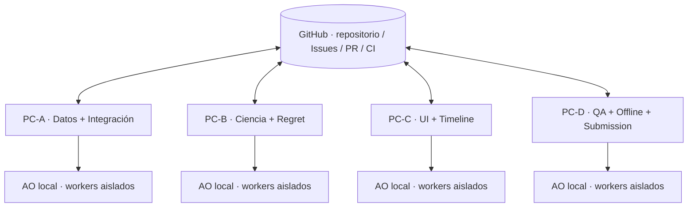

# SITE REGRET — Guía visual de instalación del entorno

**QUEMANDOTOKENS · NASA Space Apps Challenge 2026 · Bilbao / 42 Urduliz Bizkaia**  
**Edición 1.0 · 13/11/2026 · Estado: PREPARACIÓN DOCUMENTADA; ENTORNO NO CERTIFICADO.**  
**Arquitectura:** cuatro portátiles PC-A/B/C/D · Agent Orchestrator local · GitHub Issues/PR · Python científico · web 2D.

> **REGLA DE TIEMPO:** no crear repo, aplicación, dependencias propias del proyecto, datos procesados, escenas del vídeo ni artefactos SITE REGRET antes del **14/11/2026 a las 09:00 hora local**. Preparar cuentas, leer documentación y estudiar herramientas es planificación; cualquier ensayo genérico previo se condiciona a normas y autorización de Local Lead.

> **ELEGIBILIDAD:** un recurso NASA que figure exactamente en la pestaña Resources del reto debe usarse y citarse; hasta comprobarlo con navegador humano y registrar evidencia mantiene `RESOURCE_TAB_UNVERIFIED`. Una URL NASA no es prueba suficiente.

> **NO OPERACIONAL:** prueba de herramientas y ciencia de visibilidad lunar sin datos confirmados. El entorno no ejecuta cálculo real de SITE REGRET hasta H+0 y `DATA-00`/`GEO-01`. No usar los ejemplos de instalación como resultado científico.

## 01 / Qué sistema se prepara



**GitHub es el plano común. AO gestiona sesiones y worktrees en cada PC.** Ningún programa adicional hace de mensajero entre ordenadores. Si Agent Orchestrator falla, el equipo conserva el mismo flujo con terminal, ramas Git, Issues y PR. Las revisiones de ciencia, datos y envío corresponden siempre a humanos.

| Equipo | Herramientas clave | Requisito local verificable | Primer gate |
|---|---|---|---|
| PC-A | Git/gh, Node, Python, rasterio/GDAL, AO y editor | descarga autorizada + hashes y schema | `DATA-00` |
| PC-B | Python, NumPy, SpiceyPy/SPICE, rasterio, tests | importación científica y geometría analítica | `GEO-01` / `SCI-01` |
| PC-C | Node LTS, gestor paquetes, navegador con SVG/WebGL | UI 2D accesible y contratos JSON | `P0-E2E` |
| PC-D | Git, navegadores, herramienta captura/FFmpeg si aplica | QA y ejecución offline sin red | `OFFLINE` / `SUBMIT` |

**Recursos orientativos, no reglas del concurso:** 16 GB RAM para varios workers; con 8 GB, limitar a uno por máquina. SSD libre para herramientas y rasters, Wi-Fi de respaldo y cargadores. Nunca exponer puertos AO públicamente, compartir tokens ni abrir dependencias desconocidas bajo una cuenta administradora.

## 02 / Tabla de autorización temporal

| Acción | Hasta 14/11/2026 08:59 (planificación) | Desde H+0 (construcción autorizada) |
|---|---|---|
| Leer enunciado, manuales, documentación de herramientas | sí | sí |
| Crear usuario GitHub y revisar accesos individuales | sí | sí |
| Instalar Git, gh, Node, Python como utilidades generales | sí, si normas locales lo permiten | sí |
| Instalar AO/harness general y aprender el uso | sin proyectos SITE REGRET ni entregables | sí, con tareas de proyecto |
| Ejecutar smoke científico con **datos sintéticos no lunares** | solo si Local Lead lo permite expresamente | sí, recomendado |
| Crear repo o código específico SITE REGRET | **no** | sí |
| Descargar/procesar DEM/kernel para escenario concreto | investigación documental; sin procesamiento del producto | sí, tras fuente y licencia verificadas |
| Construir UI, métricas, REGRET, offline y capturar demo | **no** | sí |
| Renderizar película programática del proyecto | **no** | sí, sin bloquear P0 |

La distinción es por **naturaleza de la tarea**, no por si el fichero reside en carpeta temporal. Un ejemplo de importación de librería no sustituye la autorización de competición; toda generación de datos o interfaz de SITE REGRET espera H+0.

## 03 / Instaladores oficiales y versiones: no adivinar

Se recomienda elegir en H+0 un conjunto compatible de **Node LTS, Python ≥3.11 según dependencias reales y versiones documentadas de AO/harness**. Este manual no fija un número exacto de kernel SPICE, paquete, build ni release; se comprobará al instalar. Usar locks para reproducibilidad en repo solo tras comenzar el evento.

| Producto | Fuente legítima | Cómo verificar |
|---|---|---|
| Git | https://git-scm.com/downloads | `git --version` |
| GitHub CLI | https://cli.github.com/ | `gh --version` y `gh auth status` |
| Node.js | https://nodejs.org/ | `node --version`, `npm --version` |
| Python | https://www.python.org/ | `python --version` / `python3 --version` |
| Agent Orchestrator | https://orchestrator.inc/download y https://docs.orchestrator.inc/installation/ | abrir app, comprobar readiness del harness |
| SpiceyPy | https://spiceypy.readthedocs.io/en/main/installation.html | importación y test genérico sin kernels |
| Rasterio | https://rasterio.readthedocs.io/en/stable/installation.html | importación y raster sintético en memoria |
| NASA NAIF | https://naif.jpl.nasa.gov/ | documentación, kernel ID y hashes efectivos |
| PDS LOLA | https://pds.nasa.gov/ds-view/pds/viewProfile.jsp?dsid=LRO-L-LOLA-4-GDR-V1.0 | identificador exacto, metadatos y licencia |

**Compatibilidad concreta pendiente:** AO puede cambiar versión; la app oficial configura harness desde su interfaz. Node y Python se eligen según documentación vigente y comportamiento de los paquetes instalados. No asumir que `ao` está en PATH por instalar AO de escritorio, ni que un plan web de ChatGPT/Claude proporciona acceso CLI de pago.

## 04 / Windows 11 (PC-A/B/C/D)

1. Instalar Git for Windows desde página oficial; seleccionar consola PowerShell o Git Bash de forma consistente. Registrar nombre y correo reales de Git, no suplantar autoría.
2. Instalar GitHub CLI y autenticarse en el navegador. `gh auth login` requiere cuenta personal y permisos del repo; no publicar `gh auth status` completo si incluye identificadores sensibles.
3. Instalar Node LTS desde fuente oficial; abrir una consola nueva y comprobar `node`, `npm`. Instalar `pnpm` solo si el contrato frontend lo decide el integrador.
4. Instalar Python compatible para la máquina. Si rasterio/GDAL causan errores de binarios, considerar **Miniforge/conda-forge** con entorno aislado, sin mezclar pip de intérpretes distintos.
5. Instalar Orchestrator de escritorio con instalador Windows x64 oficial. En Settings → Harness asociar un agente autorizado, verificar que el programa puede lanzar worker y revisar trabajo con GitHub; ensayo específico solo desde H+0.
6. Comprobar herramientas:

```powershell
git --version
gh --version
node --version
npm --version
python --version
py --version
gh auth status
```

`py` y `python` no tienen por qué apuntar al mismo entorno: usar siempre el ejecutable del `venv` activo. No combinar arbitrariamente rutas Windows y WSL en los mismos worktrees ni guardar assets en una ruta sincronizada en caliente.

## 05 / macOS (Apple Silicon o Intel)

1. Instalar Command Line Tools/Git y gh según página oficial o paquete comprobado.
2. Instalar Node LTS y Python compatible con arquitectura del dispositivo; evitar reutilizar paquetes x86 con ARM sin aislamiento.
3. Descargar el paquete Orchestrator de la arquitectura exacta y abrirlo desde la aplicación de escritorio; comprobar permisos y firma del instalador.
4. Vincular cuenta GitHub y harness personal; verificar cuota/permiso del agente.
5. Inspeccionar el entorno con terminal:

```bash
git --version
gh --version
node --version
npm --version
python3 --version
gh auth status
uname -m
```

En Apple Silicon los paquetes GIS precompilados de conda-forge suelen reducir problemas de enlazado, pero nunca mezclar gestores sin decisión documentada. En entornos científicos registrar `python3 -m pip --version` antes de instalar nada.

## 06 / Ubuntu / Debian y Linux compatibles

1. Instalar Git/CLI GitHub según fuentes legítimas de la distribución y la documentación de GitHub. No copiar repositorios APT de terceros sin verificar firmas.
2. Instalar Node LTS con gestor de versiones conocido o paquetes oficiales. Usar Python `venv` o Miniforge para aislar librerías científicas.
3. Instalar Orchestrator .deb o AppImage de releases oficiales para arquitectura compatible; conceder permiso de ejecución solo al fichero legítimo y evitar abrir el daemon en red pública.
4. Verificar base:

```bash
git --version
gh --version
node --version
npm --version
python3 --version
gh auth status
uname -m
```

Las dependencias GIS nativas pueden requerir paquetes de GDAL/PROJ. El contenedor o entorno conda para ciencia debe compartir unidades y datos con la aplicación web por **JSON**, no por lecturas de archivos temporales sin schema.

## 07 / GitHub, credenciales y harness de IA

Cada persona opera con identidad real. Git guarda autoría con configuración local del repositorio; una revisión humana valida la PR. El equipo crea el repositorio SITE REGRET únicamente tras H+0, decide acceso público y permisos de colaboración, y establece `.gitignore`/secret scanning antes de la primera PR que contenga dependencias.

```bash
gh auth login
gh auth status
git config --get user.name
git config --get user.email
```

**El harness no es el modelo de ciencia:** Claude Code, Codex u otro agente compatible puede redactar código, tests y explicación, pero no se le permite generar topografía, posiciones o rankings ficticios. AO supervisa worktrees y agentes; sus workers no deben tener permisos globales del sistema si solo editan componentes. Los proveedores pueden cobrar por CLI/API aunque el usuario tenga suscripción web; validar condiciones y límites de uso.

**Flujo de una PR:** Issue con entrada/salida, worker en rama, tests, commit, PR, revisión humana del responsable de dominio y QA, merge a `main`, prueba del escenario real en segundo equipo. Si AO falla, usar Git/gh manual sin perder el estado de trabajo. Evitar force-push sobre ramas de otras personas, compartir tokens o ejecutar scripts remotos desconocidos.

### Seguridad del orquestador y del harness: cuatro reglas

- [ ] **Identidad verdadera:** cada persona inicia sesión y firma con sus propias credenciales y Git author; los agentes no atribuyen commits a compañeros.
- [ ] **Aislamiento:** Agent Orchestrator debe crear worktrees o espacios aislados; uno o dos workers por PC, bajando a uno ante RAM limitada.
- [ ] **Autoridad:** GitHub Issues/PR coordina portátiles; AO es local. Solo una persona integradora humana controla `main` y revisa los merges.
- [ ] **Integridad:** tokens fuera de repositorio, logs redactados y puertos de AO no expuestos a Internet; ningún instalador remoto desconocido se ejecuta a ciegas.

**AO no concede acceso a modelos por sí mismo.** Comprobar CLI del agente/harness, autenticación, condiciones de uso, límites y cuotas por separado. Una suscripción en navegador no garantiza API ni CLI. Antes de H+0 solo comprobaciones genéricas permitidas; después de H+0, un worker puede implementar una tarea de producto aislada con PR y revisión.

| Fallo | Señal | Continuidad sin improvisar infraestructura |
|---|---|---|
| AO no arranca | app o CLI no disponible | GitHub y agente individual/manual |
| cuotas del harness | error de acceso o límite | un worker y tickets P0 críticos |
| conflictos de worktree | archivos modificados por dos sesiones | separar dueño y rama; revertir con review |
| red no disponible | fallo GitHub/NAIF | trabajar local con assets legítimos y sincronizar después |
| token expuesto | secreto en diff o log | revocar, rotar, investigar y evitar publicación |

## 08 / Desde H+0: directorios, tareas y entorno científico

El integrador aprobará esta topología inicial solo durante las horas permitidas. Los nombres son de diseño, no rutas preexistentes:

```text
site-regret/
├── README.md
├── AGENTS.md
├── docs/
│   ├── DECISIONS.md
│   ├── SOURCES.md
│   ├── VALIDATION.md
│   ├── STATUS.md
│   ├── DEMO.md
│   └── AI_USE.md
├── data/
│   ├── manifest.json
│   ├── raw/           # assets descargados solo desde H+0
│   └── offline/       # resultados calculados reales
├── science/
│   ├── horizons/
│   ├── ephemeris/
│   ├── windows/
│   ├── regret/
│   └── tests/
├── apps/
│   └── web/
├── packages/
│   └── contracts/
└── .github/
    └── workflows/
```

En PC-A/PC-B se empleará un entorno Python aislado. Los ejemplos siguientes son comandos **que se ejecutarían desde H+0, no se han ejecutado**:

```bash
python3 -m venv .venv
source .venv/bin/activate
python -m pip install --upgrade pip
python -m pip install numpy scipy spiceypy rasterio pyproj pytest
python -m pip freeze > science-requirements.lock.txt
```

```powershell
py -m venv .venv
.venv\Scripts\Activate.ps1
python -m pip install --upgrade pip
python -m pip install numpy scipy spiceypy rasterio pyproj pytest
python -m pip freeze > science-requirements.lock.txt
```

En equipos donde rasterio no resuelva dependencias GDAL/PROJ, usar entorno conda/mamba aislado de fuente confiable y registrar canal y paquetes efectivos; no forzar pip sobre una instalación geográfica defectuosa. Los requisitos numéricos exactos quedan pendientes de la ejecución y sus logs, no se inventan en la guía.

## 09 / Prueba de humo científica sin datos lunares

**Finalidad:** comprobar importación de SpiceyPy, aritmética vectorial básica, rasterio y lectura de un raster sintético en memoria. No necesita kernel SPICE, conexión NASA, coordenadas lunares ni datos de SITE REGRET. Aunque solo use entradas fabricadas para verificar bibliotecas, **se ejecuta tras H+0**, salvo permiso explícito de Local Lead para prácticas genéricas.

### macOS / Linux: shell con entorno Python activo

```bash
python - <<'PYSMOKE'
import numpy as np
import spiceypy as spice
from rasterio.io import MemoryFile
from rasterio.transform import from_origin

v = spice.vhat([3.0, 4.0, 0.0])
assert abs(spice.vnorm(v) - 1.0) < 1e-12
arr = np.array([[1, 2], [3, 4]], dtype=np.int16)
with MemoryFile() as mem:
    with mem.open(driver='GTiff', height=2, width=2, count=1,
                  dtype='int16', transform=from_origin(0, 2, 1, 1)) as ds:
        ds.write(arr, 1)
    with mem.open() as ds:
        assert ds.read(1).tolist() == [[1, 2], [3, 4]]
print('GENERIC_SCIENCE_SMOKE_OK — no lunar project data')
PYSMOKE
```

### Windows PowerShell: misma prueba genérica

```powershell
@'
import numpy as np
import spiceypy as spice
from rasterio.io import MemoryFile
from rasterio.transform import from_origin
v = spice.vhat([3.0, 4.0, 0.0])
assert abs(spice.vnorm(v) - 1.0) < 1e-12
arr = np.array([[1, 2], [3, 4]], dtype=np.int16)
with MemoryFile() as mem:
    with mem.open(driver='GTiff', height=2, width=2, count=1,
                  dtype='int16', transform=from_origin(0, 2, 1, 1)) as ds:
        ds.write(arr, 1)
    with mem.open() as ds:
        assert ds.read(1).tolist() == [[1, 2], [3, 4]]
print('GENERIC_SCIENCE_SMOKE_OK — no lunar project data')
'@ | python
```

**Qué valida:** SpiceyPy puede normalizar vectores; rasterio/GDAL puede crear y releer bytes sintéticos en RAM. **Qué NO valida:** kernels, proyecciones lunares, calidad de LOLA, posiciones Sol/Tierra, horizonte real, ni pertenencia a Resources. La prueba no produce software de SITE REGRET ni simula un resultado NASA. Si falla: comprobar intérprete activo y resolver dependencias en entorno aislado; no silenciar fallo con valores ficticios.

### Criterios de aceptación de la prueba de humo genérica

El humo del entorno **no constituye prueba científica de SITE REGRET**. Comprueba solamente que el intérprete y las dependencias pueden calcular arrays sintéticos, operaciones vectoriales sin kernels lunares, leer rasters ficticios o genéricos, manejar hashes de un archivo de prueba y reproducir el mismo resultado. No procesa bytes DEM de proyecto ni resuelve observación lunar antes de H+0.

| Operación genérica | PASS verificable | Qué NO acredita |
|---|---|---|
| `python`/`pip` aislados | mismo intérprete y entorno declarado | que un kernel NASA sea compatible |
| `numpy` sintético | tamaño/suma conocidos | calidad de LOLA |
| `spiceypy` con vectores matemáticos | importación y operación deterministas | observador y marco de la Luna |
| `rasterio`/`pyproj` en prueba no lunar | carga/CRS artificial o genérico coherentes | uso de datum lunar correcto |
| SHA-256 de texto de prueba | identidad de bytes reproducida | exactitud física del resultado |

En H+0 PC-A/B comprueban el raster exacto: datum, marco, radio lunar, nodata, escala, offsets, proyección, convención de longitud, cobertura y checksum. **No** asignar EPSG terrestre por costumbre ni declarar `VERIFIED_ASSET` por el mero hecho de abrir un TIFF.

## 10 / Gate NASA: selección e integridad de assets

Después de H+0 y sin guardar números supuestos en UI:

1. Abrir la página oficial *Lunar Landing Site Navigator*, pestaña Resources, y guardar evidencia del recurso NASA exacto, fecha, autor e identificador. Estado inicial `RESOURCE_TAB_UNVERIFIED` hasta comprobación.
2. Seguir la referencia al producto concreto; registrar enlace literal, términos de uso, formato y documentación. Una página general sobre LOLA no acredita un raster descargado.
3. Descargar el archivo y etiquetas/cabeceras correspondientes solo si su licencia y relevancia son válidas. Registrar tamaño y SHA-256 de bytes **sin transformarlos**.
4. Validar CRS/proyección lunar, orientación, escala/offset, datum de altura, `nodata`, resolución, convención de longitud, cobertura y calidad. No asignar coordenadas a partir de imágenes no georreferenciadas.
5. Elegir A/B reales dentro del dominio válido con espacio de rayos suficiente; reservar las dos ventanas donde los kernels tengan cobertura.
6. Probar base este/norte/arriba y fecha UTC→ET/TDB, confirmar marcos y convención angular, y ensayar muestras de referencia; sin esas pruebas `GEO-01` no está verde.
7. Registrar en `data/manifest.json` fuente, checksums, `VERIFIED_ASSET`, citación, fechas, parámetros y dependencia concreta de cada cálculo.

### No confundir niveles de evidencia

`VERIFIED_SOURCE` significa manual/web consultado; `VERIFIED_ASSET` exige bytes y metadatos reales; `CANDIDATE` significa posible; `RESOURCE_TAB_UNVERIFIED` significa elegibilidad no acreditada; `UNAVAILABLE` implica recurso no usable en esta ejecución. Por separado, `OBSERVED` y `DERIVED` son tipos científicos, mientras que `MODELED` y `SIMULATED` describen hipótesis de sensibilidad y usuario. No existe el estado mágico «NASA VERIFIED» para cualquier cifra en pantalla.

### Ruta P1 opcional: incertidumbre y clones NASA PGDA

[NASA PGDA High-Resolution LOLA Topography for Lunar South Pole Sites](https://pgda.gsfc.nasa.gov/products/78) documenta DEM polares, mapas RMS de incertidumbre y conjuntos de 100 clones topográficos en ciertas regiones. Es una **fuente documental** `VERIFIED_SOURCE`; las descargas, tamaños y compatibilidad exactos siguen pendientes y el recurso no acredita por sí mismo pertenencia a la pestaña Resources (`RESOURCE_TAB_UNVERIFIED`).

Solo tras un P0 verificable, revisar metadatos de producto y cada asset: (1) cobertura de ambos sitios, (2) CRS/marco y escala sin mezcla de Moon frames, (3) shape y nodata de clones y DEM, (4) hashes originales y método de generación publicado, (5) licencia de distribución, (6) costes reales de disco/cálculo. Si algún paso falla, detener `SOURCE_CLONES`, conservar el estrés paramétrico `MODEL_STRESS` y no fusionar las fracciones de ambos orígenes. **Cien clones no equivalen automáticamente a cien futuros equiprobables.**

| Gate | GO | NO-GO |
|---|---|---|
| cobertura A/B | ambos sitios reales en región del asset | otro par verificado o cancelar clones P1 |
| alineación | proyección y metadatos iguales o transformados con prueba | no mezclar celdas sin corrección |
| presupuesto | archivos y cálculos caben sin poner en peligro Submit | detener descargas masivas |
| procedencia | autores, licencia, bytes e ID documentados | dejar como `CANDIDATE` |

## 11 / Prueba de flujo completo y contingencia

**Contrato de demo:** 2 sitios × 2 ventanas × tres alturas; horizonte, Sol/Tierra, cinco estados, ranking nominal, nominal y cuatro perturbaciones REGRET, frase determinista, pasaporte, enlace codificado + hash y recorrido offline real. `PARTIAL`/`UNAVAILABLE` deben mostrar exactamente por qué no se calculó. PC-D validará desconectando Wi-Fi en una máquina distinta y repitiendo el escenario; un paquete puede tener snapshots precalculados durante el hackathon siempre que sean **auténticos** y que el producto explique su naturaleza.

| Falla detectada | Recuperación permitida | Qué no hacer |
|---|---|---|
| No abre AO | Git worktrees + Issues/PR manuales | crear infraestructura paralela compleja |
| No funciona un harness | continuar con editor y terminal humana | compartir credenciales de otro usuario |
| GDAL/rasterio incompatible | entorno conda/mamba aislado y lock | inventar lectura exitosa de raster |
| Kernel fuera de cobertura | elegir conjunto realmente compatible o `UNAVAILABLE` | extrapolar como dato NASA |
| DEM parcial / CRS dudoso | acotar zona, elegir A/B válidos, mostrar `PARTIAL` | pintar `nodata` como sombra |
| Cálculo de cresta lento | cancelar mapa P1, conservar nominal y cuatro perturbaciones P0 | reducir K sin enseñarlo al jurado |
| 3D falla | mantener 2D íntegro | arreglar WebGL en lugar de REGRET |
| Red del evento cae | escenario offline y hotspot alternativo | sustituir demo real por CGI |
| Vídeo tarda o no cabe | grabación simple de recorrido real | falsear interfaz reconstruida |

## 12 / Comprobaciones por puesto y cierre

**PC-A**
- [ ] Existe un recurso realmente incluido en Resources, registrado con cita, hash y uso real.
- [ ] El schema de dos ventanas y 0/2/10 coincide con P0, y el repo no expone secretos.
- [ ] Cada commit, fuente, licencia y condición de fallbacks se rastrea desde manifest.

**PC-B**
- [ ] SpiceyPy y rasterio superaron humo genérico tras el inicio, y los tests lunares están separados de ese humo.
- [ ] Se han medido resultados geométricos, UTC/ET, nodata y perturbaciones con semilla; el criterio se eligió previamente.
- [ ] No se muestran probabilidades de misión; solo fracciones de variantes modeladas.

**PC-C**
- [ ] La UI usa JSON del motor, leyenda para cinco estados, tres alturas, frase y pasaporte.
- [ ] La persona puede operar con teclado, contraste, textos accesibles y reduced-motion.
- [ ] Si no hay P1, REGRET P0 sigue visible; 3D no es condición de uso.

**PC-D**
- [ ] El escenario funciona sin Internet en un segundo PC; hash/URL y sus límites se conservan.
- [ ] La demo de 30 s solo captura producto real; la película larga se rotula como conceptual.
- [ ] Dos revisores comprobaron fuentes, inglés, links, créditos, IA y confirmación de Submit.

### Checklist cruzado de cuatro máquinas en el evento

| PC | Test tras H+0 | PASS y evidencia | Fallback |
|---|---|---|---|
| A | asset NASA y contrato | hash + Resources confirmado por humano | otro asset elegible, estado explícito |
| B | horizonte y SPICE reales | analítico + comparación en grados con condiciones compatibles | parar ranking, depurar geometría |
| C | interfaz 2×2×3, cinco estados y N/K | misma respuesta JSON, foco teclado, `UNKNOWN` | SVG 2D sin WebGL |
| D | escenario offline en segundo PC | hash/salidas idénticas, `RECOMPUTABLE` o `REPLAY_ONLY` | snapshots auténticos rotulados |

Cortes: H+10 REGRET mínimo, H+15 ciencia/hash, H+32 features, H+35 captura auténtica, H+37 ventana de submit. Si falla un gate, reducir P1/P2 antes de poner cifras falsas en P0. El equipo alterna guardias y descanso; nunca comparte credenciales durante relevos.

### Fuentes y referencias cruzadas

Plan científico y alcance: `SITE_REGRET_01_PLAN_MAESTRO.md`; responsabilidades y primeras horas: `SITE_REGRET_02_GUIA_CREACION_SEGUIMIENTO.md`; experiencia producto: `SITE_REGRET_03_RESUMEN_FUNCIONALIDADES.md`; película larga conceptual: `SITE_REGRET_04_PROMPT_VIDEO_PROGRAMATICO.md`. Versión editorial PDF de este manual: `SITE_REGRET_05_GUIA_INSTALACION_ENTORNO.pdf`. **Estado de esta edición:** todos los pasos permanecen por ejecutar dentro de la ventana autorizada.
